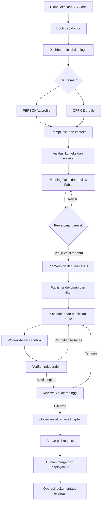
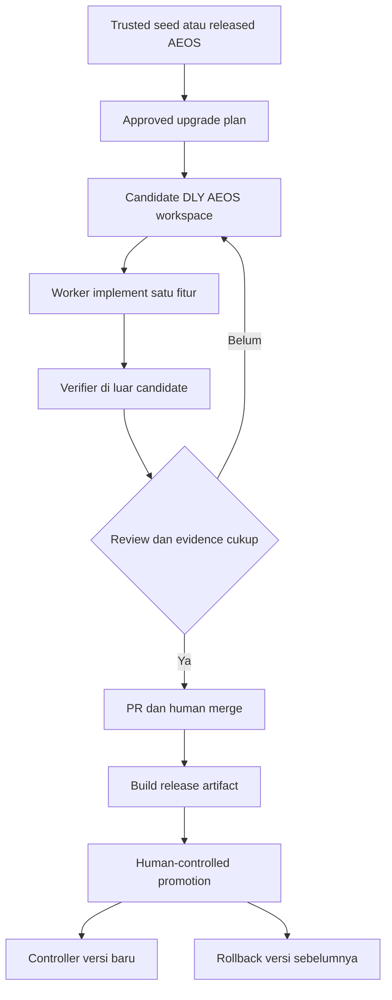
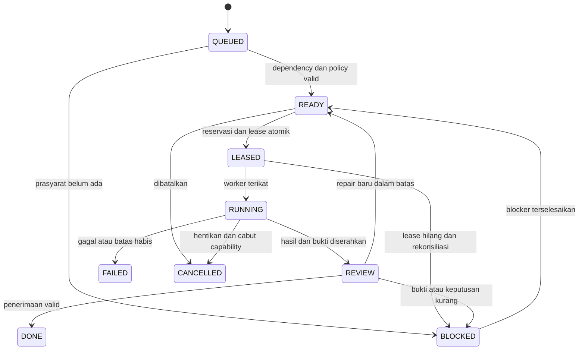
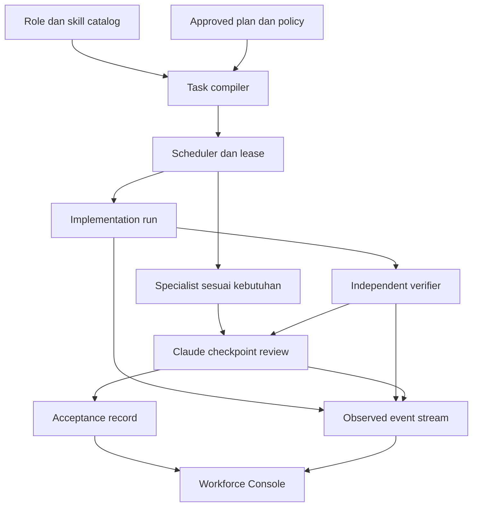
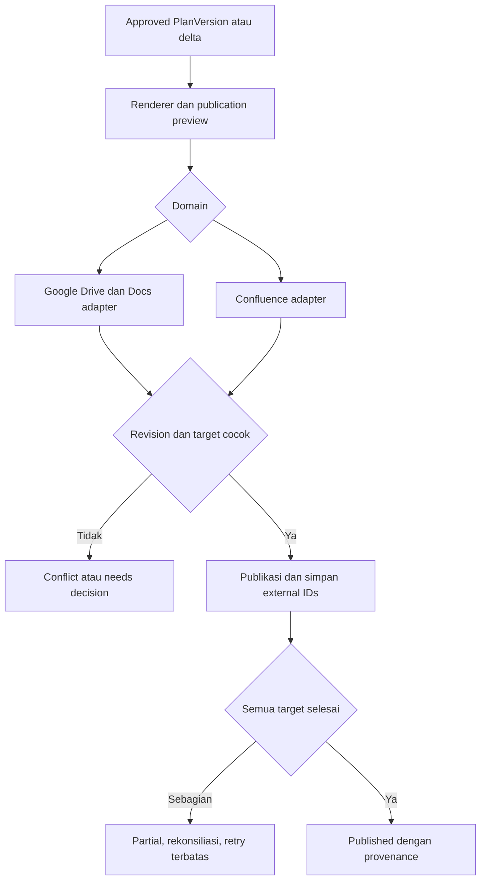
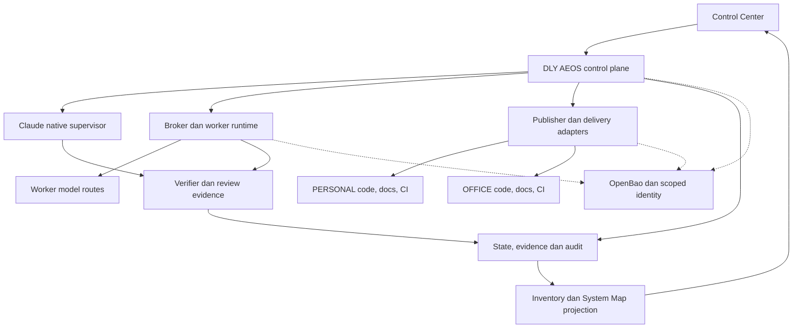
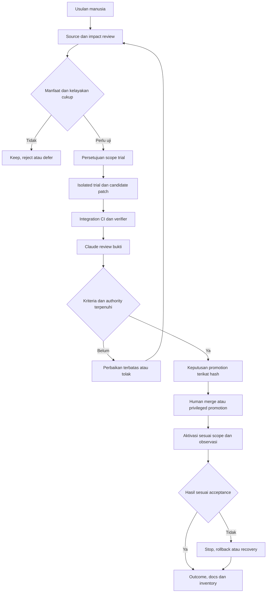

# DLY_AEOS_Master_Architecture_Final

**DLY AI Engineering Operating System — master architecture dan spesifikasi target.**  
**Tanggal konsolidasi dan batas riset:** 18 Oktober 2026, Asia/Jakarta.  
**Tujuan:** upgrade DLY AEOS di GitHub pribadi, dijalankan dari clone lokal melalui VS Code dan dashboard localhost; readiness diperiksa sebelum eksekusi. Proyek pertama workforce adalah peningkatan DLY AEOS sendiri dengan trusted controller yang terpisah dari candidate workspace.  
**Status dokumen:** DESIGN / RECOMMENDATION. Implementasi, koneksi akun, efektivitas kontrol dan hasil evaluasi **NOT-PROVEN**. Kesesuaian penuh dengan **MCI_V2_SOURCE_OF_TRUTH: UNVERIFIED**, karena sumber kanonik belum dapat dibaca; dokumen ini tidak menggantinya.

Hasil yang dituju: pengguna memilih PERSONAL atau OFFICE, memasukkan ide aplikasi, meninjau rencana beserta dokumen dan visual Product 1, lalu workforce mengerjakan fitur dalam batas yang disetujui. Controller deterministik menjaga scope, akses, biaya dan state; model murah/gratis yang eligible mengerjakan tugas; Claude tertinggi melalui native Max mengawasi checkpoint. Manusia tetap memegang keputusan bisnis, risiko, publikasi yang memerlukannya, merge dan produksi.

Dashboard menjadi jendela manusia atas seluruh managed system: komponen penyusun, repositori sumber, tools, model, integrasi, akses, dependency, tugas, tindakan teramati, bukti, biaya, blocker dan alasan keputusan. Pengguna dapat mengusulkan repo/tool/model baru, membandingkan dengan baseline, serta meninjau penambahan atau penggantian berikut migration dan rollback.

**Nama dokumen tetap, isi dapat diperbarui secara terkendali.** Tidak ada nomor revisi pada nama file atau judul. Commit, internal schema/model/tool versions, PlanVersion, approval hashes, ADR dan audit history tetap disimpan agar keputusan dapat ditelusuri.

Dokumen ini menyatukan kebutuhan dan keputusan yang diketahui; bukan prompt agent, installer atau bukti bahwa platform sudah berjalan. Penyusunannya tidak membuat repository/akun/resource kantor, memasang tool, mengaktifkan model, memublikasikan dokumen eksternal atau menjalankan deployment.

### Panduan membaca

| Tujuan membaca | Bagian utama |
|---|---|
| Memahami keputusan, alur dan pemisahan pribadi/kantor | [Keputusan](#01-hasil-dan-keputusan-utama) · [Arsitektur](#03-arsitektur-utama) · [Profil proyek](#04-profil-proyek-dan-integrasi) · [Alur pengguna](#05-pengalaman-pengguna-di-vs-code) |
| Menyiapkan clone lokal dan readiness | [Runtime](#06-runtime-lokal-dan-repository-platform) · [Bootstrap](#07-bootstrap-dan-urutan-instalasi) · [Doctor](#08-readiness-doctor-sebagai-langkah-pertama) · [Self-build](#09-self-development-proyek-pertama-adalah-dly-aeos) |
| Memahami stack, Claude dan kontrak | [Modul](#10-modul-dan-tanggung-jawab-control-plane) · [Stack](#11-stack-dan-deployment-yang-dipilih) · [Claude Max](#12-integrasi-claude-max-tanpa-claude-api) · [Model data](#13-model-data-dan-kontrak) |
| Membagi peran dan membatasi agent | [Planning/review](#15-agent-perencanaan-dan-pengawasan) · [Katalog peran](#16-katalog-peran-pelaksana) · [Pro-kontra](#18-pilihan-pola-kerja-dan-pro-kontra) · [Authority](#20-own--auth--cap--enf) |
| Mengendalikan model, konteks dan credential | [Model/routing](#23-model-registry-dan-routing) · [Konteks](#24-konteks-retrieval-dan-memori) · [MCP/security](#25-mcp-dan-tool-security) · [Secret/auth](#26-secret-dan-autentikasi-aplikasi) |
| Membuat dokumen, visual, CI dan bukti | [Product 1](#27-dokumentasi-product-1-lengkap) · [Pembaruan docs](#28-kapan-dokumen-dibuat-dan-diperbarui) · [Publikasi visual](#29-visual-dan-publikasi-dokumen) · [CI/CD](#31-cicd-dan-delivery) · [Evidence](#34-evidence-review-dan-non-regression) |
| Melihat dan memahami seluruh sistem | [Control Center](#35-control-center-dan-transparansi-sistem) · [System Map](#36-peta-sistem-dan-visualisasi-arsitektur) · [Tools & Repos](#37-inventaris-tools-repository-dan-komponen) · [Status dan rekonsiliasi](#38-status-sumber-bukti-dan-rekonsiliasi-inventaris) |
| Mengusulkan tools/repo/model baru | [Usulan](#39-usulan-penambahan-atau-penggantian-komponen) · [Review dan promotion](#40-review-eksperimen-migrasi-dan-promosi-perubahan) · [Sinkronisasi arsitektur](#41-sinkronisasi-arsitektur-dokumentasi-dan-dashboard) |
| Menghemat biaya dan menilai kandidat | [Cost/quota](#42-cost-dan-quota) · [Leaderboard](#43-evaluasi-dan-leaderboard-model) · [Eksperimen metode](#44-cara-membuktikan-pilihan-organisasi-dan-metode) · [Katalog tool](#45-katalog-tools-repo-dan-keputusan-penempatannya) · [Riset](#47-research-metode-dan-pembaruan-kandidat) |
| Menjalankan implementasi dan penerimaan | [Pemetaan kebutuhan](#48-daftar-cakupan-terhadap-kebutuhan-pengguna) · [Tahapan](#49-tahapan-implementasi) · [Acceptance](#50-acceptance-matrix-untuk-implementasi) · [Unknowns](#51-risiko-unknown-dan-keputusan-sebelum-real-execution) · [Referensi](#52-referensi-dan-batas-bukti) |

### Istilah dan cara membaca status

| Istilah | Arti |
|---|---|
| Control plane | Satu pengendali project/plan/task/policy/audit dan keputusan eksekusi DLY AEOS |
| Role / agent definition / run | Kompetensi; konfigurasi pelaksana; aktivitas aktual. Katalog banyak peran tidak berarti banyak model sedang berjalan |
| Harness / worker engine | Perangkat eksekusi yang menghubungkan model dengan context, tools dan kontrak tugas |
| Controller / broker / verifier | Layanan pengatur state; pemberi capability terbatas; pelaksana pemeriksaan independen |
| Projection | Tampilan turunan record/evidence; bukan sumber authority atau tracker baru |
| Desired / configured / observed | Yang disetujui dalam rancangan; yang berlaku pada konfigurasi; yang teramati pada waktu tertentu |
| Evidence E0–E4 | Klaim; bukti statis; controlled test; runtime observation; regression-protected, selalu per klaim |
| OWN / AUTH / CAP / ENF | Tanggung jawab; wewenang keputusan; kemampuan tindakan; pembatas yang benar-benar ditegakkan |
| Pin / hash / digest | Identitas versi atau isi untuk menghindari pergantian diam-diam dan mengikat persetujuan |
| Trial / canary / promotion | Uji terisolasi; aktivasi terbatas bila aman; pengangkatan kandidat ke konfigurasi berlaku sesuai authority |
| UNVERIFIED / NOT-PROVEN / UNKNOWN | Belum diverifikasi; bukti belum cukup; informasi tidak tersedia. Ketiganya tidak diperlakukan sebagai PASS |

Setiap klaim harus dibaca bersama scope, sumber, timestamp/freshness, versi/config dan evidence-nya. Terhubung tidak otomatis berarti terverifikasi; enabled tidak otomatis berarti sedang dipakai; reviewer PASS tidak menggantikan bukti independent runner.

## 01. Hasil dan keputusan utama

DLY AI Engineering Operating System (DLY AEOS) tetap satu produk dan satu control plane. VS Code menjadi permukaan kerja. Source platform dapat disimpan di GitHub; setiap aplikasi yang dikelola mempunyai repository, dokumen, issue tracker, serta lingkungan sendiri sesuai domainnya.

Urutan penggunaan: pilih PERSONAL atau OFFICE terlebih dahulu; masukkan ide/prompt dan lampiran; bangun konteks; susun dan tinjau rencana; pemilik menyetujui versi yang konkret; publikasikan dokumen/tiket; jalankan pekerjaan yang terbatas; verifikasi; review; jalankan governance yang berlaku; siapkan PR dan bukti; manusia melakukan merge dan deployment produksi.

Keputusan pengguna yang dipertahankan:

| ID | Keputusan / batas |
|---|---|
| U-01 | VS Code sebagai lingkungan kerja. |
| U-02 | Source platform DLY AEOS di GitHub; source aplikasi kantor di Bitbucket, aplikasi pribadi di GitHub. Kepemilikan kode platform dan kebijakan kantor tetap berlaku. |
| U-03 | OFFICE menggunakan Bitbucket + Confluence + Jira. |
| U-04 | PERSONAL menggunakan GitHub + Google Docs dalam folder Google Drive per nama proyek. |
| U-05 | Domain dipilih manusia sebelum prompt; model tidak menginfer, menyarankan, mengganti, atau mengabaikannya. |
| U-06 | Claude Max 20x melalui Claude Code resmi menjadi pengawas; Claude API tidak menjadi default atau fallback berbayar. |
| U-07 | Model lain menjadi pekerja, dengan prioritas jalur gratis/murah yang diizinkan dan lolos evaluasi. |
| U-08 | Struktur PRODUCT 1 — SOFTWARE DEVELOPMENT & ENGINEERING dipertahankan. Test Strategy di dalam Test Plan; Release Notes di dalam Release Plan. |
| U-09 | Merge ke main dan deployment produksi tetap human-only, sesuai keputusan sebelumnya yang berhasil ditelusuri. |
| U-10 | Publikasi eksternal V1 memakai persetujuan manusia atas versi dan target yang konkret. Satu persetujuan dapat mencakup operasi yang jelas dalam satu publication/run; tidak perlu meminta ulang untuk setiap panggilan API. |
| U-11 | Semua permukaan intake mendukung unggahan berkas, termasuk .md. |
| U-12 | Satu Control Center dan Human Decision Queue; hindari state, authority, atau tracker yang bersaing. |
| U-13 | OpenBao sebagai vault runtime, bukan .env berisi credential sebagai penyimpanan permanen. |
| U-14 | Hasil agent dan reviewer bukan bukti kelulusan; diperlukan verifikasi independen dan bukti runtime yang sesuai. |
| U-15 | DLY AEOS adalah upgrade proyek sebelumnya di GitHub pribadi; runtime melalui clone lokal dan port localhost. |
| U-16 | Readiness Doctor menjadi pintu masuk; kekurangan dan cara penyelesaiannya terlihat sebelum eksekusi. |
| U-17 | Pengguna memasang/mengonfigurasi tool menurut urutan bootstrap; Claude memeriksa integrasi, lalu worker bekerja dalam batas yang disetujui. |
| U-18 | Proyek pertama workforce adalah peningkatan DLY AEOS sendiri; controller/policy/verifier aktif tidak dapat diubah worker. |
| U-19 | Cakupan organisasi engineering harus terlihat; agent yang aktif, tugas, biaya, blocker dan evidence harus dapat dipantau di dashboard. |
| U-20 | Pembagian agent dipilih dari manfaat yang dapat diuji untuk tugas tersebut; tidak mengklaim lebih unggul dari seluruh metode developer/forum tanpa pembandingan. |
| U-21 | Dashboard memperlihatkan tools, repository, model, integrasi, dependensi dan proses; status rancangan dibedakan dari penggunaan aktual dengan bukti dan waktu pemeriksaan. |
| U-22 | Manusia dapat mengajukan review komponen baru untuk penambahan, penggantian, upgrade atau penghentian; hasilnya berupa keputusan, uji, dampak, migrasi dan rollback yang dapat ditinjau. |
| U-23 | Nama master tetap DLY_AEOS_Master_Architecture_Final; pembaruan berikutnya memakai file yang sama dengan riwayat perubahan internal dan approval yang dapat dilacak. |

## 02. Dasar sumber, keputusan dan pengendalian perubahan

Basis internal yang telah dibaca dalam penelusuran sebelumnya: unggahan struktur Product 1; DLY_AEOS_PHASE1_FINAL_IMPLEMENTATION_SPEC.md, seluruh 6.461 baris; bagian awal spesifikasi gateway sebelumnya sebagai pembanding; serta keputusan percakapan yang berhasil ditelusuri. Keberadaan spesifikasi bukan bukti bahwa implementasinya sudah ada.

| Baseline lama | Rancangan sekarang | Dampak / transisi |
|---|---|---|
| PERSONAL memakai Notion | Google Docs + Google Drive, sesuai keputusan terbaru | Adapter personal baru menggunakan GoogleDocsProvider. Dokumen Notion lama tidak dihapus atau dimigrasikan otomatis. Migrasi membutuhkan inventaris, pemetaan ID, pemilik, dan pemeriksaan hasil. |
| Planner diasumsikan melalui LLM/API provider | ClaudeNativeBridge untuk Claude Code resmi dengan Max | Tidak membuat proxy credential langganan. Integrasi lokal harus diuji sebelum dinyatakan otomatis. |
| Opus → Fable → Opus → Fable untuk perencanaan | Kebijakan keluarga model tetap dipertahankan | Empat tahap dilakukan pada perencanaan yang memerlukannya menurut baseline, bukan pada setiap edit. Pengurangan tahap merupakan perubahan kebijakan yang harus dievaluasi dan diputuskan terpisah. |
| ID model September 2026 | ID model berupa konfigurasi terversi | Penggantian versi bukan perubahan diam-diam; perlu evaluasi dan rollback. |
| Bagian lama menyebut RBAC di luar V1 | Bagian auth/final baseline mewajibkan SUPER_ADMIN dan VIEWER | Klausul auth yang lebih spesifik dan final menjadi acuan rancangan; VIEWER read-only ditegakkan backend. |
| Status task eksternal dapat DONE | Status kerja eksternal dan penerimaan hasil runtime dipisah | DONE pada Jira/GitHub tidak otomatis membuka dependency runtime yang belum memiliki bukti penerimaan. |
| Contoh bootstrap credential ada dalam dokumen lama | Nilainya tidak disalin ke blueprint ini | Jika ditemukan saat implementasi, wajib rotasi/force-change sebelum operasi normal/eksternal; hardening bootstrap menjadi ADR dan diuji bersama recovery. |
| MCI disebut authoritative | Isi MCI belum dapat dibaca | Tidak mengarang kernel, pack, ambang risiko, atau klaim compliance. Pemetaan lengkap masih UNVERIFIED. |

Rancangan memperinci RoleSkillPack/AgentDefinition/RunView serta Workforce Console dalam modul Workforce dan Control Center yang sudah ada. Tidak menambah CEO/CTO authority, scheduler, tracker, atau database operasional kedua. Role catalog yang luas tidak memperbesar default concurrency.

Baseline Opus/Fable planning, native Max, Office deny-by-default untuk route belum disetujui, OpenBao, human external publication/merge/production, immutable plan, self-build zones, evidence ladder dan MCI authority dipertahankan.

Semua pilihan baru adalah rekomendasi desain yang dapat diuji, bukan hasil runtime. Riset pihak ketiga adalah evidence tentang studi/tool tersebut; bukan E2/E3 implementasi DLY AEOS. Verdict superiority, keamanan runtime, ranking model dan kepatuhan kanonik tetap NOT-PROVEN/UNVERIFIED sesuai claim masing-masing.

Nama dokumen Final adalah identitas stabil, bukan larangan memperbaiki arsitektur. Dokumen diperbarui pada tempat yang sama setelah keputusan yang sah. Commit, revision provider, PlanVersion, schema version, pin tool/model, policy hash, ADR, approval dan histori audit tetap dipertahankan. Menghapus nomor revisi dari nama file tidak menghapus jejak keputusan atau kemampuan rollback.

Untuk platform, master architecture generik direview dan disimpan sebagai source artifact pada repository DLY AEOS yang disetujui; dokumen resmi setiap proyek tetap mengikuti Google Docs atau Confluence beserta revision-nya. Tidak ada dua source naratif yang boleh saling menimpa tanpa hubungan publication/revision yang jelas. MCI yang sah tetap lebih tinggi daripada rekomendasi dalam dokumen ini.

## 03. Arsitektur utama

Diagram menunjukkan urutan konseptual. Kontrol policy, secret, audit, dan biaya berlaku pada seluruh tahap. Kegagalan satu target publikasi tidak boleh memaksa pekerjaan berjalan dengan kontrak yang tidak lengkap.

Satu control plane berarti satu pemilik Project/PlanVersion/TaskSpec/DAG/policy/audit. Worker engine, model gateway, MCP gateway, workflow library, dan observability tidak mengambil alih keputusan bisnis atau state tersebut.

## 04. Profil proyek dan integrasi

| Area | PERSONAL | OFFICE |
|---|---|---|
| Source aplikasi | GitHub repository yang dipilih | Bitbucket repository yang dipilih |
| Dokumentasi resmi | Google Docs dalam Google Drive folder proyek | Confluence, dedicated project folder di bawah parent yang dikonfigurasi |
| Tracking kerja | GitHub Issues | Jira work items |
| Tampilan roadmap | GitHub Projects opsional, sebagai visualisasi | Jira board/roadmap yang berlaku |
| CI | GitHub Actions | Bitbucket Pipelines atau CI kantor yang sudah disetujui |
| PR | GitHub pull request | Bitbucket pull request |
| Credential | Namespace personal dan identity terbatas | Namespace office dan identity yang disetujui kantor |
| Model / data | Route sesuai klasifikasi dan ketentuan data | Default external worker deny; hanya route yang disetujui kantor |
| Deployment | Target pribadi yang dipilih, dengan otorisasi pemilik | Lingkungan dan mekanisme kantor yang berlaku |
| Evidence / memory / cache | Partisi proyek personal | Partisi proyek office; tidak dikirim ke sistem personal |

Atlassian Cloud merupakan asumsi integrasi untuk blueprint API ini, bukan fakta tentang tenant pengguna. Jika kantor memakai Data Center, diperlukan capability check dan adapter tersendiri. Cloud MCP tidak dianggap otomatis bekerja pada Data Center.

Source platform di GitHub tidak menjadi alasan untuk menyalin source, data uji asli, trace, secret, kebijakan sensitif, atau evidence kantor ke repository personal.

Identitas proyek menggunakan UUID tetap. Nama dan slug adalah atribut tampilan, bukan authority atau satu-satunya kunci idempotensi. Domain tidak dapat diganti melalui output model atau edit manifest worker; pemindahan domain adalah migrasi dengan keputusan pemilik.

Untuk Confluence, baseline lama berisi configured parent content. Nilai itu harus divalidasi kembali terhadap tenant, space, akses, dan target yang sah. Gunakan nama konfigurasi CONFLUENCE_PROJECTS_PARENT_ID; compatibility alias lama tidak menjadi target kedua.

## 05. Pengalaman pengguna di VS Code

1. Clone repository DLY AEOS pribadi, buka di VS Code, jalankan bootstrap check dan startup lokal. Setelah login, halaman pertama menampilkan readiness. VS Code extension tipis dapat menjadi wrapper setelah alur lokal terbukti.
2. Pilih PERSONAL atau OFFICE. Backend menolak permintaan tanpa pilihan pengguna yang sah, kemudian memeriksa readiness profile/capability yang dipilih sebelum prompt dieksekusi.
3. Pilih proyek baru atau existing; untuk existing, pilih repository/workspace secara eksplisit.
4. Isi nama dan ide; unggah .md, gambar, dokumen, atau referensi tambahan.
5. Sistem membaca jenis/ukuran berkas, memindai input, mengisolasi parser, dan menyimpan asal serta klasifikasinya. Arsip traversal, symlink keluar workspace, dan file aktif tidak dieksekusi.
6. Untuk existing project, buat inventaris repo, kontrak, dependensi, baseline tes, dan deployment yang tersedia; jangan langsung scaffold ulang.
7. Sistem menampilkan fakta, asumsi, batas, pertanyaan material, dan kemampuan integrasi yang benar-benar tersedia.
8. Perencanaan menghasilkan Product Home, kebutuhan awal, arsitektur, risiko, visual, milestone, serta manifest dan DAG.
9. Pemilik melihat diff/revisi dan target publikasi, lalu memilih Approve & Publish, Request Revision, atau Reject.
10. Publisher membuat struktur dokumen dan tiket dari PlanVersion yang disetujui.
11. Execute memilih pekerjaan READY yang diizinkan. Untuk V1 pertama, eksekusi coding dapat belum tersedia dan harus terlihat sebagai kemampuan belum aktif.
12. Control Center menampilkan agent, model, workspace, tahap, bukti, biaya, blocker, dan keputusan yang dibutuhkan; System Map serta Tools & Repos memperlihatkan komponen terpasang, konfigurasi, hubungan, versi dan penggunaan aktual.
13. Pengguna dapat membuka detail komponen dan mengirim usulan Add, Replace, Upgrade, Remove atau Compare dengan URL sumber; platform menyiapkan review dan dampak sebelum perubahan dijalankan.
14. PR dibentuk beserta evidence bundle; merge dan production tetap tindakan manusia.
15. Hasil operasi serta insiden memperbarui backlog dan evaluasi melalui proses perubahan yang sah.

Normal flow meminta konteks minimum. Pertanyaan tambahan hanya untuk ambiguitas yang material terhadap arsitektur, scope, biaya, keamanan, legal, atau target eksternal.

## 06. Runtime lokal dan repository platform

DLY AEOS tetap aplikasi lokal hasil clone GitHub pribadi, bukan keharusan meng-host dashboard di GitHub Pages atau cloud. Clone menyediakan source; dependency/configuration serta local runtime tetap dipersiapkan di mesin pengguna.

Rancangan port: satu origin UI/API pada http://127.0.0.1:8787 sebagai contoh default yang dapat dikonfigurasi. Mode pengembangan boleh memakai port frontend terpisah dengan origin/CSRF/CORS yang eksplisit. Periksa konflik port; jangan otomatis bind 0.0.0.0 atau menonaktifkan auth/CORS agar startup berhasil.

Database, prompt/lampiran, traces, credential, worker output dan data Office berada di data directory yang dipisah dari tracked source. Path ditentukan konfigurasi OS/profile, bukan cwd repo atau nama project yang tidak tervalidasi.

| Kelompok rancangan | Contoh path relatif / lokasi | Masuk GitHub platform |
|---|---|---|
| Backend/frontend | backend/, frontend/ | Ya, source platform yang dimiliki secara sah |
| Blueprint/contracts | blueprints/, contracts/ | Ya, schema/template generik tanpa data sensitif |
| Doctor/bootstrap | scripts/doctor, scripts/bootstrap, install-manifest | Ya, versioned dan direview |
| Integration adapters | providers/ atau modul existing yang setara | Ya, tanpa credential/tenant data sensitif |
| Trusted policy references | policy references/schema, bukan salinan data rahasia | Sesuai ownership dan klasifikasi; MCI tidak dimasukkan tanpa hak |
| Tests/fixtures | tests/, synthetic fixtures | Ya; suite trusted acceptance dan approval root tetap dilindungi runtime |
| CI/release config | .github/workflows/, release manifest | Ya; perubahan berisiko tinggi, bukan worker live-reload |
| Docs/ADRs | docs/, decision/provenance registry | Ya untuk desain generik/platform yang disetujui |
| Local config | file setting non-secret yang diperlukan | Example saja; konfigurasi lokal/identity dipisahkan |
| Runtime state | app-data/profile database, queue, cache, logs | Tidak |
| Worker sandboxes/worktrees | task-data dengan reference repo yang benar | Tidak di-commit ke platform sebagai folder runtime |
| Office artifacts | partisi Office yang diotorisasi | Tidak ke GitHub personal |
| OpenBao / native auth | secret store terpisah | Tidak |

Repositori platform akan menghasilkan aktivitas GitHub melalui perubahan source/dokumentasi yang nyata, issue, PR dan release. Commit attribution memakai identitas yang sah dan email yang terhubung ke akun/noreply pengguna. Tampilnya contributions mengikuti aturan GitHub; commit pada branch kerja belum otomatis sama dengan contribution di default branch. Visibility private contributions mengikuti pengaturan akun dan aturan GitHub, tanpa menjadikan konten privat terbuka.

Root file/directory di atas adalah rancangan; saat repo aktual dibaca, pertahankan struktur yang sudah baik dan tambahkan kontrak minimum, bukan melakukan rewrite demi menyamai nama folder.

## 07. Bootstrap dan urutan instalasi

Bootstrap dibuat untuk menghindari ketergantungan bahwa DLY AEOS harus sudah lengkap sebelum dapat membangun dirinya sendiri. Seed merupakan mode kecil dalam produk yang sama: pemeriksaan lokal, pembacaan manifest, pemanggilan official Claude, dan satu task worker yang dibatasi.

| Urutan | Yang dipasang/dikonfigurasi | Bukti sebelum lanjut |
|---|---|---|
| 0 | Inspect repo/AGENTS/kanonik yang tersedia, backup existing data, baseline version dan decision register | Tidak menimpa implementasi atau data lama; unknown dicatat |
| 1 | Git, VS Code, versi Python/Node/package manager sesuai lockfile/compatibility yang dipin | Version checks dan local import/build prerequisites |
| 2 | Official Claude Code; login melalui alur resmi Max; model/paket dicek di client resmi | Sesi akun sendiri, model identity dan auth mode benar; Claude API fallback tidak aktif |
| 3 | OpenBao, machine identity dan OS bootstrap credential store | Vault health, policy scope, token TTL, redaction, restart/recovery behavior |
| 4 | Worker isolation dan trusted capability broker | FS/egress/credential negative tests, no host socket/home mount, cancel/kill |
| 5 | OpenCode sebagai worker pertama; satu route resmi yang sesuai data/terms | Bounded tool/schema/patch task, output/evidence sesuai kontrak |
| 6 | Model gateway bila diperlukan: LiteLLM untuk API worker resmi, dengan budget/DB sesuai fitur yang dipakai | Connectivity saja belum cukup; routing, caps, outage behavior dan fallback diuji |
| 7 | PERSONAL GitHub + Google Drive/Docs adapters | Exact repo/root, least privilege, dry-run preview, scoped read dan controlled write hanya bila diotorisasi |
| 8 | Doctor/Control Center, evidence collector, verifier, native Claude bridge | Hasil preflight, satu workflow end-to-end controlled, tidak ada self-approval |
| 9 | Proyek DLY AEOS upgrade: pilih domain PERSONAL, buat plan, approve, jalankan satu slice | Worker mengubah candidate workspace, trusted controller tetap utuh |
| 10 | OFFICE connectors dan route yang disetujui perusahaan | Tenant/scope/model/data/authority/isolasi terverifikasi |
| 11 | Retrieval/arena/observability/distributed scheduler tambahan | Manfaat terukur, bukan semua tool wajib dipasang dahulu |

Tool selection dan versi tetap berupa InstallManifest yang ditinjau. Manifest mencatat source resmi, pin/version/digest, license, support/compatibility, configuration references, port, network/credential scope, health probe, capability test, biaya dan uninstall/recovery notes. Jangan mengambil installer dari komentar forum atau menjalankan install script tak diverifikasi.

9Router disebut pengguna sebagai contoh instalasi. Hasil pemeriksaan repository menunjukkan dukungan OAuth/subscription routing; fitur itu tidak membuktikan izin dari provider atau kebebasan dari limit. Pada baseline ini 9Router bukan dependency wajib dan tidak menampung OAuth Claude Max. Bila suatu hari dipakai untuk route API-key yang sah, perlu adapter review dan pengujian; jangan menumpuknya dengan gateway lain tanpa kebutuhan. Claude pengawas tetap melalui native client.

Claude boleh membantu memeriksa hasil install dan mengusulkan perubahan konfigurasi. Konfigurasi tidak berarti ia memperoleh AUTH untuk mendaftarkan provider baru, menaikkan budget, mematikan isolation atau membaca semua credential. Perubahan berprivilege/berbiaya ditampilkan sebagai rencana konkret.

Perintah startup/doctor akan disediakan implementasi setelah repo diperiksa. Blueprint ini tidak mengklaim script atau command tersebut sudah tersedia. OS/hardware pengguna belum diperiksa langsung; langkah installer spesifik Windows/WSL/macOS/Linux ditetapkan dari mesin sebenarnya, bukan dari lingkungan cloud tempat dokumen disusun.

Hasil bootstrap memperbarui InstallManifest, integration records dan evidence observasi yang sudah ada. UI tidak mengubah seluruh daftar rekomendasi menjadi installed hanya karena installer selesai. Setiap langkah menghasilkan status install, configuration, connectivity, functional verification serta waktu pemeriksaan sendiri; komponen opsional yang belum dipasang tidak memblokir capability yang tidak bergantung padanya.

## 08. Readiness Doctor sebagai langkah pertama

Doctor mempunyai dua lapis:

1. Bootstrap CLI: tetap dapat memberi laporan ketika server/UI belum dapat berjalan. Mengecek dependency/runtime/port/path dan non-secret configuration, tanpa LLM.
2. Dashboard Readiness: setelah login, memperlihatkan konfigurasi, autentikasi, koneksi, permission, functional proof, serta policy untuk profile/capability yang dipilih.

Pemeriksaan dihitung dari code/probes. Claude dapat menjelaskan hasil, tidak menyatakan READY hanya dari narasi.

| Kelompok | Pemeriksaan yang relevan |
|---|---|
| Host | OS/architecture/resource, disk, clock, process/port, filesystem permissions |
| Repository | Repo/path/domain/base commit, branch/dirty state, lockfile, hooks dan konfigurasi yang akan dimuat |
| Runtime aplikasi | Python/Node/dependency compatibility, DB/migration, storage/write permissions, server/frontend |
| Local auth | Login/session/RBAC/CSRF/bootstrap/interlock, tidak ada default credential normal-use |
| Canonical policy | MCI reference/version tersedia bila gate memerlukannya, owner decisions, active policy hash |
| Claude native | Official binary/version, native login mode, model resolution, extra-billing configuration, quota state yang resmi/UNKNOWN |
| Secret | OpenBao health/auth/policy/TTL, no raw secret exposure; fail closed pada operation terkait |
| Worker | Engine/version, model tool/schema behavior, request/response contract, resource caps |
| Containment | Allowed FS/egress, credential isolation, process kill, protected-policy/CI/test paths |
| Model route | Provider/key reference, exact route, data terms, free/paid status, caps/fallback/cost freshness |
| Project adapters | GitHub/Bitbucket repo, Jira project, Confluence parent/space, Google Drive root/Docs scopes |
| Delivery | Actual provider entitlements, branch/merge/deploy restrictions, status check identity, trusted CI |
| Evidence/review | Collector/verifier independence, artifact permissions, trace redaction, acceptance invalidation |
| Recovery | Lease/queue restart, duplicate publication prevention, backups/restore, config/model rollback |

Tiap CheckResult menyimpan check ID, component version, project/domain/capability scope, target identity, status/severity, observed evidence, last_checked_at, expiry/invalidators, error code, remediation proposal, serta destructive/paid-write requirements. Jangan menyimpan secret dalam pesan error.

Status ringkas: MISSING, CONFIGURED, CONNECTED, VERIFIED, FAILED, EXPIRED, UNKNOWN, dan NOT_APPLICABLE. CONNECTED berarti probe koneksi berhasil; VERIFIED berarti skenario fungsi tertentu berhasil pada target/environment yang disebut. VERIFIED bukan label universal “aman”.

Capability gates minimal: CAN_OPEN_DASHBOARD, CAN_PLAN_PERSONAL, CAN_PLAN_OFFICE, CAN_PUBLISH_PERSONAL, CAN_RUN_WORKER, CAN_REVIEW_WITH_MAX, CAN_PREPARE_PR, CAN_USE_OFFICE_INTEGRATIONS, CAN_VALIDATE_STAGING. Human-only merge/production tidak menjadi capability worker.

Aplikasi tetap dapat menampilkan laporan dan bekerja dalam mock/read-only mode ketika tool opsional belum dipasang. Kegagalan Office tidak memblokir fitur Personal yang tidak bergantung padanya. Namun operasi dengan dependency critical gagal tidak dijalankan.

Tidak perlu semua model/tool dalam inventaris menjadi hijau sebelum fitur inti dapat digunakan. Readiness dievaluasi menurut capability dan target. Perubahan binary/config/token scope/model route/plan/target memicu invalidation dan pemeriksaan ulang terkait.

Tombol remedy menampilkan operasi, source/version, target, privilege, biaya, rollback dan evidence yang akan dikumpulkan. Tidak melakukan auto-install, auto-topup, perubahan IAM atau privileged fix tersembunyi. Otorisasi yang sudah sah untuk satu run tetap berlaku dalam scope-nya.

Doctor dan inventaris menggunakan component references yang sama. Klik pemeriksaan gagal membuka komponen, bukti, dependency dan remedy terkait. Perubahan binary/version/digest, endpoint, permission, model resolution atau konfigurasi yang relevan membuat pemeriksaan terdampak STALE dan memicu recheck sebelum capability tersebut digunakan kembali. Pemeriksaan runtime bersifat scoped; tidak memindai seluruh komputer atau akun tanpa otorisasi.

## 09. Self-development: proyek pertama adalah DLY AEOS

DLY AEOS upgrade didaftarkan sebagai proyek PERSONAL dengan repository GitHub platform dan folder Google Docs-nya. Workforce membangunnya secara incremental dari source existing yang sudah diinventarisasi.

Pisahkan tiga zona:

| Zona | Isi / siapa dapat mengubah |
|---|---|
| Trusted seed / released controller | Binary/code controller yang dipin, policy yang sah, broker, budgets, verifier/acceptance root. Read-only bagi worker. |
| Candidate build workspace | Branch/worktree DLY AEOS versi berikut, dependencies dan test environment terisolasi. Worker dapat mengedit hanya scope TaskSpec. |
| Accepted release | Artifact yang lulus verifikasi/review dan di-merge/release oleh manusia; baru kemudian dapat menggantikan controller aktif melalui proses upgrade terkontrol. |

Worker boleh mengusulkan perubahan controller, router, tool permissions, CI atau evaluator dalam candidate source sesuai kontrak. Ia tidak dapat memuat perubahan itu ke controller aktif, menurunkan grader, mengubah policy approval, atau menaikkan capability miliknya sendiri.

Feature pertama yang direkomendasikan: Doctor + Local Readiness UI. Setelah itu domain-first Gateway/auth, immutable planning/approval, PERSONAL docs/issue publisher, satu sandboxed worker loop, verification/review, lalu upgrade modules berikutnya.

Initial coding untuk membangun seed menggunakan native Claude dalam trusted workspace dengan batas yang disetujui pengguna; sebelum broker/sandbox/verifier tersedia, jangan menyatakan autonomous multi-model workforce siap. Seed bukan platform paralel, melainkan subset/rilis awal DLY AEOS dengan kontrak yang sama.

Development hot reload tidak dijalankan dengan vault-root/production credential dan tidak memuat policy dari candidate source ke trusted controller. Promotion memakai artifact/config hash, versioned migrations, pre-upgrade backup, compatibility check, health/function smoke tests dan recovery. Kegagalan upgrade tidak boleh menghilangkan rilis controller lama atau evidence.

## 10. Modul dan tanggung jawab control plane

| Modul | Tanggung jawab / state yang dimiliki |
|---|---|
| Gateway & Portfolio | Intake, identitas proyek, domain, lifecycle, pencarian, project switch yang eksplisit |
| Identity & Authorization | Login lokal, session, RBAC, scope proyek/domain, external-write interlock |
| Policy & Decision Registry | Referensi MCI, keputusan pemilik, policy snapshot, versi, pengecualian, masa berlaku; proposal perubahan, ADR dan promotion/rollback decision |
| Planning & Blueprint | PlanningRun, immutable PlanVersion, content blueprint, manifest, proposal DAG |
| Knowledge & Context | ContextPack terkurasi, retrieval, klasifikasi, provenance, batas konteks |
| Integration Registry | Tenant/root/repo/project IDs, component/source references, kemampuan nyata, credential reference, health; bersama InstallManifest menjadi dasar inventaris terotorisasi |
| Publisher | Publication job, mapping external ID, outbox, preview, partial failure, conflict |
| Workforce & Scheduler | Task readiness, lease, resource reservation, dependency, fairness, cancellation |
| Model Routing | Eligibility dan pemilihan worker route sesuai kontrak yang sudah diizinkan |
| Worker Runtime | Adapter OpenCode, sandbox lifecycle, hasil dan trace eksekusi |
| Verification & Review | Verifier independen, review terpisah, claim/evidence ledger, acceptance |
| Governance Handoff | GovernanceHarnessAdapter untuk kontrak downstream yang sudah ada |
| Delivery & CI | PR bundle, status CI, staging/release references; tidak memiliki human merge authority |
| Documentation & Visuals | Rencana konten, rendering diagram, screenshot terverifikasi, delta dan snapshot |
| Operations & Reliability | Service inventory, SLI/SLO, runbook, restore, incident, retirement workflow |
| Cost & Model Evaluation | Usage ledger, quota state, evaluation suite, scorecard konfigurasi model |
| Monitoring & Decision Queue | Control Center, Workforce Console, System Map, Tools & Repos, health, sync freshness, alert, blocker, decision dan audit; seluruhnya projection |
| SecretProvider | Mengambil capability melalui identity yang sesuai; tidak menampilkan secret ke UI/model |

Modul adalah batas kode dan kontrak, bukan kewajiban membuat microservice terpisah. Pemisahan proses/VM dilakukan ketika dibutuhkan sebagai batas keamanan, terutama untuk worker dan credential broker.

## 11. Stack dan deployment yang dipilih

Pilihan mempertahankan stack dalam baseline, kecuali repository nyata saat implementasi memiliki stack stabil yang lebih tepat untuk dipertahankan.

| Lapisan | Rekomendasi |
|---|---|
| Backend | Python, FastAPI, Pydantic, SQLAlchemy, Alembic, httpx |
| Frontend | React, TypeScript, Vite, Tailwind, TanStack Query, React Router |
| Local metadata | SQLite pada V1; migration terversi dan backup teruji |
| Local search | Pencarian metadata/FTS yang sederhana terlebih dahulu |
| Secret | OpenBao, AppRole dan/atau OpenBao Agent; bootstrap melalui secure credential store OS |
| Worker | OpenCode sebagai engine pertama |
| Sandbox | Lingkungan per tugas dalam container/VM dengan pembatasan OS; worktree untuk isolasi perubahan |
| Scheduling awal | State machine eksplisit, queue/lease persisten dalam control plane; tidak membuat workflow engine generik |
| Scheduling terdistribusi | Temporal sebagai kandidat ketika ada kebutuhan multi-host, workflow lama, atau recovery yang terukur |
| Agent graph | LangGraph opsional di dalam activity/adapter; tidak menjadi scheduler atau approval authority kedua |
| API model gateway | LiteLLM untuk route worker resmi, setelah dibutuhkan; Claude Max tidak lewat gateway ini |
| MCP | AEOS MCP interface terkurasi; ToolHive sebagai kandidat pengelola server pada tahap workforce |
| Pengujian | pytest/Ruff/type checking, pengujian UI dan browser yang relevan, independent acceptance suite |
| Instrumentasi | Audit/usage internal wajib; OpenTelemetry/Langfuse sebagai exporter atau perluasan setelah bermanfaat |
| AI evaluation | Suite proyek terproteksi; Promptfoo sebagai kandidat alat pelaksana evaluasi yang sesuai |

V1 bind localhost, tetap membutuhkan login. Ekspos internet/hosted SaaS berada di luar baseline lokal dan memerlukan desain auth, tenancy, jaringan, operasi, serta ketentuan provider tersendiri.

VS Code Profiles dan git worktree membantu kenyamanan/organisasi; keduanya bukan security boundary. OFFICE dengan persyaratan pemisahan kuat membutuhkan identity/proses serta filesystem/egress yang terpisah; bila isolasi yang disyaratkan belum tersedia, eksekusi OFFICE diblokir. Satu produk dapat memiliki deployment profile terisolasi tanpa menciptakan dua authority.

## 12. Integrasi Claude Max tanpa Claude API

Target ClaudeNativeBridge:

- Menggunakan binary Claude Code resmi yang tidak dimodifikasi dan autentikasi native milik pengguna.
- Tidak menyimpan, mengekstrak, meneruskan, memperdagangkan, atau membagikan OAuth/session token Claude.
- Tidak menawarkan form Claude login buatan platform. Login berjalan melalui alur resmi Anthropic.
- Memanggil aktivitas planning/review yang terbatas, mengonsumsi hasil terstruktur, dan menyimpan provenance.
- Memisahkan trusted supervisor workspace dari working directory worker/repository yang belum dipercaya.
- Tidak memberikan runtime supervisor akses bebas ke kedua domain sekaligus tanpa policy yang sah.
- Memastikan environment tidak memilih ANTHROPIC_API_KEY atau provider berbayar untuk sesi Max.
- Menonaktifkan penggunaan tambahan berbayar sesuai pengaturan resmi yang tersedia; jika kuota habis, checkpoint disimpan dan aktivitas berhenti.

Dokumentasi saat diperiksa mendukung pemanggilan CLI noninteraktif dan output terstruktur. Namun ada batas penting: mode --bare tidak memakai subscription login dan memerlukan jalur API/provider lain. Mode non-bare dapat memuat hooks/MCP dari project tanpa dialog trust. Karena itu blueprint ini tidak menyalin contoh --bare dan tidak menjalankan supervisor dari folder worker. Bridge wajib memiliki capability test pada versi CLI yang benar-benar dipakai.

Jalur fallback bila bridge belum terbukti: rencana dan paket review tetap tersedia, lalu pengguna menjalankannya melalui Claude Code resmi; platform tidak diam-diam menggantinya dengan Claude API. Kemampuan otomatis dinyatakan NOT-PROVEN sampai pilot berhasil.

Kandidat pengawas saat riset: Fable 5.1; Opus keluarga terbaru untuk tahap primary/synthesis sesuai baseline. /model best dipakai untuk discovery akun, bukan alias yang dibiarkan mengubah baseline tanpa pemeriksaan. Catat ID/version yang teresolusi dan tolak penerimaan hasil bila model yang digunakan tidak sesuai policy.

Fable pada Max termasuk paket dengan pembatasan mingguan khusus yang merupakan bagian dari total batas mingguan, bukan tambahan kapasitas tanpa batas. Saat pengawas tertinggi tidak tersedia atau kuotanya habis, antrekan menunggu. Peralihan ke pengawas lain hanya melalui perubahan policy yang disetujui, bukan fallback diam-diam.

Untuk produk multiuser di masa depan, masing-masing end user harus memakai autentikasi yang diizinkan dan credential miliknya menurut ketentuan yang berlaku. Satu langganan Max tidak menjadi backend Claude bersama untuk pelanggan.

## 13. Model data dan kontrak

| Objek | Kontrak utama |
|---|---|
| Project | project_id, project_key, domain, owner reference, lifecycle, data_classification, repository reference |
| ProjectIntegration | domain, provider, tenant/root IDs, capability status, credential_ref, last_verified_at |
| PlanningContext | input berprovenance, constraints, assumptions, unknowns, attachments, policy reference |
| PlanningRun / Artifact | model/config identity, input/output hash, role, status, trace, timestamps |
| PlanVersion | immutable, version, parent_version, schema_version, decision references, manifest hash |
| Feature / Milestone | kebutuhan, prioritas, acceptance, dependency, owner |
| TaskSpec / TaskDependency | tujuan, allowed scope, expected outputs, acceptance, DAG, policy refs |
| OperationalWorkProjection | issue ID, external_status, last_synced_at, sync_status; tidak menjadi authority kerja kedua |
| WorkerRun / Lease | run/attempt IDs, execution_status, lease owner/expiry, heartbeat, budget reservation, sandbox |
| AcceptanceRecord | artifact/base/head/config hashes, verifier evidence, review verdict, acceptance status, validity |
| Publication / ExternalReference | approved plan/version hash, target IDs, idempotency key, response/result, partial/conflict |
| EvidenceArtifact | origin, collector identity, content hash, classification, location, retention policy, evidence level |
| Decision / Approval | actor, AUTH scope, target, version/hash, allowed operations, expiry, invalidation reason |
| ModelRoute / AIConfiguration | provider, exact model/version, harness/prompt/tool/policy revisions, pricing/terms timestamp |
| ContextPack / MemoryRecord | scope, provenance, classification, AUTH, status, TTL/expiry, supersession |
| AuditEvent / Metric / Alert | actor/run/target, transition, result, timestamp, reason, redacted dimensions |
| InstallManifest / ComponentReference | Component ID/source kind, approved pin/digest, intended scope, dependency, lifecycle ownership, install/probe contracts; gunakan objek setara yang sudah ada |
| RoleSkillPack / AgentDefinition | Kompetensi, role config, route/tool policy, owner, allowed scope, revision; definisi bukan run aktif |
| ComponentObservation | Evidence/probe subtype: observed identity/version/process/route, observer, result, scope, timestamp, expiry; bukan authority konfigurasi |
| TechnologyInventoryView / SystemMapView | Projection gabungan manifest, integration/model/role/repository records dan observasi; tidak memiliki scheduler, credential atau state tugas sendiri |
| ChangeProposal | Proposal dalam alur Decision/ADR yang sama: add/replace/upgrade/remove, baseline/candidate hashes, impact, eval, biaya, approval, migration/rollback dan outcome |
| ArchitectureSnapshot | Artifact immutable berisi references/hashes dari keputusan, manifest dan kontrak yang disetujui untuk render/diff/audit; bukan policy authority baru |

Planning state dipisahkan dari work status, runtime execution, publication status, dan review acceptance. Diagram lifecycle bukan izin untuk menggabungkan kelima state tersebut menjadi satu field.

Project manifest dan schema version dipakai sama pada PERSONAL/OFFICE. Adapter tidak boleh menambahkan aturan domain tersembunyi atau menulis ulang plan agar sesuai kemampuan provider.

Nama objek baru di tabel memperjelas kontrak, bukan mandat membuat subsistem atau tabel duplikat. Saat repository aktual dibaca, perluas record/module setara dan referensikan ID kanonik. ChangeProposal memakai Decision/PlanVersion/TaskSpec/EvidenceArtifact/AuditEvent yang sudah berlaku; status trial komponen tidak boleh menggantikan status task.

## 14. State dan konsistensi

Perencanaan mempertahankan tahap: DRAFT, CONTEXT_READY, PRIMARY_PLANNING, CHALLENGE_REVIEW, SYNTHESIS, FINAL_REVIEW, READY_FOR_HUMAN_REVIEW, APPROVED, PUBLISHING, PUBLISHED; dengan jalur revisi, reject, review/planning failure, needs decision, dan publication partial/failed.

Kontrak runtime menggunakan state yang sudah dicadangkan dalam baseline:

Penerapan state diagram harus menangani cancellation pada semua state nonterminal, lease expiry ketika RUNNING, serta kegagalan verifier/reviewer tanpa menganggap hasil lulus. Kehilangan lease tidak otomatis menjalankan duplikat; terlebih dahulu cek apakah proses lama dan efek eksternalnya masih aktif.

Aturan konsistensi:

- Task DAG harus menolak node tidak dikenal, self-dependency, dan siklus.
- Dependency runtime siap ketika artifact dependency diterima dan masih berlaku untuk plan/base/config yang relevan.
- Exit code 0 dari worker hanya membawa hasil ke REVIEW.
- Task Done di Jira/GitHub tetap status operasional; acceptance runtime tidak dibuat hanya dari status itu.
- PlanVersion yang sudah ditinjau tidak dimutasi. Perubahan manusia membuat versi baru.
- Approval terikat ke approved_plan_version_id, target, manifest hash, dan scope operasi.
- Perubahan head/base yang relevan membatalkan acceptance/approval lama dan memicu verifikasi ulang.
- Side effect menggunakan outbox dan idempotency/reconciliation. Tidak mengklaim exactly-once delivery lintas API.
- Crash recovery membaca lease, reservation, publication records, dan status eksternal sebelum retry.
- Budget/reservation diperbarui atomik; concurrency tidak boleh membuka cara melewati batas.

## 15. Agent perencanaan dan pengawasan

| Peran | Model / engine | Batas |
|---|---|---|
| Primary Planner | Opus family, versi terkonfigurasi | Menyusun proposal produk/arsitektur/DAG; tidak mengotorisasi publikasi |
| Planning Challenger | Fable tertinggi yang tersedia sesuai policy | Mencari kontradiksi, dependency hilang, risiko dan scope; konteks review terpisah |
| Planning Synthesizer | Opus family sesuai baseline | Menggabungkan temuan ke versi rencana baru; bukan reviewer penerima perubahannya sendiri |
| Final Planning Reviewer | Fable sesuai policy | Memberi REVIEW + VERIFY + VERDICT untuk paket rencana |
| Human Owner / Approver | Manusia dengan AUTH yang sah | Memilih domain, menyetujui versi, target, scope, exception, dan keputusan bisnis |
| Feature / Architecture Reviewer | Claude tertinggi sesuai policy | Memeriksa checkpoint, impact, contracts, evidence, regression dan integrasi |
| Security Reviewer | Sesi reviewer terpisah sesuai risiko | Memeriksa kontrol; tidak melakukan self-repair atau menerima residual risk atas nama pemilik |

Empat tahap planning baseline dilakukan sebagai aktivitas terbatas. Sesi challenger/final reviewer menerima paket yang perlu dinilai, bukan seluruh percakapan dengan instruksi worker.

Claude mengawasi mutu dan keputusan. Enforcement di luar model membatasi tindakan. Model pengawas tertinggi tetap dapat salah; verifikasi dan wewenang manusia tidak ditiadakan.

## 16. Katalog peran pelaksana

Peran adalah jenis pekerjaan dan kontrak, bukan sejumlah agent permanen yang selalu hidup.

| Peran | Tugas / keluaran | Batas dan verifikasi |
|---|---|---|
| Product Analyst | Problem, goals/non-goals, requirement, user stories, AC, metrik | Tidak mengarang stakeholder atau keputusan bisnis |
| UX Research Assistant | Journey, persona berbasis input, isu usability | Asumsi persona ditandai; tidak mengaku telah melakukan riset pengguna |
| UX/UI Designer | Flow, wireframe, design tokens, state/loading/error, aksesibilitas | Desain diverifikasi terhadap AC dan pengguna yang dimaksud |
| Solution Architect | Component/data/integration design, RFC/TDD | Perubahan kontrak berdampak tinggi masuk keputusan/review |
| Engineering Delivery Analyst | Mengusulkan milestone, dependency, kapasitas dan risiko delivery | Tidak mengubah prioritas/scope/otorisasi pemilik atau state scheduler |
| Feature Implementer | Mengimplementasikan satu irisan fitur end-to-end | Memiliki satu TaskSpec; tidak menjadi project manager kedua |
| Frontend Engineer | UI, form, state, API integration, responsive behavior | Browser test, visual evidence, a11y |
| Backend/API Engineer | Domain logic, API, validation, authz, error handling | Unit/integration/contract serta tes negatif |
| DB/Data Engineer | Schema, migration, query, isolation, seed, retention | Uji migration/rollback/restore; credential migration dipisah runtime |
| Integration Engineer | Adapter dan contract test provider | Target/tenant dan idempotency wajib; tidak memakai akses global |
| Data/AI Feature Engineer | Pipeline/data/model integration untuk produk yang memang memerlukannya | Tidak mengubah routing/policy control plane; quality/privacy/eval terpisah sesuai task |
| Security Engineer | Threat model, secure implementation, finding triage | Tidak menandatangani risk acceptance atau pentest yang tidak dilakukan |
| Privacy/GRC Analyst | Data inventory, assessment, control/evidence mapping | Mapping bukan bukti compliance effectiveness |
| Supply-chain Analyst | Dependency/license/SBOM/build provenance review | Perubahan dependency diperiksa, tidak auto-upgrade seluruh proyek |
| Platform/DevSecOps Engineer | CI, IaC, build/deploy/runbook proposal | Policy, IAM, pipeline, secret, deploy target adalah area terbatas |
| QA/Test Designer | Test Plan, acceptance scenarios, edge/negative/adversarial cases | Suite penerimaan disimpan terpisah dari akses tulis implementer |
| Independent Verifier | Menjalankan suite terpercaya pada hasil dan merged state | Sebaiknya runner deterministik; bukti dikumpulkan sendiri |
| Technical Writer | PRD/RFC/TDD narrative, dokumen perubahan dan release | Menulis proposal/delta, bukan status runtime atau approval |
| Diagram/Visual Author | Diagram source, wireframe, screenshot manifest | Diagram diperiksa terhadap kontrak; screenshot berasal dari aplikasi nyata |
| Release Coordinator | Release Plan, evidence index, rollback checklist | Menyiapkan paket; human-only merge/production |
| SRE/Operations Assistant | SLI/SLO, monitoring, runbook, diagnostic proposal | Awalnya read-only; tindakan operasional memerlukan capability/otorisasi |
| Incident Analyst | Timeline, impact, hipotesis, root cause berbukti, corrective action | Bukti incident dikendalikan; tidak menyatakan root cause tanpa dukungan |
| Retirement Assistant | Inventory closure, dependency/data/access checklist | Tidak menghapus layanan, data, atau backup tanpa owner auth |
| Context Curator | Paket konteks terbatas dan catatan keputusan | Tidak mengubah MCI/policy/memory dari input tidak terpercaya |
| Model Evaluation Analyst | Ringkasan eksperimen dan kegagalan model | Tidak mengubah grader atau hasil eksperimen |
| FinOps/Quota Analyst | Analisis penggunaan dan opsi efisiensi | Angka ledger berasal dari kode/provider, bukan tebakan model |

Scheduler, Policy Enforcer, Credential Broker, Publication Worker, Evidence Collector, Budget Counter, dan Stop/Kill Controller merupakan layanan deterministik. Model dapat membantu menjelaskan keluarannya tetapi tidak mendefinisikan state/angka/otorisasinya.

## 17. Keputusan pembagian agent dan organisasi

Rekomendasi arsitektur adalah organisasi sebagai katalog kompetensi dan tanggung jawab, lalu eksekusi dengan agent aktif yang dipilih sesuai tugas. DLY AEOS tidak meniru jumlah jabatan sebuah perusahaan sebagai jumlah sesi LLM yang harus berjalan.

Empat objek dibedakan:

| Objek | Makna / authority |
|---|---|
| RoleSkillPack | Definisi kompetensi, input/output, scope, forbidden actions, evaluasi dan versi; tidak menjalankan LLM sendiri |
| AgentDefinition | Konfigurasi worker/reviewer: role, harness, route policy, tools, batas dan owner; dapat enabled tetapi tidak sedang berjalan |
| Run | Aktivitas aktual pada PlanningRun/WorkerRun/review/verification record yang sesuai; mempunyai task, attempt, lease dan outcome |
| OrganizationView | Projection katalog/assignment/ownership untuk dashboard; diagram organisasi tidak memberi permission atau authority baru |

AgentDefinition merupakan perluasan kontrak worker yang sudah ada; jika repo aktual telah memiliki objek setara, gunakan itu. RunView dashboard menggabungkan referensi canonical run records; jangan menciptakan scheduler atau runtime-state database kedua.

Peran lintas organisasi diperlukan sebagai Principal/Technical Lead pada tahap perencanaan, perubahan arsitektur, konflik lintas fitur, dan review checkpoint. Pada baseline Claude tetap mengisi fungsi pengawasan ini. Empat tahap planning Opus/Fable yang sudah ditetapkan tidak dipangkas tanpa evaluasi dan keputusan baru.

Principal menilai rencana, scope, dependencies, konsistensi dan bukti; ia tidak menjadi CEO yang menerima risiko bisnis atau mengotorisasi produksi. Pemilik manusia tetap AUTH. Scheduler deterministik yang memulai/menunda tugas; tidak perlu manager agent bertukar laporan setiap heartbeat.

Agent yang lazim aktif pada satu feature slice: satu implementer dengan RoleSkillPack yang relevan; verifier independen berbasis runner; dan reviewer Claude pada checkpoint. UX, security, data, SRE atau specialist lain aktif jika keluaran/risikonya membutuhkan. Satu implementer dapat mengerjakan irisan FE/API kecil secara end-to-end, dengan pemeriksaan spesialis bila perlu.

Perbedaan peran tidak otomatis berarti perbedaan model. Route dipilih dari konfigurasi yang eligible dan hasil evaluasi per jenis tugas. Satu model dapat layak untuk beberapa peran; dua peran pada model sama tetap memerlukan pemisahan run/permission yang relevan. Reviewer terpisah tidak menjamin kesalahan model tidak berkorelasi; independent tests tetap diperlukan.

Org view boleh mengelompokkan Product & UX; Architecture & Delivery; FE/API/Data; Security & Privacy; Platform & SRE; QA & Verification; Docs & Release; Research/AI Evaluation/Cost. Slot yang belum memiliki run ditampilkan sebagai available/inactive, tanpa seolah-olah ada karyawan AI yang sedang bekerja.

## 18. Pilihan pola kerja dan pro-kontra

| Pola | Keuntungan yang mungkin | Biaya / kelemahan | Keputusan untuk DLY AEOS |
|---|---|---|---|
| Satu implementer berurutan + verifier/reviewer | Sedikit koordinasi, mudah melacak perubahan dan biaya | Dapat lambat untuk pekerjaan yang benar-benar independen | Default pilot untuk slice kecil atau perubahan yang saling bergantung |
| Specialist berurutan | Perspektif produk/desain/security lebih jelas, keluaran per tahap dapat ditinjau | Handoff berulang, dokumen drift, context duplication | Aktifkan hanya peran dengan keluaran konkret dan acceptance yang berbeda |
| Specialist paralel | Eksplorasi/tes/review independen dapat lebih cepat | Konflik shared files/state, integrasi dan token overhead | Conditional setelah kontrak/dependency/write set jelas dan budget tersedia |
| Company-style hierarchy | Tanggung jawab/ownership dan delegasi lebih terlihat | Manager-of-manager loops, authority semu, approval dan tracker ganda | Gunakan organisasi sebagai view; tidak menjalankan seluruh hierarki setiap saat |
| Peer-to-peer swarm/debate | Dapat membantu hipotesis/debugging atau pencarian yang dapat dipisah | Komunikasi melebar, consensus salah, state berbeda dan audit lebih sulit | Hanya eksperimen terbatas bila manfaat spesifik dapat diuji |
| Controller deterministik + specialist on-demand + frontier review | Memadukan batas akses, biaya, traceability dan spesialisasi | Memerlukan implementasi kontrak, verifier dan integrasi yang disiplin | Arsitektur target yang dipilih untuk kebutuhan DLY AEOS |

Ini penilaian arsitektural/REC, bukan hasil benchmark DLY AEOS. Tidak ada metode yang dinyatakan terbaik universal. Pola yang memberi hasil terbaik pada satu tugas dapat kalah pada tugas lain.

## 19. Aturan aktivasi, komunikasi dan paralelisme

Sebelum menambah agent, scheduler memerlukan jawaban atas: keluaran tambahan apa yang dihasilkan; dependency mana yang sudah valid; apakah write set bertabrakan; berapa konteks yang perlu disalin; apakah route diizinkan; batas resource/biaya; serta siapa verifier dan penerima hasilnya.

| Situasi | Pola yang dipilih |
|---|---|
| Perbaikan lokal dengan kontrak jelas | Satu implementer; tidak menyalakan seluruh katalog |
| FE dan BE menunggu schema/API yang sama | Selesaikan kontrak terlebih dahulu; implementasi paralel hanya setelah interface stabil |
| Review security dan a11y read-only yang independen | Dapat paralel jika scope dan review budget telah diizinkan |
| Auth/IAM/shared schema/migration/control-plane policy | Serialisasi keputusan dan shared mutation; specialist review sesuai risiko |
| Beberapa hipotesis bug | Read-only investigations terpisah dengan timebox; integrator memilih perbaikan berbukti |
| Dokumentasi perilaku yang baru dibangun | Draft/delta dari artifact relevan; finalisasi setelah sumber implementasi diterima |
| Tool/config hanya perlu cek status | Gunakan code/probes, tidak perlu LLM status manager |
| Quota/review belum tersedia | Block/wait dengan checkpoint; jangan membuka approval gate |

Default komunikasi adalah handoff artifact/task yang terstruktur melalui control plane. Pesan berisi task/run/version refs, fakta/temuan, evidence refs, blocker dan requested decision. Pesan agent tetap DATA; tidak dapat menjadi persetujuan pemilik, mewariskan privilege, mengubah policy atau menginstruksikan model lain melewati penolakan.

Peer messaging hanya bila TaskSpec mengizinkan kolaborasi, dengan peserta/scope, batas waktu/jumlah pesan, dan tracing yang terkonfigurasi. Tidak ada broadcast atau nested fan-out bebas. Manager agent tidak dapat membuat biaya/delegasi tak terbatas.

Batas pilot awal: satu active implementation worker dan batas attempt yang sudah ditetapkan. Dua worker aktif adalah langkah eksperimen berikutnya untuk tugas independen; perlu admission/budget yang sah dan bukti integrasi. Jumlah optimal belum diketahui sampai workload/hardware/route diuji.

Pekerja, reviewer dan verifier untuk hasil yang sama dipisah run, capability dan trust context. Reviewer mengembalikan findings; repair dilakukan worker baru/attempt baru yang dapat dilacak. Verifier menggunakan suite yang tidak dapat diturunkan oleh implementer. Hasil retest pada merged state wajib sebelum klaim penerimaan yang bergantung padanya.

Role catalog, run graph, dan org view memiliki tujuan berbeda. Grafik reporting line tidak dianggap execution dependency DAG; scope permission tidak diwariskan hanya karena posisi dalam grafik.

## 20. OWN / AUTH / CAP / ENF

| Komponen | OWN / tanggung jawab | AUTH / keputusan | CAP / kemampuan | ENF / pembatas |
|---|---|---|---|---|
| Pemilik proyek | Outcome, scope, risiko dan target | Sesuai mandat proyek; Office mengikuti delegasi kantor | Approve/reject, merge/deploy yang berwenang | Session/RBAC, provider IAM, approval binding |
| Claude reviewer | Kualitas evaluasi | Memberi verdict review, bukan human approval | Membaca artifact dan meminta verifikasi | Read-only tools/context, no deploy/write token |
| Worker | Hasil TaskSpec | Tidak menetapkan goal atau policy baru | Edit ruang kerja tugas, alat yang diizinkan | Sandbox, FS/egress, scoped capability, caps |
| Verifier | Kebenaran hasil uji | Menetapkan hasil tes yang dijalankannya | Menjalankan suite terpercaya | Suite read-only, isolated runner, evidence collector |
| Publisher | Efek eksternal dari paket disetujui | Tidak memilih versi/target baru | Menulis dokumen/tiket/branch sesuai capability | Target allowlist, version/hash binding, IAM, interlock |
| Scheduler | Ketertiban eksekusi | Menjalankan keputusan policy yang sudah berlaku | Lease, queue, reserve, stop | Transactional state, dependency validator, caps |
| Governance adapter | Handoff sesuai kontrak downstream | Hanya yang didelegasikan oleh sistem yang sah | Validasi dan serahkan artifact | Versioned contract, downstream policy, no bypass |

R0 read, R1 perubahan lokal reversibel, R2 perubahan eksternal/shared, R3 produksi/destruktif/privileged, dan R4 catastrophic dipetakan ke kebijakan kanonik ketika tersedia. Daftar ini tidak mengarang threshold atau pengecualian MCI.

SUPER_ADMIN aplikasi tidak otomatis memiliki AUTH atas seluruh resource kantor. Ia tetap terikat tenant, project, delegated role, dan kebijakan organisasi.

## 21. Kontrak setiap pekerjaan

TaskSpec minimal memuat: project_id; domain; plan_version_id/hash; feature/task IDs; tujuan; input artifacts; expected outputs; acceptance criteria; dependencies; base commit; allowed paths; forbidden paths; tools dan egress yang diizinkan; capability scope/expiry; data classification; model route policy; reviewer/verifier policy; batas waktu/resource/token/attempt; stop conditions; evidence requirements; dan artifact schema version.

Worker tidak diberi izin mengubah: policy/MCI, approval records, grader/held-out tests, credential store, routing policy, audit/evidence final, atau pipeline tepercaya. Jika TaskSpec memang perubahan pipeline/IAM/policy, keluarannya tetap patch karantina yang melalui review khusus sebelum dipromosikan.

Cap awal pilot sebagai rekomendasi yang dapat dievaluasi: satu active worker; maksimal dua attempt implementasi per TaskSpec; tidak ada nested fan-out otomatis. Concurrency dua baru diaktifkan untuk tugas independen dengan resource memadai dan tanpa overlapping write set. Angka ini adalah batas awal rancangan, bukan klaim optimum.

Jika scope berkembang atau kontrak tidak mungkin dipenuhi, worker berhenti dan mengirim blocker/decision request. Ia tidak memecah scope sendiri menjadi pekerjaan eksternal tanpa otorisasi scheduler/pemilik.

## 22. Orkestrasi dan penghematan koordinasi

- Bangun fitur sebagai irisan end-to-end yang dapat diuji, bukan menyerahkan seluruh frontend ke satu agent dan seluruh backend ke agent lain tanpa kontrak.
- API contract, schema, design tokens, dan shared interfaces disepakati sebelum pekerjaan paralel yang bergantung padanya.
- Satu task memiliki satu lease aktif; konflik shared files diserialisasi.
- Reviewer tidak menerima tugas memperbaiki artifact yang kemudian ia setujui sendiri.
- Temuan review dikembalikan sebagai repair task; retest memakai hasil baru.
- Verifier melakukan negative/edge/adversarial tests sesuai dampak, bukan hanya tes yang dibuat implementer.
- Integration branch dikelola melalui capability terbatas; verifikasi diulang pada merged/base state yang relevan.
- Retry untuk timeout/429 mengikuti kebijakan provider dan backoff. Pengulangan kegagalan yang sama memerlukan diagnosis/root cause, bukan infinite retry.
- Sistem mencadangkan compute, biaya, dan slot sebelum memulai.
- Stop berlaku saat kuota habis, deadline tercapai, lease hilang, policy berubah, scope dilanggar, evidence tidak valid, atau pemilik membatalkan.
- Cancel mencabut capability, mematikan process tree/sandbox, menutup reservation, dan mempertahankan bukti seperlunya.
- Claude membaca checkpoint terstruktur, bukan setiap heartbeat atau seluruh transcript.
- Control Center menghitung progress dari task/evidence/CI yang aktual, bukan persentase karangan model.

## 23. Model registry dan routing

Registry berisi semua kandidat yang relevan; route produksi hanya menggunakan konfigurasi yang diizinkan dan telah diuji. Penemuan model baru tidak otomatis mengaktifkannya.

| Pool | Kandidat / akses yang ditemukan | Status rancangan |
|---|---|---|
| Pengawas Max | Fable 5.1; Opus family untuk tahap planning baseline | Native Claude Code, versi/account availability harus diverifikasi |
| Worker awal | DeepSeek V4.1 Flash Free dan GLM-5.3 Flash Free di OpenCode | Prioritas pilot, bukan peringkat juara |
| Pembanding | Gemini 3.8 Flash Free Tier | Hanya input sesuai data terms |
| Arena tambahan | LongCat 2.5 Preview Free, MiMo-V2.6 Flash Free, Beam Free | Uji kelayakan route dan data |
| Arena tambahan | Nemotron 3 Ultra / 3.5 Lightning / 3.5 Super VL gratis | Trial/data restrictions diperiksa |
| Arena terbatas waktu | Poolside Laguna S 2.1 Free | Halaman saat riset menyebut berakhir 31 Oktober 2026 |
| Arena identitas belum terbuka | Space Bunny, LL Alpha, Exo, Big Pickle | Tidak dijadikan identitas model yang pasti atau default data sensitif |
| Watchlist provider lain | Qwen, Kimi, MiniMax, Mistral, GPT/Codex, Grok, Muse | Paid route nonaktif kecuali akses resmi dan anggaran disetujui |
| Lokal/open-weight | Qwen3.8-Flash-Next ditambahkan dari repo resminya; kandidat lain berdasarkan hardware/lisensi | Tidak mengasumsikan hosted endpoint gratis; compute/terms/quantization/eval harus diverifikasi |

Catalog/free availability merupakan E1 saat riset, bukan jaminan route bisa dipakai akun ini atau gratis selamanya. DeepSeek official Flash alias kini melayani versi 1017; gateway/free alias belum tentu sama. Versi yang sebenarnya dilayani harus dicatat atau ditandai UNKNOWN.

Data route penting: beberapa jalur gratis menyatakan tanpa retensi/pelatihan; jalur lain dapat memakai input/output untuk perbaikan model atau membatasi penggunaan trial. Klaim provider bukan bukti bahwa data routing proyek telah patuh. OFFICE default external_worker_allowed=false dan approved_worker_routes kosong sampai otorisasi perusahaan dan verifikasi tersedia.

Kebijakan Office berlaku sejak panggilan planning/review pertama, bukan hanya pada worker. Upload lokal tidak memberi izin mengirim isinya ke Claude Max atau provider lain. CAN_PLAN_OFFICE memerlukan otorisasi data/provider yang sesuai; jika belum tersedia, hanya fungsi lokal/read-only yang tidak mengirim data eksternal dapat berjalan.

ModelRoute menyimpan exact model ID/version, provider/endpoint, mode/thinking parameters, harness version, prompt revision, tool set, policy version, context strategy, fallback chain, pricing timestamp, data terms, region/residency bila relevan, dan capability/eval results.

Routing dua tahap: filter eligibility keras dahulu—domain/data/terms/tools/context/budget/availability—kemudian pilih berdasarkan hasil tugas yang relevan. Model tidak memilih dirinya sendiri. Fallback hanya ke route yang sudah diizinkan dengan batas dan kontrak setara; paid fallback dan downgrade pengawas tidak dilakukan diam-diam.

LiteLLM mengelola akses API worker saat diperlukan. Virtual keys/budget memakai dependensi database sesuai dokumentasinya; jangan menganggap proxy tanpa konfigurasi/DB otomatis menjadi batas anggaran. Outer controller tetap dapat menolak/stop ketika quota, pricing, atau budget state tidak dapat dipercaya. Tidak ada Claude Max token passthrough ke LiteLLM/OpenRouter/9Router.

### Batas pembacaan katalog model

Katalog OpenCode yang dibaca ulang masih mencantumkan jalur gratis GLM-5.3 Flash, DeepSeek V4.1 Flash, LongCat 2.5 Preview, MiMo-V2.6 Flash, Beam serta keluarga Nemotron yang telah dicatat. Gemini 3.8 Flash tetap memiliki Free Tier pada halaman harga resmi yang diperiksa. Terms/kuota/promo/region tetap dinilai per route sebelum penggunaan.

Qwen3.8-Flash-Next ditambahkan sebagai kandidat open-weight dari repo resmi Qwen, bukan sebagai asumsi hosted free API. Model/quantization/inference backend/hardware membentuk konfigurasi uji tersendiri. Versi GGUF/quantized atau serving parameters yang berbeda tidak otomatis mewarisi hasil benchmark model lainnya.

Thread 17 Oktober mengenai DeepSeek-V4.1-Flash-1017 menunjukkan pembahasan aktif, termasuk pengalaman yang saling berbeda. Model ini tetap prioritas kandidat pilot, bukan dinyatakan juara. GLM Flash, Qwen, MiMo dan keluarga lain memperoleh ranking setelah tes per role, first-pass acceptance, oversight usage, data eligibility, latency dan biaya.

Tidak ada model yang diberi status teruji untuk DLY AEOS, tidak ada login/provider route diaktifkan, dan tidak ada fallback berbayar ditambahkan oleh penyusunan dokumen ini.

## 24. Konteks, retrieval, dan memori

| Jenis | Isi / aturan |
|---|---|
| Policy context | MCI dan kebijakan yang sah, read-only, versi/hash jelas; bila hilang tidak direkonstruksi dari ingatan model |
| Project context | PRD/RFC/TDD, keputusan, kontrak, accepted artifacts yang relevan |
| Repository context | Symbol/file subset dari commit yang diketahui, bukan dump seluruh repo |
| Runtime context | Test logs, metrics, traces yang dikumpulkan alat tepercaya dan sudah direduksi/redaksi |
| Research context | Sumber eksternal berprovenance, tanggal dan ketidakpastian; tetap DATA, bukan instruction authority |
| Task context | Input minimum untuk tugas dan role tertentu, dengan token budget dan forbidden scope |
| Long-term memory | Fakta/keputusan yang diterima, scope, AUTH, time, status, expiry dan supersession; tidak menyimpan secret atau instruksi tidak tepercaya |

Mulai dengan Git search/symbol retrieval dan metadata search. Serena dapat dievaluasi untuk code retrieval; Context7 untuk dokumentasi dependency yang sesuai versi. codebase-memory-mcp tetap kandidat, dengan identitas/version dan kontrol yang harus diverifikasi sebelum pemasangan.

Cache dipartisi minimal oleh domain/project/route/config relevan. Summary tidak mengalahkan source terbaru. Indeks dan hasil retrieval dari branch/base lama harus diberi status stale atau dibangun ulang. Memory tidak dipakai lintas proyek untuk data sensitif. Saran skill/memory dari Hermes atau worker lain masuk proposal review, tidak langsung menjadi kebijakan aktif.

## 25. MCP dan tool security

AEOS mengekspos operasi spesifik seperti claim_task, read_context, submit_result, request_decision, dan read_evidence sesuai role. Nama operasi ini adalah kontrak rancangan, bukan klaim bahwa tool sudah dibuat.

Worker tidak mendapat shell host, vault root, broad GitHub/Atlassian credentials, global Drive, unrestricted browser session, atau seluruh katalog MCP.

Tool admission mencatat vendor/source, pinned version/digest, signature/provenance bila tersedia, schema, permission, network behavior, dependency/license, dan hasil tes. Perubahan schema/tool/prompt/instruction/memory diperlakukan sebagai system change.

ToolHive dan Docker MCP Gateway merupakan alternatif pengelola server; pilih satu sesuai hasil uji. Tidak keduanya menjadi authority. Official Atlassian MCP dapat membantu interaksi; publisher deterministik tetap menggunakan operasi terikat target/version melalui adapter, terutama bila MCP tidak mengekspos semua metadata yang dibutuhkan.

Kontrol minimum target: non-root; filesystem read-only kecuali allowlisted paths; tidak ada docker socket/host home/SSH agent mount; egress default deny dengan broker yang disetujui; process/resource/time cap; capability expiry; environment separation; tools read-only bagi reviewer; parser isolation; log redaction; dan kill controller di luar model.

Container standar tidak dianggap jaminan isolasi kuat terhadap semua kode tak tepercaya. Pilihan VM/microVM/sandbox untuk risiko lebih tinggi harus diuji terhadap host dan kebutuhan organisasi. Jika boundary yang disyaratkan belum tersedia, pekerjaan tersebut BLOCKED.

External documents, README, issue, web page, tool output, dan attachment tidak dapat mengubah goal, policy, permission, memory, atau model routing. Prompt bukan hard security boundary.

## 26. Secret dan autentikasi aplikasi

OpenBao menjadi credential source of truth untuk runtime integrasi. Jalur terpisah untuk OFFICE, PERSONAL, model worker, dan per proyek; AppRole/Agent memperoleh token dengan scope dan TTL yang sesuai. Root token, unseal/recovery material, dan bootstrap SecretID tidak disimpan bersama konfigurasi aplikasi.

Credential native Claude tetap dikelola binary/alur resminya, tidak dipindahkan ke vault untuk dipakai sebagai backend API.

Pada Windows gunakan credential store OS yang sesuai; pada macOS/Linux pilih secure store yang tersedia. SOPS + age hanya pelengkap untuk bootstrap/backup terenkripsi, bukan pengganti runtime vault. Infisical tetap alternatif yang telah dibahas, bukan default baseline.

UI menampilkan status credential, scope dan expiry—tidak nilai secret. Worker menggunakan capability terbatas melalui broker; provider key tidak diletakkan dalam .env repository/sandbox yang dapat dibaca model atau shell task. Broker menangani credential upstream dan membatasi operasi/rute.

Auth lokal mempertahankan server-side opaque sessions, Argon2id untuk password, cookie/CSRF/origin protections yang sesuai localhost, throttling, session revocation, audit, dan backend RBAC. Session token tidak disimpan dalam browser localStorage/sessionStorage. Recovery adalah tindakan lokal berwenang dengan temporary credential satu kali dan pencabutan sesi, bukan mengembalikan credential bootstrap publik.

External-write interlock membutuhkan actor AUTH yang sah, bootstrap selesai, provider/domain/target valid, write enablement, approved immutable version/hash, dan capability yang belum kedaluwarsa. Localhost tidak menghapus kebutuhan autentikasi atau proteksi request.

## 27. Dokumentasi Product 1 lengkap

Judul produk: PRODUCT 1 (<Nama Produk>) — SOFTWARE DEVELOPMENT & ENGINEERING. Folder luar memakai nama proyek. Folder/parent, dokumen/page, dan section di dalam dokumen dibedakan; daftar isi tidak otomatis menjadi puluhan subpage.

| Node | Bentuk dan isi yang dipertahankan |
|---|---|
| 00. Product Home | Identity; Product Owner/Engineering Lead/Tech Lead; repository/Jira atau GitHub Issues/service; criticality/data classification; stack; quick links; current development; active epics/features/release; open risks/security findings; SDLC lifecycle; governance links. |
| 01. Product Overview | Overview; vision/objectives; scope; team/ownership; stakeholders; roadmap; system/service inventory; data overview. |
| 02. Requirements | Folder PRDs, satu PRD per fitur yang diperlukan. Isi: overview; problem; background; goals/non-goals; business/functional/non-functional requirements; user stories; AC; user/customer impact; dependencies; assumptions; risks; success metrics; rollout considerations; related work items/RFC/TDD. |
| 03. Architecture & Design | Architecture Overview: context, high-level/component/data architecture, data flow, external integrations, API landscape, infra, security architecture, principles dan decisions. RFCs: context/problem/proposal, goals/non-goals, alternatives, architecture/security/privacy/operations/performance impact, risks/deps, migration/rollback, decision/approval. TDDs: components, data model/flow, API/integration, authn/authz, controls, errors, logs/monitoring, performance, deployment, migration/rollback, deps/technical risks/testing. |
| 04. Security & Privacy | Security Overview: ownership, authn/authz, encryption, secrets, logs/monitoring, controls. Assessments per change: scope, requirements, risks/findings/mitigations/residual risk/approval. Threat models: assets, actors, boundaries, entry points, threats, attack scenarios/mitigations. VA, PT, privacy assessments; data types/classification/owner/storage/access/retention/disposal; security/privacy decisions. |
| 05. Development | Development guidelines, coding/secure coding, branching, PR/review, dependency/open-source management, dev environment, secrets, CI/CD requirements. |
| 06. Testing | Test Plans per feature/release. Isi: overview/objectives/scope; Test Strategy; approach/levels/types; environment/data/tools; scenarios/cases; functional/regression/performance/security/UAT; execution/results; defect management; exit criteria; final assessment; sign-off; evidence/references. Test Strategy tetap section dalam Test Plan. |
| 07. Release & Deployment | Release Plans per versi: overview/objectives/scope, features/enhancements/fixes/breaking changes, related requirements/architecture, testing/security/UAT status, known issues/risks; Release Notes sebagai section; deployment/migration/rollback; production readiness; sign-off; post-release validation; evidence. |
| 08. Operations | Operational Overview: production architecture/ownership/dependencies/support/criticality/SLI-SLO-SLA. Runbooks restart, DB recovery, certificate renewal, failover yang relevan. Monitoring metrics/dashboard/coverage/threshold; application/audit/security logs, retention/access; alert rules/severity/notification/escalation; availability/latency/error objectives; backup scope/frequency/retention/storage/restore procedure/testing; maintenance/jobs/checks/routine activities. |
| 09. Incidents & Problems | Incident summary/impact/detection/timeline/response/root cause/resolution/corrective/preventive actions/evidence. Problem statement/root cause/impact/actions/validation. |
| 10. Changes | Description/reason/scope/risk/impact, implementation/testing/approval/rollback/validation/evidence. |
| 11. Improvements | Opportunity/current state/proposal/expected benefit/risk/owner/implementation/result/metrics. |
| 12. Retirement | Retirement & Decommission Plan: overview/scope/impact, data/access/integration/infra closure, security/privacy/backup closure, communication, execution/validation/evidence/final approval. |
| Templates | PRD, RFC, TDD, Risk Assessment, Security Assessment, Threat Model, Privacy Assessment/DPIA, Test Plan, Release Plan, Runbook, Post-Mortem, Retirement & Decommission. |

Di Google Drive, folder meniru node folder yang dibutuhkan; page menjadi Google Docs. Dokumen seperti Product Home/Overview menggunakan sections/daftar isi di dalam satu dokumen, bukan subfolder untuk setiap heading. Confluence memakai project folder nyata dan struktur page/folder menurut kemampuan tenant.

Setiap dokumen mempunyai logical doc ID, project/domain, owner, status (draft/approved/published/superseded), source plan/version, external revision, last reviewed/last synced, dan links ke requirement/commit/issue/evidence relevan.

Tidak membuat hasil PT/VA, restore test, UAT, atau approval palsu untuk mengisi folder. Node masa depan dapat berstatus NOT STARTED/NOT APPLICABLE dengan alasan dan owner yang sah.

## 28. Kapan dokumen dibuat dan diperbarui

| Saat | Dokumen / perubahan |
|---|---|
| Project creation | Product Home, Overview, initial PRD, Architecture Overview, initial risk/security, development baseline, skeleton lifecycle |
| Feature approval | Detail PRD/RFC/TDD bila diperlukan, API/schema/design contract, threat/assessment, Test Plan dan AC |
| Implementation/PR | Delta kontrak, keputusan dan perilaku yang berubah; machine references dan test evidence; tidak menulis ulang seluruh handbook |
| Release candidate | Snapshot konsisten, Release Plan termasuk Release Notes, migration/rollback/readiness, runbook sesuai scope |
| Production validation | Referensi deployment, post-release checks, monitoring, operational ownership; status hanya berdasarkan evidence |
| Incident | Timeline dan evidence, analisis/keputusan, corrective action; kegagalan menjadi regression/eval case |
| Retirement | Plan closure dan evidence eksekusi ketika lifecycle benar-benar retirement |

Kebutuhan/kontrak matang sebelum implementasi; detail yang baru diketahui ditambahkan sebagai delta. Dokumentasi tidak ditunda seluruhnya sampai akhir dan tidak diregenerasi penuh pada setiap edit.

Jenis konten: STATIC (identity); DYNAMIC (ticket/release/test status dari API); AI_MAINTAINED (narasi proposal); HUMAN_GOVERNED (decision, risk acceptance, approval). AI tidak menjadi penentu status dinamis atau approval.

Perubahan tools/model/integrasi mengikuti aturan yang sama: catat event dan diff terstruktur segera, perbarui kontrak/permission yang diperlukan sebelum dipakai, lalu perbarui narasi/diagram terpadu pada checkpoint yang disetujui. Probe health atau heartbeat biasa tidak memicu regenerasi dokumen dengan LLM.

## 29. Visual dan publikasi dokumen

| Visual | Sumber / verifikasi |
|---|---|
| Context/component diagram | Contract/manifest dan review arsitektur |
| Sequence diagram | Alur API dan pengujian integration |
| ERD | Schema/migration yang dirujuk, bukan tabel yang dihalusinasikan |
| Trust boundary/data flow | Threat model dan inventory data |
| CI/CD/deployment topology | Pipeline/IaC dan target environment yang diverifikasi |
| Wireframe/journey | Proposal UX; diberi status desain |
| Screenshot | Aplikasi berjalan pada commit/environment tertentu; tanpa secret/PII yang tidak perlu |
| Evidence chart | Test/metric data yang tercatat; bukan ilustrasi untuk menyatakan PASS |

Diagram teknis dibuat dari source yang dapat di-diff (misalnya Mermaid) lalu dirender menjadi PNG/SVG yang didukung tujuan. Generated illustration dapat digunakan untuk estetika/mockup, tidak untuk bukti runtime atau diagram presisi.

Google Docs API mendukung update dengan revision control. Gunakan requiredRevisionId untuk menolak update stale. Jangan memakai server conflict merge otomatis sebagai pengganti review pada konten HUMAN_GOVERNED.

Untuk gambar, Docs API mempunyai ketentuan URI yang dapat diakses. Jangan membuka dokumen/gambar rahasia sebagai public link agar API mudah mengambilnya. Kandidat jalur publikasi snapshot adalah file DOCX dengan gambar tertanam lalu impor melalui Drive menjadi Google Docs; fidelity, ukuran, heading/table/link harus diuji. Ini merupakan pilihan implementasi, bukan klaim konversi sempurna. Update incremental gambar memerlukan jalur akses yang disetujui; jika belum ada, siapkan snapshot baru dan keputusan publikasi.

Confluence menggunakan attachment gambar dan format konten yang didukung tenant. Folders dan update/revision memakai API resmi. Jangan menaruh raw Mermaid dengan asumsi tenant pasti merendernya.

Publikasi tidak bersifat full bidirectional sync pada V1. Human edits dibaca sebagai input revisi; source snapshot lama tidak menimpa konten baru. Gunakan logical doc ID dan external ID/revision, bukan menebak dokumen dari judul. Jika request create timeout dan hasil tidak diketahui, lakukan rekonsiliasi dahulu agar retry tidak membuat duplikat.

## 30. Source of truth per jenis data

| Data | Authority |
|---|---|
| Kebijakan | MCI yang sah dan policy/owner decision sesuai urutan otoritas |
| Identitas proyek, approved plan, TaskSpec, DAG | DLY AEOS immutable records |
| Code, API/schema/IaC aktual | Repository PERSONAL GitHub / OFFICE Bitbucket pada commit yang diketahui |
| Dokumentasi resmi proyek | Google Docs untuk PERSONAL / Confluence untuk OFFICE, dengan revision/approval references |
| Status kerja setelah publikasi | GitHub Issues / Jira |
| Runtime lease/attempt/reservation | Scheduler/worker runtime DLY AEOS |
| Test execution | Independent trusted runner dan artifact yang dikumpulkannya |
| CI result | Provider CI untuk run/commit tersebut, bukan summary model |
| Deployment/runtime behavior | Runtime environment yang dituju dan trace/observasi yang sah |
| Secret | OpenBao untuk credential integrasi; native auth milik official client untuk Claude |
| Komponen yang disetujui / konfigurasi yang diinginkan | InstallManifest, integration/model/role configurations serta Decision yang sah; bukan hasil scan atau saran model |
| Komponen yang teramati / digunakan | Probe, broker/runner/provider observations dan run/evidence references sesuai scope serta waktu; observasi tidak memberi izin |
| Usulan perubahan arsitektur | Proposal/ADR/Decision terikat baseline/candidate hashes, lalu PlanVersion/TaskSpec bila dieksekusi |
| Ringkasan/control center | Projection yang diturunkan dengan timestamp dan freshness, bukan authority baru |

File Markdown atau snapshot dalam repository/AEOS adalah artifact terversi untuk generation/review/audit sesuai perannya. Tidak membuat dua dokumen PRD yang sama-sama boleh berubah tanpa hubungan revision, approval, dan konflik yang eksplisit.

## 31. CI/CD dan delivery

Pipeline reference per proyek, diimplementasikan menggunakan CI yang sesuai domain:

| Gate | Yang dibuktikan |
|---|---|
| G0 Input / policy | Versi plan, authority, target, klasifikasi dan scope benar |
| G1 Static | Schema/manifest, format/lint/type, secret scan, dependency/license/SBOM sesuai kebutuhan |
| G2 Controlled tests | Unit, API/integration, negative/edge, migration/rollback, permission tests sesuai change |
| G3 Product tests | Browser/UI/a11y, contract, performance baseline dan security scenarios yang relevan |
| G4 Review | Claude review + independent evidence, downstream impact, unknowns dan non-regression |
| G5 Integration | Retest hasil integrasi/merged state, policy files terlindungi, artifact identity konsisten |
| G6 Staging | Deploy staging berizin, smoke/E2E, monitoring, recovery yang sesuai |
| G7 Human release | Owner/approver yang berwenang melakukan merge dan produksi |
| G8 Post-release | Observasi target runtime, SLI/error/critical flows, rollback bila kriteria terpenuhi |

Perubahan routing/hooks/IAM/secrets/CI/migration/schema/flags/shared state/tools/instructions memakai pemeriksaan dampak tinggi meskipun diff kecil. Test scope mengikuti impact, bukan jumlah file.

Implementer tidak mendapatkan production credential. PR build tidak mendapat secret produksi. Pipeline tepercaya tidak menjalankan script PR tak terpercaya dengan credential privileged. Action/container/dependency dipin sesuai supply-chain policy; third-party license dan vulnerability diperiksa berdasarkan kebijakan yang sah.

Artifact dibangun sekali setelah gate yang relevan, diberi digest/provenance, lalu dipromosikan ke environment yang diizinkan. Perubahan DB mempertimbangkan compatibility, data state, backup/restore, migration identity, dan rollback/forward fix. Rollback kode tidak diasumsikan membatalkan perubahan data.

GitHub protected branches untuk private repository tidak tersedia pada semua paket Free; Bitbucket enforcement merge checks merupakan fitur Premium menurut dokumentasi yang diperiksa. Jika fitur enforcement tidak tersedia, jangan menyatakan required checks telah memblokir merge.

Fallback yang mempertahankan human-only authority: worker tidak mempunyai credential remote; hanya broker tepercaya dapat menulis branch yang diizinkan dan membuat PR; owner credential untuk main/production tidak berada di runtime agent. Pembatasan broker wajib diuji terhadap direct push, refspec, merge API, branch deletion, force-push, dan credential escape. Jika jalur lain masih tersedia, enforcement NOT-PROVEN/BLOCKED sampai diperbaiki.

Manual merge tidak otomatis berarti gate provider enforceable. Provider capability dan batas residual harus terlihat dalam readiness matrix. Eligibility paket/akun diverifikasi; jangan mempublikasikan kode kantor agar memperoleh fitur gratis.

## 32. Governance harness dan downstream

GovernanceHarnessAdapter tetap setelah verifikasi/review dan sebelum delivery trust promotion. Istilah ini merujuk kontrak integrasi governance yang pernah direncanakan, bukan klaim bahwa repository atau layanan Harness.io sudah diperiksa.

Input: approved task/plan identities, code/artifact digests, change scope, dependency/contract deltas, verifier reports, reviewer findings/verdict, risk/owner decisions dan rollback metadata.

Output: handoff result terversi, required downstream checks/decisions, accepted/rejected/block reasons, dan evidence references.

Adapter tidak mengubah hasil verifier, menulis approval manusia, mempromosikan artifact yang hash-nya berubah, atau mem-bypass pipeline kantor. Kontrak/hook/caller/consumer nyata harus diperiksa sebelum implementasi.

## 33. Operasi, reliability, incident dan retirement

- Control plane mempunyai backup metadata/artifact dan recovery procedure; restore benar-benar diuji sebelum mengklaim backup siap.
- OpenBao recovery material, data store backup, dan integrasi credential recovery dipisah sesuai kebijakan.
- Worker crash, controller restart, broker outage, quota exhaustion, expired credential, partial publication dan provider outage menjadi skenario operasi normal yang diuji.
- SLI/SLO ditentukan sesuai criticality, bukan angka availability generik. Monitoring mencakup outcome, queue age, stale lease, retry, acceptance failure, budget drift, sync freshness dan external integration health.
- Runbooks mencakup restart/recovery, credential rotation, queue drain, cancel runaway run, publication reconciliation, restore, model rollback, dan incident containment.
- Incident response menghentikan capability berisiko, menjaga bukti, menentukan owner dan blast radius, memperbaiki akar masalah, lalu menambah regression/eval case.
- Retirement memetakan consumer/dependency, data retention/disposal, credential/IAM/repo/integration/job/infra closure, legal hold, backup closure, communication, dan verifikasi final oleh pemilik yang sah.
- Tidak ada agent yang menghapus data, resource produksi atau backup secara otonom.

## 34. Evidence, review dan non-regression

Evidence ladder: E0 claim; E1 static; E2 controlled test; E3 runtime; E4 regression-protected. Level harus ditetapkan per klaim. Dokumen provider dan konfigurasi hanya mendukung E1 mengenai kemampuan yang didokumentasikan, bukan E3 sistem ini.

Setiap ReviewRecord berisi REVIEW (outcome/change/why, architecture/up-downstream, owner/auth, blast, baseline, contradictions, scope), VERIFY (claim vs evidence, test IDs, environment/commit/config, old behavior dan unknowns), VERDICT (PASS-STATIC / PASS-CONTROLLED / PASS-STAGING / PASS-PRODUCTION / NOT-PROVEN / BLOCKED / FAIL sesuai bukti).

Worker attachments adalah input evidence yang belum tepercaya. Collector/verifier independen menulis hasil aktual, content hash, timestamp dan identity. Local append-only table bukan klaim WORM atau tamper-proof terhadap administrator host; kebutuhan audit kuat memerlukan penyimpanan dan kontrol terpisah sesuai canonical policy.

Non-regression mencakup existing behavior, direct/adjacent callers, contract consumers, authentication/authorization, fallback/order, state/data, operational recovery dan integration E2E. Baseline ditetapkan sebelum perubahan; critical regression tidak ditebus skor agregat.

Tidak mengklaim compliance hanya dari template, checklist, dokumen, atau green CI. Pack ARCH, PRODUCT, UX/FE, BE/API, DB/DATA, PLATFORM/SRE, QA, SEC/GRC, AGENT/HARNESS/ROUTING, TOOL/MCP, RESEARCH, DOCS/DECISIONS, CLIENT/AUDIT, SUPPLY-CHAIN, INCIDENT/REL, AI-GOV, COST/QUOTA perlu dipetakan ke kontrol MCI yang benar sebelum readiness yang memerlukannya. Blueprint menyediakan tempat dan evidence contracts; isi pack lengkap belum diverifikasi.

## 35. Control Center dan transparansi sistem

Satu Control Center memvisualisasikan keseluruhan DLY AEOS: tujuan dan rencana, komponen penyusun, akses dan aliran data, organisasi kompetensi, pekerjaan aktual, bukti, biaya dan keputusan. Workforce Console adalah salah satu bagiannya. Setiap halaman menjawab pertanyaan manusia dengan ringkasan singkat sebelum detail teknis. Semua fitur di bagian ini adalah spesifikasi; UI dan integrasi live belum dibuktikan pada mesin pengguna.

**Tampilan dan kebutuhan pengguna**

| Halaman | Pertanyaan manusia yang dijawab | Isi utama |
|---|---|---|
| Overview / Readiness | Apakah proyek ini dapat berjalan dan apa yang belum siap? | Domain/project, capability readiness, active plan/policy, blocker, health, biaya/quota, keputusan tertunda |
| System Map | Sistem ini terdiri dari apa dan siapa terhubung dengan siapa? | Peta rancangan/konfigurasi/observasi, data flow, trust boundary dan dependency; klik node/edge untuk detail |
| Tools & Repos | Tool/repository apa yang dipakai, dari mana asalnya dan untuk apa? | Komponen wajib/opsional/kandidat, source repo, pin/digest, install/config/health/use, owner, akses, biaya, riwayat |
| Models & Routes | Model mana yang tersedia, diizinkan dan benar-benar mengerjakan tugas? | Provider/endpoint, exact/resolved model, eligible domains, terms/quota, engine, evaluation, penggunaan dan fallback |
| Organization & Roles | Fungsi engineering apa yang tersedia dan siapa sedang menjalankannya? | Kelompok kompetensi, role/agent definitions, human owner, assignment, available/disabled; beda dari run aktif |
| Live Work | Apa yang sedang dikerjakan setiap agent? | Run/attempt, task, model, engine, observed action, elapsed/heartbeat, cap, blocker, verifier dan evidence |
| Task DAG | Mengapa pekerjaan menunggu dan apa yang terdampak? | Dependencies, critical blockers, shared-write conflicts, lease owner, accepted prerequisite artifacts |
| Run Detail | Apa yang dilakukan, berubah dan terbukti pada pekerjaan ini? | TaskSpec, base/head, scope, actions, diff/artifacts, attempt, test, review, acceptance dan decisions |
| Integrations & Access | Akun/target mana yang terhubung dan hak apa yang dimiliki? | Tenant/root/repo/project IDs yang boleh dilihat, capability, credential status/ref, expiry, boundaries dan proof; tanpa nilai secret |
| Costs & Quotas | Biaya apa yang terpakai, diperkirakan dan belum diketahui? | Ledger, estimates, native subscription limits, compute/CI/storage, per-outcome cost serta stop caps |
| Evidence & Decisions | Mengapa sistem memilih ini dan apa bukti kelulusannya? | Klaim/bukti/level, review findings, approval/version/hash/target, ADR, exceptions dan unknowns |
| Upgrade Proposals | Bagaimana mengusulkan dan menilai komponen baru? | Add/replace/upgrade/remove/compare, source review, baseline comparison, experiment, impact, migration dan rollback |
| History / Audit / Recovery | Apa yang berubah, siapa menyetujui dan bagaimana memulihkannya? | Timeline, accepted/failed/cancelled attempts, config/architecture history, publication status, rollback/restore references |

**Kontrak tabel Live Work**

Kolom minimum: project/domain; agent/role definition ID; canonical run ID/type dan attempt; task/feature; exact model route dan engine version; execution state; wait/block reason; current observed action; started_at; last heartbeat; files/resources yang disentuh; verifier/acceptance status; cash spend/usage estimate/quota status; active caps; evidence links; owner/approval requirements.

Idle/available adalah keadaan definisi yang tidak mempunyai run aktif, bukan agent yang terus membuat panggilan model. UI WAITING_QUOTA, WAITING_REVIEW, STALE atau BLOCKED diturunkan dari execution state dan reason; enum canonical runtime QUEUED/READY/LEASED/RUNNING/REVIEW/BLOCKED/DONE/FAILED/CANCELLED tetap dipertahankan.

Worker-reported completion, verifier-passed, reviewer verdict, accepted outcome dan merged/released adalah field terpisah. Jangan menggabungkannya menjadi satu tanda centang. Progress dihitung dari AC/evidence/task dependency yang nyata. Heartbeat membuktikan liveness tertentu, bukan kemajuan atau kualitas.

Ringkasan aktivitas menampilkan tindakan alat dan hasil yang teramati—misalnya mengubah file, menjalankan tes, menerima error—beserta waktu/sumber. Narasi AI diberi label summary. Jangan mengarang “sedang berpikir 80% selesai”. Transcript/prompt/input-output lengkap tidak dibuka secara default; gunakan redaksi, klasifikasi dan AUTH untuk akses.

**Sumber data dan mekanisme update**

Trusted controller, broker, runner, verifier dan provider adapter menghasilkan event yang terkait run/attempt/lease/version. Event dipersist dahulu, lalu dibentuk menjadi projection untuk dashboard. Untuk V1, SSE atau mekanisme streaming satu arah yang setara dapat digunakan; tidak perlu LLM untuk menyusun tiap update.

Event memakai sequence/cursor, source identity, timestamp dan entity/version refs. Client dapat reconnect/deduplicate; event dari attempt/lease lama ditolak atau ditandai stale sesuai kontrak. Koneksi putus menampilkan freshness/UNKNOWN, tidak mempertahankan status hijau tanpa batas.

RunView adalah projection dari PlanningRun/WorkerRun/review/verifier/audit records yang sudah ada. Panel organization dan model tidak menciptakan task tracker, status, authority atau scheduler kedua. Project/domain filter ditegakkan backend. Office trace/cache tidak masuk UI/session/data export Personal tanpa AUTH yang sah.

**Kontrol operator**

Pause scheduling, cancel run, request review, inspect evidence, dan retry/reassign yang memenuhi policy dapat tersedia menurut role manusia. Reassign menghentikan/menyelesaikan lease lama dan mencabut capability sebelum lease baru. Cancel mematikan process tree/sandbox dan mencabut akses; tidak diasumsikan membatalkan side effect eksternal yang sudah terjadi.

Approval tetap mengikat actor AUTH, scope, target dan artifact/version hash. Tombol pada org chart tidak dapat memberi agent permission baru. Tidak ada tombol force-green, bypass review, silent paid fallback atau automatic production merge.

**Kontrak API yang direncanakan**

Operasi konseptual: read workforce summary; list project-scoped role/agent definitions; stream event projection; read run detail; read evidence; pause scheduling; cancel run; request retry/reassign; submit human decision. Ini daftar kontrak, bukan klaim endpoint telah diimplementasikan.

Semua write mengikuti existing session/RBAC/CSRF/interlock. Scope tetap diverifikasi pada backend dan pada broker/runner; menyembunyikan tombol di UI bukan enforcement.

**Penerimaan dashboard**

Dashboard harus membuktikan: satu run nyata dapat ditelusuri; pause/cancel bekerja; stale heartbeat/event terlihat; failed test dan unverified outcome tidak hijau; cost/quota UNKNOWN ditampilkan; perubahan config membatalkan readiness; scope Office/Personal tidak bocor; serta approval lama tidak dapat dipakai setelah perubahan hash.

M1 dapat menampilkan role catalog dan fixtures yang jelas berlabel MOCK/DEMO; live execution diaktifkan setelah runtime tersedia. Jangan menampilkan fixture seolah workforce sudah berjalan.

Control Center tetap mendukung project-scoped/global metadata search yang diotorisasi, export/backup, capability readiness matrix, activity feed, feature flags, secret health tanpa nilai secret, serta integration settings/health. Semua status eksternal membawa freshness; AI tidak mendefinisikan state atau persentase progress.

Langfuse/OpenTelemetry tetap exporter/trace backend opsional yang disetujui. Sumber state operasional adalah AEOS/provider/runner yang sah. Retention audit/evidence mengikuti policy, dengan redaction dan restore yang diuji.

### Bahasa dan navigasi dashboard

Nama ramah manusia, fungsi singkat, alasan digunakan dan tindakan berikutnya tampil sebelum ID teknis. Contoh label: “OpenCode — mesin eksekusi pekerja”, “Claude Code — pengawas”, “Belum diperiksa”, “Terpasang tetapi tidak aktif”, “Sedang digunakan oleh task …”. Warna selalu disertai teks/ikon yang dapat diakses, bukan satu badge hijau untuk seluruh jaminan.

Header menunjukkan domain, proyek, environment, data freshness dan mode LIVE/MOCK. Tampilan Default merangkum komponen utama; Advanced membuka seluruh dependency/SBOM/provenance yang tersedia. Pencarian/filter, breadcrumb, legenda, daftar relasi dan tampilan tabel tersedia sebagai alternatif diagram. Metadata list, jumlah baris, pagination, search, stream, detail, export dan cache tunduk pada AUTH yang sama; menyembunyikan nama di layar saja tidak cukup.

Tombol “Apa fungsinya?”, “Mengapa dipilih?”, “Dipakai oleh siapa?”, “Lihat bukti”, “Apa dampaknya jika diganti?” dan “Usulkan perubahan” membuka sumber record yang sama. Penjelasan AI opsional dapat diringkas/cache berdasarkan hash record; badge status, biaya, permission dan acceptance tetap dihitung kode. Alasan yang ditampilkan berupa decision/rationale dan tindakan teramati, bukan klaim menampilkan seluruh proses berpikir internal model.

## 36. Peta sistem dan visualisasi arsitektur

System Map menampilkan hubungan yang dapat dijelaskan dan ditelusuri, bukan gambar dekoratif. Pengguna memilih domain, proyek, environment dan snapshot; peta tidak mencampur komponen personal dan kantor. Satu node mewakili component/service/repository/route/role yang memiliki reference sah, bukan instance agent fiktif.

Tiga lensa dapat dipilih:

| Lensa | Sumber | Makna |
|---|---|---|
| Rancangan disetujui | Master/ADR, PlanVersion, InstallManifest dan contract snapshot | Komponen serta hubungan yang direncanakan; belum membuktikan instalasi |
| Konfigurasi berlaku | Released controller manifest dan konfigurasi/integration/model/role records yang sah | Apa yang di-enable dan diizinkan saat ini |
| Observasi terakhir | Scoped probe, process/sandbox/broker/runner/provider event dan evidence | Apa yang ditemukan atau dipakai pada waktu tertentu; dapat stale/UNKNOWN |

Perbedaan ketiganya menjadi drift: planned-but-missing, installed-but-disabled, enabled-but-unverified, resolved-version-mismatch, observed-but-unregistered atau obsolete-reference. Perbedaan bukan langsung insiden security; severity dan admission mengikuti policy serta bukti.

Peta logis berikut adalah rancangan, bukan snapshot instalasi pengguna:

Koneksi ke suatu node menunjukkan kemungkinan hubungan sesuai scope, bukan izin aktif. Office tetap diblokir sampai data/provider/company authorization dan boundary yang diperlukan lulus.

Relasi memiliki jenis dan provenance: depends_on, calls, reads, writes, publishes_to, verifies, stores_in, runs_with, implements, governed_by atau replaces. Setiap edge menyimpan source record/artifact, target reference, scope dan waktu; bedakan hubungan hasil analisis source, konfigurasi, serta traffic/event aktual. Dependensi transitif bukan koneksi jaringan langsung.

Klik komponen membuka kartu manusia: fungsi, alasan dipilih, siapa menggunakannya, project/domain, status terpisah, source repo, pin/versi aktual, biaya, data/akses, dependency, evidence dan proposal terkait. Klik relasi menjawab data apa yang lewat, arah, operasi read/write, broker/boundary, identity reference, freshness dan hasil pengujian. Nilai credential serta payload sensitif tidak ditampilkan.

Tampilan peta dapat dilipat per domain fungsi: experience/intake, planning/governance, workforce, tools/context, code/docs/CI, data/secrets, operations/evaluation. Zoom-out merangkum; zoom-in memperlihatkan komponen dan run yang authorized. Jika terlalu padat, tampilkan tabel dependency, pencarian path dan blast-radius view. Semua node/edge yang tidak diinstrumentasi diberi label UNKNOWN, tanpa mengarang hubungan melalui LLM.

Peta organisasi, peta komponen, execution DAG dan data flow adalah view berbeda atas reference yang terkait. Reporting line tidak menetapkan dependency kerja, tidak mewariskan permission, dan tidak menciptakan authority baru. Diagram naratif dan snapshot runtime menyertakan sumber serta tanggal agar pengguna memahami perbedaannya.

## 37. Inventaris tools, repository dan komponen

Tools & Repos menyediakan inventaris yang hidup dari sistem yang benar-benar diotorisasi untuk dikelola. Halaman ini adalah TechnologyInventoryView di Control Center, bukan aplikasi asset management atau sumber authority kedua. Ia menggabungkan InstallManifest, Integration Registry, ModelRoute, RoleSkillPack/AgentDefinition, repository references, observations, usage ledger dan Decision/Audit yang sudah ada.

Inventaris mencakup:

| Jenis | Contoh / tujuan |
|---|---|
| Repository platform | Source DLY AEOS sendiri; trusted released controller dipisahkan dari candidate build |
| Repository proyek | GitHub PERSONAL atau Bitbucket OFFICE; branch/base/head dan project ownership |
| Upstream pihak ketiga | Source resmi tool, library, harness, model/weights atau skill; bukan repository aplikasi pengguna |
| Executable / worker engine | Claude Code resmi, OpenCode, renderer/test runner, bootstrap/doctor |
| Paket / image / dependency | Paket runtime/build/dev dan image terpasang dari lockfile/SBOM yang tersedia; relasi transitif dapat dibuka |
| Model / provider route | Exact/resolved model, provider/endpoint, harness, terms, pricing dan eligibility |
| MCP / integration / connector | Server/tool schema, provider adapter, account/tenant/target, capability dan health |
| Infra / datastore / secret | Metadata store, artifact storage, OpenBao, sandbox/runtime, CI/staging target yang dikelola |
| Method / skill / policy reference | Workflow/reference pack dan versinya; reference-only tidak disebut dependency aktif |
| Observability / evaluation | Collector/exporter, dataset/suite version dan evaluator yang sah, biaya/retention |
| Layanan aplikasi hasil build | Service/API/UI/DB/job yang benar-benar menjadi bagian proyek; ownership dan lifecycle |

Core component tampil dalam daftar ringkas; paket transitif dapat dieksplorasi pada dependency view. Cakupan “semua” berarti seluruh komponen yang terdaftar atau teramati di managed scope, dengan coverage yang terlihat. Inventory yang belum membaca sebuah environment/lockfile menampilkan coverage gap, bukan menyatakan seluruh mesin atau internet telah terpetakan.

Setiap kartu/detail memuat field berikut bila relevan:

| Kelompok field | Isi yang diwajibkan |
|---|---|
| Identitas | Stable component ID, kind, nama ramah, fungsi, kategori, source/upstream identity dan component instances |
| Scope | Platform/proyek, PERSONAL/OFFICE, environment, owner, maintainer operasional dan authorization scope |
| Sumber | Canonical repo/docs/release URL, publisher/maintainer, license/SPDX bila tersedia, retrieval/verification time, unresolved identity |
| Versi | Approved pin/commit/digest, installed/resolved version, config/schema/prompt/skill revision, lockfile reference, mismatch/UNKNOWN |
| Peran penggunaan | runtime/build/dev/test/reference; required/optional/candidate; consuming tasks/services/routes dan alasan pemilihan |
| Lifecycle | Proposal/review/admission, installation/configuration, connectivity, verification, enablement, observed-use serta retirement; bukan satu enum tunggal |
| Akses dan data | Allowed tools/paths/egress, read/write operations, data class, tenant/target, identity/credential reference, expiry; tanpa nilai secret |
| Relasi | Depends-on/used-by/replaces/alternative-to, contracts dan consumers terdampak; typed edges berprovenance |
| Bukti | Doctor/check/eval IDs, evidence level per klaim, last checked/observed/used, source identity, freshness/coverage |
| Biaya | Subscription/API/compute/CI/storage/ops, actual vs estimate, free expiry, budget/quota source dan UNKNOWN |
| Operasi | Health/probe definition, restart/recovery/uninstall runbook, rollback compatibility, data retention dan support status |
| Perubahan | ADR/decision/proposal IDs, approval target/hash, baseline/candidate, migration, outcome dan previous accepted configuration |

Local path/endpoint dapat sensitif: UI menampilkan nama logis atau redaksi sesuai AUTH. Field tidak tersedia tampil UNKNOWN atau NOT APPLICABLE dengan alasan. Jangan mengisi maintainer, lisensi, harga atau versi “latest” dengan tebakan.

Source repo, distribution artifact dan installed executable merupakan identitas yang terkait tetapi berbeda. Repo fork tidak disamakan dengan upstream; rename/redirect atau perubahan maintainer diperiksa dan dicatat. Pin source commit belum membuktikan binary di PATH dibangun dari commit itu. Jika provenance artifact tidak dapat dibuktikan, tampilkan keterbatasannya.

Untuk repository milik pengguna, simpan provider, exact repo ID, domain/project, branch/head/base, dirty state pada scope workspace, PR/CI links, policy/capability, official docs folder/page links dan last verified time. Jangan mengira repo bernama sama adalah target yang sama atau menebak repo pribadi dari akun cloud.

Untuk upstream tool/model, tampilkan repo resmi yang diketahui dan release/terms reference. Bila produk tidak memiliki repo publik, gunakan halaman resmi distribusi/docs dan label source kind yang benar. Bila identitas belum terverifikasi—misalnya DDorchestrator atau nama generik yang belum dipastikan—tetap CANDIDATE/UNVERIFIED, tanpa tautan tebakan atau tombol install aktif.

### Contoh isi, bukan kondisi runtime

| Komponen | Fungsi dan sumber dalam rancangan | Status saat dokumen disusun |
|---|---|---|
| DLY AEOS platform repo | Source pribadi pengguna; URL/ID belum diberikan atau diinspeksi dalam tugas ini | PLANNED; repository/runtime UNVERIFIED |
| Claude Code resmi | Supervisor Max-native; dokumentasi resmi pada daftar referensi | SELECTED DESIGN; login, binary dan bridge belum diuji pada mesin pengguna |
| OpenCode | Worker engine; https://github.com/anomalyco/opencode | SELECTED DESIGN; belum diklaim terpasang/aktif |
| OpenBao | Vault runtime; official auth/agent docs pada daftar referensi | SELECTED DESIGN; belum diklaim terpasang/terhubung |
| GitHub + Google Drive/Docs | Target PERSONAL sesuai pilihan dan AUTH pengguna | PROFILE DESIGN; repo/root/identity dan controlled write belum diuji |
| Bitbucket + Jira + Confluence | Target OFFICE pada tenant yang diotorisasi | PROFILE DESIGN; external AI/operasi Office belum diizinkan oleh dokumen ini |
| Hermes | https://github.com/NousResearch/hermes-agent; kandidat ops/context/skill adapter | OPTIONAL CANDIDATE; tidak memberi auto-promotion memory/skill |
| Paperclip | https://github.com/paperclipai/paperclip; referensi visibilitas organisasi | REFERENCE/CANDIDATE; bukan control plane tambahan |

Seed awal boleh mengisi katalog desain dari blueprint ini, dengan label tersebut. Data itu tidak boleh otomatis menjadi installation evidence, successful connection, evaluated model atau active use.

## 38. Status, sumber bukti dan rekonsiliasi inventaris

Satu badge “aktif” tidak cukup menjawab apakah tool sudah disetujui, terpasang, sehat, aman dan sedang dipakai. Simpan dimensi berikut secara terpisah; nama field final mengikuti kontrak repo aktual.

| Dimensi | Contoh nilai / arti |
|---|---|
| Admission / keputusan | DISCOVERED, UNDER_REVIEW, TRIAL_APPROVED, APPROVED, REJECTED, SUSPENDED; terikat decision dan scope |
| Installation | NOT_INSTALLED, INSTALLED, INSTALL_FAILED, REMOVED, UNKNOWN; identitas versi/digest harus tersedia |
| Configuration | MISSING, CONFIGURED, INVALID, DRIFTED, UNKNOWN; hash/revision serta target tercatat |
| Connectivity | NOT_CHECKED, CONNECTED, UNREACHABLE, EXPIRED_AUTH, UNKNOWN; reachable tidak berarti permission cukup |
| Functional verification | NOT_TESTED, VERIFIED untuk capability tertentu, FAILED, STALE, NOT_APPLICABLE; evidence/environment/version jelas |
| Enablement | DISABLED atau ENABLED dalam approved config; bukan bukti bahwa sudah dipakai |
| Usage / liveness | NEVER_OBSERVED, IDLE, IN_USE, LAST_USED, STALE, UNKNOWN; run/process/operation dan time window jelas |
| Lifecycle akhir | DEPRECATED, QUARANTINED, RETIRING, RETIRED; tidak menghapus histori atau bukti yang masih diwajibkan |

Tabel merupakan vocabulary desain, bukan penggantian enum Readiness Doctor atau execution TaskSpec. UI memetakan record yang sudah ada; task tetap memakai state canonical-nya. VERIFIED hanya menyatakan hasil functional proof yang dirujuk, bukan badge aman/compliant universal.

“Digunakan saat ini” memerlukan referensi observasi yang relevan: run/attempt aktif yang masih sah, proses terikat sandbox/controller, atau broker/provider operation pada window waktu yang ditampilkan. Model request yang selesai ditandai LAST_USED, bukan proses model yang masih hidup. Dependency yang ter-link dalam build diberi “digunakan oleh build X”; tidak semua library perlu menjadi process service. Heartbeat hanya mendukung liveness tertentu.

### Rekonsiliasi yang dapat diaudit

1. Ambil desired manifest dan konfigurasi release yang sah untuk scope terpilih.
2. Jalankan probe non-LLM yang telah diizinkan: version, health, scoped repository/lockfile, registered process/sandbox dan provider capability. Probes read-only menjadi default; functional write test harus memiliki otorisasi target yang sesuai.
3. Simpan observation/evidence dengan source identity, timestamp, scope, resolved version, command/operation reference yang direduksi dan expiry.
4. Bandingkan identity/pin/config/capability yang diharapkan dengan observasi; hasilkan drift/freshness/coverage, bukan menulis ulang desired state.
5. Perbarui projection dan capability readiness terkait melalui event persisten. Bila probe gagal, tampilkan failure/UNKNOWN yang sesuai.
6. Jika perlu perubahan, buat remedy/proposal yang dapat ditinjau; tidak melakukan silent install, upgrade, disable policy atau perbaikan privileged.

Polling mengikuti interval/TTL per jenis data, rate limit, resource budget serta policy. Streaming event run dan incremental diff digunakan bila tersedia. Refresh satu komponen tidak perlu benchmark seluruh arena, re-render seluruh handbook, atau memanggil Claude. Cache dipartisi AUTH/domain/project dan diinvalidasi pada record/config change yang relevan.

Informasi upstream update mempunyai checked_at, fetched release metadata dan source; “ada update” tidak berarti update kompatibel atau security fix wajib. Istilah “latest” selalu berdasarkan pemeriksaan bertanggal. Jika pengecekan tidak tersedia, tampilkan NOT CHECKED/STALENESS; jangan memakai hasil riset lama sebagai live version monitor.

### Drift dan kegagalan

- Binary/version/route berubah dari pin: invalidasi readiness/eval/acceptance yang memang terdampak, hentikan admission capability terkait sampai rekonsiliasi; jangan membekukan capability yang tidak bergantung padanya tanpa alasan.
- Alias model tidak mengekspos versi: resolved identity UNKNOWN; kelayakan mengikuti policy dan bukti, bukan nama pemasaran.
- Komponen terpasang tetapi tidak terdaftar: tandai UNREGISTERED observation dan minta review. Tidak mengadopsi, menghapus atau mematikan proses milik pengguna di luar managed scope.
- Worker mencoba memanggil tool/route yang belum approved: broker menolak, walaupun scan menemukan binary atau key di host.
- Endpoint terhubung tetapi functional proof gagal: tampilkan CONNECTED + FAILED untuk capability terkait, bukan READY.
- Stream/heartbeat putus: last known state dan usia observasi terlihat, bukan hijau terus.
- Rekonsiliasi sebagian selesai: setiap source/komponen mempertahankan status dan waktunya sendiri; dashboard tidak mengklaim seluruh inventaris tersinkron.
- Penghapusan komponen tidak menghapus historical references. Tombstone menjaga keterlacakan run/release; data/credential disposal mengikuti retention dan authority.

Saat startup, Doctor memeriksa prasyarat yang diperlukan sebelum worker admission. UI dapat menampilkan inventory dari last known snapshot dalam mode read-only dengan freshness jelas, sementara koneksi/health terbaru belum tersedia.

Operasi API yang direncanakan mencakup list/read inventory, read component dependencies/source/evidence, read desired-versus-observed map, request scoped refresh, create/read proposal dan submit human decision. Semua memakai canonical entity refs, pagination/filter backend, optimistic concurrency/idempotency bila relevan, serta session/RBAC/CSRF yang sudah ada. Nama endpoint dan schema final ditetapkan setelah repository diinspeksi. Refresh/read tidak memperoleh write/install authority.

## 39. Usulan penambahan atau penggantian komponen

Pengguna dapat mengembangkan platform dari dashboard tanpa harus menghafal semua kontrak internal. Tombol “Usulkan perubahan” tersedia pada Tools & Repos, detail komponen, System Map dan Upgrade Proposals. Memasukkan URL atau meminta review tidak menginstal tool, mengubah route/policy, atau memberikan credential baru.

Form minimum: jenis usulan; repo/docs/model/tool URL atau nama; masalah/tujuan; platform atau proyek/domain; komponen lama jika ada; manfaat yang diharapkan; dan batas biaya/data/resource yang relevan. Lampiran .md dan berkas lain mengikuti intake/parser isolation yang sama. Field teknis yang belum diketahui diisi sebagai UNKNOWN untuk diteliti, bukan ditebak.

| Jenis | Pertanyaan keputusan |
|---|---|
| ADD | Capability baru apa yang dibutuhkan dan mengapa komponen yang ada tidak cukup? |
| REPLACE | Komponen mana yang diganti, siapa consumer-nya, dan kapan versi lama boleh dihentikan? |
| UPGRADE | Apa delta versi/publisher/terms/schema dari komponen yang sama? |
| REMOVE / RETIRE | Dependency, data, identity, job dan support apa yang harus ditutup? |
| COMPARE / RESEARCH | Apakah cukup menjadi referensi atau perlu uji lebih lanjut? Belum ada izin install/aktivasi. |

Jika ide menyentuh beberapa komponen, buat satu parent proposal dengan bagian perubahan yang eksplisit dan dependency-nya; jangan membuat beberapa approval yang saling bertentangan. Duplikat repo/nama/tujuan ditautkan ke proposal yang ada melalui canonical source identity, tanpa menggabungkan konteks Office dan Personal.

### Hasil review yang diterima manusia

Proposal menghasilkan paket keputusan yang dapat diperiksa:

1. Ringkasan fungsi, masalah yang diselesaikan dan alasan relevan bagi DLY AEOS.
2. Source identity yang sudah/ belum terverifikasi: official repo, release/commit, maintainer, license, distribution dan terms beserta tanggal.
3. Kondisi baseline saat ini: peran komponen lama, versi/config, consumer, bukti, biaya dan kekurangan yang sudah tercatat.
4. Alternatif: keep existing, konfigurasi/perbaikan kecil, add, replace, trial atau reject dengan alasan dan unknowns.
5. Dampak up/downstream: kontrak, state/data/migration, policy/OWN-AUTH-CAP-ENF, secrets, egress, CI, docs, operations dan rollback.
6. Rencana eksperimen dengan pin/hashes, dataset/task/suite, isolasi, limits, acceptance, stop conditions dan collector/verifier.
7. Biaya tunai, compute/CI/storage, token/oversight, usaha operasi dan migrasi; actual/estimate/UNKNOWN dibedakan.
8. Rekomendasi Claude dalam format REVIEW / VERIFY / VERDICT; findings bukan persetujuan pemilik.
9. Keputusan manusia yang diperlukan, target/scope/versi yang diikat, serta tindakan lanjutan yang konkret.
10. Hasil setelah implementasi: evidence, accepted configuration, partial failures, rollback bila terjadi, dan pembaruan inventory/docs.

Laporan menggunakan bahasa yang dapat dimengerti: “mengurangi konteks command output, tetapi menambah dependency CLI”, atau “menambah kemampuan worker, tetapi belum terbukti mengurangi kebutuhan review Claude”. Persentase penghematan/keunggulan hanya ditampilkan bila ada metode pengukuran dan baseline yang sesuai.

### Pembagian pekerjaan review

Research/Supply-chain Analyst mengumpulkan sumber; Integration/Architecture specialist memetakan compatibility dan consumer; Security/Privacy menilai batas data/akses; FinOps memperkirakan biaya; Model Evaluation menyiapkan workload bila relevan. Peran tersebut diaktifkan sesuai kebutuhan, bukan semua harus menjadi sesi LLM. Metadata fetch, dependency diff, budget hitung dan probe memakai kode.

Claude tertinggi menilai konsistensi dan evidence pada checkpoint. Owner memutuskan tujuan, biaya, residual risk dan target. Worker hanya mengerjakan TaskSpec yang disetujui; verifier independen mengumpulkan bukti. Pembuat usulan atau implementer tidak dapat memberi approval atau mengubah grading agar kandidat lolos.

Public research memakai metadata generik yang boleh keluar. Nama/code/prompt/data/trace proyek Office tidak dikirim ke web search atau provider tidak disetujui. README, forum, manifest dan hasil tool eksternal tetap input tidak tepercaya; instruksi di dalamnya tidak menjadi AUTH untuk menjalankan installer, membaca secret atau mengganti policy.

Review dapat berakhir KEEP, REJECT, DEFER atau REQUEST_MORE_EVIDENCE. Tidak semua repo baru perlu masuk runtime. Komponen yang hanya bermanfaat sebagai pola/dokumentasi disimpan REFERENCE_ONLY; tidak menambah dependency, proses, token atau kewenangan baru.

## 40. Review, eksperimen, migrasi dan promosi perubahan

ChangeProposal berada dalam alur Decision/ADR dan eksekusi yang sudah ada. Ia menautkan baseline manifest/config hash, candidate pin/digest, domain/target, review, approval, TaskSpec, evidence dan publication/release records. Status proposal tidak menggantikan execution state task atau readiness capability.

Node akhir menyimpan outcome yang sebenarnya: ACCEPTED atau ROLLED_BACK/FAILED/PARTIAL. Rollback tidak diubah menjadi klaim penerimaan kandidat.

| Tahap | Kontrol dan output |
|---|---|
| Source verification | Canonical upstream/distribution, release identity, publisher/maintainer/license, terms/privacy/retention, known security advisories dan unresolved provenance |
| Compatibility / impact | Schema/API/tool names, hooks, prompts, memory, identity, paths/egress, resource/hardware, caller/consumer, data/state dan operations |
| Trial admission | Scoped authorization, model/provider eligibility, budget/resource/time/attempt caps, protected baseline, disposable sandbox dan stop/kill |
| Controlled comparison | Baseline vs candidate pada tugas representatif dengan verifier/suite dan budget setara; negative/edge/scope-escape/recovery cases sesuai impact |
| Candidate implementation | Adapter/config/code/doc changes pada candidate branch; controller aktif, policy, budgets dan grader tidak dimutasi worker |
| Integration / delivery | Contract/regression/recovery tests pada merged state yang relevan, CI sesuai domain, provider capability checks dan human-only merge/production |
| Review / decision | REVIEW / VERIFY / VERDICT, hard gates, unknowns, evidence dan owner decision terikat candidate/baseline hashes |
| Canary / activation | Hanya jika ada metode aman dan reversible; target kecil berizin, cap, observasi, stop criteria dan evidence sebelum pelebaran |
| Finalization | Accepted/failed/rollback outcome; installed/config/observed inventory diperbarui; dokumentasi, ADR, ownership dan rollback history tersambung |

Canary bukan kewajiban bila komponen tidak mendukung coexistence atau perubahan state berisiko; pilih sandbox/staging dan cutover berizin yang sesuai. Jangan menjalankan dua scheduler/vault/credential authority aktif untuk “membandingkan” sistem yang seharusnya mempunyai satu pemilik. Shadow read-only mode tidak diberi write authority.

### Acceptance dan ekonomi

Keberhasilan trial ditetapkan sebelum eksekusi: requirement yang dipenuhi, compatibility, scope adherence, privacy/secret behavior, correctness, recovery/cancel, operational overhead, serta metrik manfaat. Tool penghemat token dievaluasi terhadap accepted outcomes dan oversight Claude; output command lebih pendek belum membuktikan total biaya lebih rendah. Model baru dinilai sebagai konfigurasi lengkap pada workload yang sama, dengan terms/provider eligibility sebagai gate.

Batas keamanan/authority/evidence wajib lulus; skor kecepatan atau murah tidak menebus kegagalan gate. Semua failed, timeout, quota-stopped dan repaired runs dilaporkan. Kecilnya sampel dan perbedaan environment membatasi kesimpulan; tidak ada auto-ranking yang mengubah route aktif dari satu eksperimen.

Approval trial berbeda dari approval promotion. Satu authorization dapat mencakup rangkaian operasi trial/promotion yang jelas, versi, target, biaya dan stop/rollback scope-nya; tidak perlu bertanya untuk setiap API dalam scope yang sah. Jika hash, provider, data class, permission, budget atau target material berubah, authority terkait harus dinilai ulang. Request “review repo” saja tidak mencakup instalasi atau pengiriman data proyek.

### Rencana penggantian dan rollback

Untuk REPLACE/UPGRADE, catat konfigurasi diterima sebelumnya; versi/schema/data compatibility; backup dan bukti restore bila perlu; adapter/consumer changes; credential/egress changes; urutan cutover; masa coexistence jika aman; success/stop criteria; pemilik operasi; serta prosedur rollback atau forward recovery.

Rollback kode tidak menjamin rollback data. Migration yang irreversible memerlukan strategi yang realistis dan keputusan owner; jangan menulis “rollback tersedia” hanya karena commit lama ada. Credential dari komponen lama dicabut pada waktu yang tepat setelah consumer sah dipindahkan; revoke/uninstall bukan efek samping review.

Rollback otomatis hanya untuk tindakan reversibel dalam scope managed runtime yang telah diotorisasi dengan trigger deterministik. Tindakan produksi, destruktif atau privileged tetap mengikuti AUTH dan human-only production baseline; kegagalan memicu stop/decision queue bila kewenangan recovery belum tersedia.

Tool/policy/verifier/controller baru tidak memuat diri sendiri ke trusted process. Perubahan self-build memakai candidate workspace dan artifact promotion yang terpisah. Runtime released controller tetap mengawasi proses upgrade.

Jika perubahan ditolak, baseline tetap berlaku dan kandidat dicatat bersama alasan/evidence. Jika berhasil, komponen lama ditandai deprecated/retired sesuai rencana, tidak dihapus dari history. Jika sebagian target gagal, status PARTIAL dan reconciliation/decision terlihat; tombol “selesai” tidak membuka gate.

## 41. Sinkronisasi arsitektur, dokumentasi dan dashboard

Satu master dengan nama tetap harus dapat berkembang tanpa membuat manusia kehilangan alasan keputusan. Hubungkan setiap perubahan dengan proposal/ADR, approval, source/config hashes, task/release, runtime observations serta publication revisions. Dashboard menampilkan timeline keputusan dan diff “sebelum → sesudah”.

### Sumber dan alur pembaruan

| Yang berubah | Sumber pembaruan | Waktu dan batas |
|---|---|---|
| Status proses/task/CI/probe | Event/record aktual dari controller, runner, broker/provider dan Doctor | Incremental projection; tidak perlu generasi teks AI |
| Installed/resolved component | Verified observation plus approved manifest/config references | Setelah install/probe/reconciliation; tidak menyalin desired state menjadi observed |
| Kontrak/API/schema/permission | Patch/manifest/decision yang ditinjau pada candidate | Kontrak dan gate yang terdampak harus benar sebelum digunakan |
| Narasi arsitektur/diagram | Accepted contract/config/artifact snapshot, proposal Tech Writer/Diagram Author | Delta pada PR/checkpoint; finalisasi pada accepted milestone/release |
| Dokumen resmi proyek | Publisher dari immutable approved snapshot ke Google Docs atau Confluence | Exact project/target/revision, sesuai authorization; partial/conflict tetap terlihat |
| Master architecture platform | Source artifact pada repo DLY AEOS + keputusan yang sah | Edit file yang sama; review/commit/history dipertahankan, tanpa suffix revisi nama |
| Research/daftar kandidat | Source review bertanggal dan hasil eksperimen | Tetap kandidat/reference sampai admission dan promotion sah |

Diagram dihasilkan dari contract/manifest atau source diagram terversi yang direview. Peta runtime memakai observed record, sehingga tetap membedakan “arsitektur yang dituju”, “konfigurasi saat ini” dan “perilaku teramati”. AI dapat mengusulkan penjelasan atau delta; tidak menulis fakta koneksi, test PASS, approval, harga atau status operasi.

Tidak ada transaksi atomik global antara git, database, Google Docs, Confluence, Jira dan CI. Gunakan intent/outbox, operation identity, optimistic concurrency, target/hash binding, idempotent operation atau reconciliation sesuai provider. Tampilkan terpisah: APPROVED, IMPLEMENTED, ACTIVE, VERIFIED, ARCHITECTURE_SOURCE_UPDATED dan DOCS_PUBLISHED; sebagian gagal menjadi PARTIAL/CONFLICT, bukan semua hijau.

### Tampilan perubahan bagi manusia

Detail proposal menunjukkan masalah/tujuan, keputusan dan alasan, baseline/candidate, komponen ditambah/diganti/dihentikan, consumers terdampak, nilai manfaat/bukti, biaya, siapa menyetujui, kapan aktif, serta bagaimana rollback. System Map dapat menyorot added/changed/removed edges berdasarkan dua approved snapshots. Perbandingan tidak mencampur secrets atau domain yang tidak boleh dilihat.

Setiap halaman menyediakan “Sumber data”, “Diperiksa pada”, “Batas bukti”, “Keputusan terkait” dan “Usulkan koreksi”. Export inventory/architecture/evidence memakai snapshot ID/hash, timestamp, scope dan redaction yang sama. Snapshot ekspor bukan status live terus-menerus.

Human edit pada dokumen resmi dibaca sebagai input revisi; revision conflict tidak ditimpa. Perubahan master tidak otomatis memodifikasi MCI atau policy yang lebih tinggi. Perubahan kebijakan, model, tool schema, hooks, prompt/memory, fallback dan context strategy tetap system change dengan eval/decision/rollback yang relevan.

### Menekan biaya pembaruan

Collector dan projection deterministik menangani status dinamis. Hash/diff menentukan bagian dokumentasi yang berubah; tidak meregenerasi seluruh Product 1 atau meminta Claude menyimpulkan setiap event. Summary yang sudah disetujui dapat dipakai ulang pada scope/hash yang sama, dengan invalidation ketika input penting berubah.

Kebutuhan dan kontrak inti dimatangkan sebelum coding. Selama implementasi, simpan delta, findings, test/artifact references dan keputusan. Pada checkpoint yang benar-benar diterima, Tech Writer/Diagram Author menyusun narasi dan visual terpadu; Claude memeriksa paket perubahan material. Dokumen security/permission/operational contract yang diperlukan sebagai gate tidak boleh ditunda sampai akhir demi hemat token.

Pengguna tetap melihat event, drift dan docs freshness ketika narasi belum difinalkan. Label “documentation pending” disertai bagian yang terdampak; bukan menyembunyikan perubahan. Kriteria kesiapan menentukan apakah bagian itu wajib lengkap sebelum tahap berikutnya.

## 42. Cost dan quota

Satuan yang dipantau dipisah: biaya tunai, token/request worker, penggunaan/limit native Claude, compute/CI/storage, latency, jumlah repair, serta waktu manusia. Token Claude tidak dikonversi secara asal menjadi persentase sisa kuota Max atau dolar tagihan nyata.

Penghematan utama: context minimum, reuse hasil diterima, tidak mengirim seluruh repo/history, output command ringkas, tes deterministik dahulu, review per checkpoint, batas repair/fan-out, resource reservation, dan tidak mengaktifkan semua model untuk semua tugas.

RTK dapat diuji untuk mengurangi output perintah; simpan log asli untuk diagnosis. Persentase pengurangan output bukan persentase pengurangan tagihan. ccusage dapat membaca data penggunaan lokal; estimator bukan invoice atau quota authority.

Paid fallback/auto-topup tidak diaktifkan tanpa keputusan berbiaya. Akun/provider dapat ditambah, dinonaktifkan, atau dihapus manual; tidak menggunakan account/key rotation untuk melewati limit. Jika ketentuan atau harga free route berubah, hentikan route atau pilih fallback yang sudah diizinkan, bukan otomatis membayar.

Claude supervisor dipanggil pada planning, checkpoint integrasi, exception material, dan final acceptance. Scheduler memantau heartbeat dan antrean tanpa memanggil LLM setiap event. Batas native provider tetap berlaku; bila sisa kuota tidak dapat diperoleh secara resmi, tampilkan UNKNOWN dan gunakan stop/caps yang benar-benar dapat ditegakkan.

## 43. Evaluasi dan leaderboard model

Unit evaluasi adalah AIConfiguration: model/version + provider route + harness + prompt + tools + policy + context parameters. Hasil dari nama model sama tetapi route berbeda tidak digabung tanpa penjelasan.

| Dimensi | Metrik |
|---|---|
| Outcome | First-pass acceptance, final accepted tasks, regresi |
| Contract | Scope adherence, permission attempts, false evidence/claim |
| Reliability | Completion, tool/schema failures, repair count, provider availability |
| Product quality | UI/accessibility, API/data behavior, maintainability, doc accuracy sesuai tugas |
| Oversight | Konsumsi review Claude, jumlah intervensi dan koreksi manusia |
| Economics | Worker API/compute/CI cost per accepted outcome, terpisah dari kuota langganan |
| Performance | End-to-end p50/p95 latency dan queue/quota delays, dengan ukuran sampel |

Protokol: baseline dan workload representatif; tasks held-out dengan verifier independen; environment/input/resource/repair budget setara; uji normal, negative, edge, adversarial, incident/recovery; beberapa pengulangan; catat sample size dan variasi; blind qualitative review bila relevan; jangan membuang failed/quota-interrupted runs dari laporan.

Syarat keamanan/authority/evidence merupakan gate kelayakan, bukan komponen yang bisa ditebus skor. Ranking per role lebih berguna daripada satu urutan universal. Ranking gabungan hanya memakai bobot workload yang dideklarasikan, dengan ties/uncertainty. Pilihan route produksi berubah setelah evaluasi dan keputusan, bukan otomatis dari satu hasil bagus.

Semua kandidat saat dokumen ini dibuat berstatus BELUM DIUJI dalam platform pengguna. Tidak ada juara/terburuk yang dinyatakan. Perubahan model, prompt, retrieval, tools, memory, fallback atau policy menjalani evaluasi system-change dan memiliki rollback.

## 44. Cara membuktikan pilihan organisasi dan metode

Bandingkan pola pada feature/task suite yang sama, dengan data policy, model route/harness yang sesuai, serta batas budget/attempt/time yang dideklarasikan. Pada uji topology, tahan konfigurasi model/tool tetap agar perubahan model tidak mengacaukan kesimpulan.

| Kandidat eksperimen | Yang dibandingkan |
|---|---|
| A — Sequential | Satu implementer per slice, verifier independen dan checkpoint Claude |
| B — Specialist on-demand | Tambahkan specialist hanya pada subproblem yang memenuhi kontrak |
| C — Bounded parallel | Pekerjaan independen paralel dengan write sets dan interface terkunci |
| D — Company-role workflow | Peran berurutan yang lebih lengkap; eksperimen saja sebelum manfaat terbukti |

Keempat eksperimen mempertahankan policy/authority, review dan security gates yang sama. Mode riset bukan izin untuk melemahkan MCI, menjalankan puluhan agent, menambah paid route atau melewati human approval. Empat tahap planning baseline tetap sama kecuali ada perubahan yang sah.

Ukur accepted outcomes, critical/adjacent regression, security/permission violations, context/coordination tokens, worker usage, review consumption Claude, total latency/queue wait, repair/merge conflict, doc accuracy, compute/CI, dan intervensi manusia. Jangan menilai dari banyaknya agent, pesan atau baris kode.

Masukkan small bugfix, feature FE/API, shared schema/auth change, independent read-only reviews, docs-only change, provider quota interruption, self-build controller change dan crash/recovery. Gunakan sample berulang yang sesuai sumber daya, laporkan n/variasi dan jangan menetapkan threshold universal dari satu paper.

Kelulusan keamanan/integritas merupakan syarat. Mode baru dipromosikan hanya untuk kelas tugas yang menunjukkan manfaat terhadap baseline dan memiliki rollback. Tidak otomatis memperluas penggunaan ke semua proyek/peran karena satu eksperimen berhasil.

Hasil routing/role/mode menjadi DecisionRecord: opsi, tujuan, evidence, cost/quality tradeoff, owner AUTH, scope, versi dan kondisi yang membatalkannya. Setiap keputusan penting dapat ditelusuri; tidak membutuhkan LLM rapat terus-menerus.

## 45. Katalog tools, repo dan keputusan penempatannya

Katalog berikut menjaga seluruh tool/metode yang sudah tercatat tetap dapat ditemukan. Ini keputusan desain dan watchlist bertanggal; bukan daftar komponen yang sedang terpasang atau telah digunakan. Status runtime berasal dari inventaris teramati. Source yang belum diverifikasi tetap disebut sebagai gap, bukan diberi URL yang diperkirakan.

| Kelompok / tool | Penempatan | Sumber / identity reference |
|---|---|---|
| DLY AEOS | Control plane yang dipertahankan | Repository pengguna belum diberikan; source ID/URL UNVERIFIED. |
| VS Code + official Claude Code | Permukaan kerja dan supervisor native | S01–S06 untuk Claude resmi; identitas binary dan distribusi VS Code dicatat saat bootstrap. |
| Git / worktrees | Version control dan workspace perubahan; bukan sandbox | Distribusi Git resmi dan version probe saat bootstrap; repo proyek dipilih eksplisit. |
| GitHub / Issues / Actions | PERSONAL code/work/CI; platform repo sesuai ownership | S22, S36; repository provider ID/URL baru dinyatakan terhubung setelah validasi. |
| Bitbucket / Pipelines, Jira, Confluence | OFFICE code/CI/work/docs | S13–S15, S23; tenant/project/source URLs dipilih dan diverifikasi. |
| Google Drive / Docs API | PERSONAL folder/dokumentasi | S16–S21. |
| OpenBao / Agent / AppRole | Default secret architecture | S24; official auth/agent documentation. |
| OS credential store, SOPS + age | Bootstrap/backup pelengkap sesuai penggunaan | Distribusi OS/source resmi dan versi perlu diperiksa saat pemilihan; bukan input credential pada repository. |
| Infisical | Alternatif vault; tidak mengganti keputusan OpenBao | Identitas/source/version belum dipin dalam blueprint; alternatif, belum admitted. |
| OpenCode | Worker engine pertama yang diuji | S07–S08, S28: https://github.com/anomalyco/opencode |
| Goose / Pi | Alternatif worker adapter; bukan bersamaan secara default | Kandidat sebelumnya; canonical repo/distribution/version harus diverifikasi sebelum admission. |
| Hermes | Adapter ops/context/skills tambahan bila bermanfaat dan batasnya teruji | S28: https://github.com/NousResearch/hermes-agent |
| OpenHands / Deep Agents | Kandidat engine; perlu pembuktian tugas dan trust boundary | Kandidat sebelumnya; source identity/version masing-masing perlu dipastikan sebelum admission. |
| LiteLLM | API worker gateway ketika diperlukan; satu pemilik routing policy di AEOS | S25; dokumentasi resmi virtual keys/proxy. |
| OpenRouter / OpenCode Console / provider resmi | Route inferensi; terms, data, quota dan versi diuji per endpoint | S07, S09–S12 dan official provider endpoint/terms yang dipilih. |
| 9Router | Bukan default; rute berbasis session/subscription credential tidak digunakan | S35: https://github.com/decolua/9router |
| ToolHive | Kandidat pengelola MCP runtime, setelah kebutuhan dan kontrol teruji | S30: https://github.com/stacklok/toolhive |
| Docker MCP Gateway | Alternatif ToolHive, bukan gateway authority kedua | Source/distribution resmi perlu diverifikasi pada pemilihan; alternatif, belum admitted. |
| Serena / Context7 | Retrieval simbol/dokumentasi dengan scope/version; uji manfaat | S29: https://github.com/oraios/serena ; https://github.com/upstash/context7 |
| codebase-memory-mcp | Kandidat yang identitas/version dan kontrolnya perlu verifikasi | Canonical upstream UNVERIFIED; tidak memberi tautan tebakan. |
| RTK / ccusage | Eksperimen context reduction dan metering; tidak menjamin savings atau invoice akurat | S31: https://github.com/rtk-ai/rtk ; https://github.com/ccusage/ccusage |
| Langfuse / OpenTelemetry | Observability tambahan yang disetujui; internal control state tetap AEOS | Official source/docs/version dan data destination diperiksa saat admission; exporter opsional. |
| Promptfoo | Kandidat alat untuk evaluation suite; bukan acceptance authority | Official source/version dan evaluator boundary diperiksa saat admission. |
| Temporal | Pilihan saat workflow distributed/durable dibutuhkan | S27; official platform documentation. |
| LangGraph | Opsional sebagai activity internal, bukan control plane kedua | S26; official persistence documentation. |
| Copier | Kandidat template bootstrap; hasil tetap mengikuti manifest dan repo yang ada | Official source/version/template ownership perlu diverifikasi saat admission. |
| Spec Kit / OpenSpec | Referensi/adaptor spec workflow; tidak mengganti MCI atau authority plan | S32: https://github.com/github/spec-kit ; https://github.com/Fission-AI/OpenSpec |
| BMAD / GSD | Referensi pola role/context/task; tidak menambah agent swarm secara otomatis | S33: https://github.com/bmad-code-org/BMAD-METHOD ; https://github.com/gsd-build/get-shit-done |
| Agent Orchestrator | Kandidat pelaksana fleet di balik adapter; tidak mengambil source of truth | S34: https://github.com/OrchestratorInc/agent-orchestrator |
| Paperclip | Referensi pengelolaan agent/organisasi; tidak dijadikan control plane kedua | S34, S50: https://github.com/paperclipai/paperclip |
| DDorchestrator | Nama kandidat sebelumnya dipertahankan; identitas repository/version belum berhasil dipastikan ulang, sehingga belum dipilih | UNVERIFIED; identitas repository/version belum dipastikan. |
| Claude native subagents/teams/workflows | Opsional untuk pekerjaan Claude yang memang layak; tidak dianggap worker eksternal gratis atau cara menghindari kuota | S06, S48; native Claude features, bukan external worker API. |
| Agency Agents / gstack / Superpowers | Kandidat role/skill/checklist workflow; impor selektif setelah review/license/pinning, tidak auto-install semua atau auto-update policy | S49, S52–S53: https://github.com/msitarzewski/agency-agents ; https://github.com/garrytan/gstack ; https://github.com/obra/superpowers |
| MetaGPT / ChatDev / CrewAI | Referensi/eksperimen role orchestration; tidak menambah control plane kedua | S57–S59: https://github.com/FoundationAgents/MetaGPT ; https://github.com/OpenBMB/ChatDev ; https://github.com/crewAIInc/crewAI |
| OpenAI Symphony | Referensi issue-driven isolated runs/proof of work; adapter/authority perlu disesuaikan, native auto-landing tidak diadopsi | S51: https://github.com/openai/symphony |
| Ralph | Referensi bounded sequential PRD loop; completion memerlukan verifier, bukan checkbox agent | S54: https://github.com/snarktank/ralph |
| Gas Town / Ruflo | Kandidat fleet/meta-harness; tidak dipasang sebagai authority paralel; perlu bukti manfaat dan boundary sebelum aktivasi | S55–S56: https://github.com/gastownhall/gastown ; https://github.com/ruvnet/ruflo |
| Research & Technology Registry | Menyimpan repo/forum/method evidence dan proposal upgrade, tidak auto-install atau auto-promote | Modul/records internal yang diperluas; bukan service/vendor baru. |
| Readiness Doctor / InstallManifest | Dependency/capability checks, installation sequence, remediation preview dan version invalidation | Source DLY AEOS; kontrak di dokumen ini, belum bukti implementasi. |
| Trusted self-build seed | Mode awal DLY AEOS yang mengawasi candidate source tanpa self-modification aktif | Source/released artifact DLY AEOS terpisah dari candidate; belum bukti runtime. |
| Security/test tools | Pilih minimum berdasarkan stack: secret/dependency/SAST/SBOM/IaC/DAST/browser/load/restore tests; versi, license dan gate diverifikasi saat implementasi | S40 sebagai requirement reference; executable/version dipilih per stack dan impact, tidak mengarang hasil scan. |

Daftar ini menjaga semua kelompok yang pernah dibahas tetap terlihat. Status kandidat bukan rekomendasi memasang seluruhnya. Integrasi menambah biaya operasi dan permukaan risiko, sehingga harus mempunyai tugas, kontrak, owner dan manfaat yang dapat diuji.

## 46. Standar kompetensi yang ingin dicapai

“Departemen tech” diterjemahkan menjadi capability dan outcome yang dapat dinilai: product discovery, UX, arsitektur, coding, data, keamanan, delivery, reliability, dokumentasi dan operasi. Nama perusahaan atau persona “senior engineer” bukan bukti kompetensi.

Setiap RoleSkillPack mempunyai: tugas yang dapat ditangani, batas AUTH/tools, source praktik yang sah, contoh keluaran, acceptance/evaluation cases, failure modes, reviewer/verifier, versi serta hasil evaluasi. Agent menjadi layak untuk suatu peran dari hasil tersebut, bukan dari judul dalam prompt.

| Praktik rujukan | Penerapan di DLY AEOS | Bukti yang dituntut |
|---|---|---|
| Google SRE: SLO/error-budget-based reliability | Outcome reliability dan prioritas operasi ditetapkan dari kebutuhan layanan | SLI yang benar-benar terukur, SLO disetujui, tindakan ketika budget terpakai |
| Stripe: API idempotency | Contract retry/publish tidak membuat efek eksternal duplikat | Timeout/partial-success/replay tests sesuai semantics API tujuan; tidak mengasumsikan semua provider memiliki idempotency Stripe |
| OWASP ASVS | Requirement verifikasi keamanan dipilih sesuai aplikasi/risiko dan dipin versi | Test dan trace per kontrol relevan, bukan badge atau checklist saja |
| Anthropic long-running harness research | Initializer, feature list, incremental implementation, explicit progress dan E2E checks | Satu slice selesai, accepted artifacts, regression dan startup smoke test |
| Repo/organization practice yang sah | Existing CI, review, contract dan governance dipertahankan | Bukti compatibility dengan consumers dan operasional nyata |

Rujukan tidak berarti afiliasi, tenaga kerja asli, atau jaminan mutu setara perusahaan tersebut. Target kualitas harus berupa AC, non-functional requirements, security controls, usability dan reliability evidence yang dinyatakan. Tidak menjanjikan penggantian semua keputusan atau tanggung jawab manusia.

## 47. Research, metode dan pembaruan kandidat

Research & Technology Registry menampung semua kandidat yang ditemukan tanpa otomatis mengaktifkannya. Setiap entri mencatat nama/identity, repo/docs/forum URLs, tanggal rilis/riset, maintainer/license, source version, claim, evidence level, relevansi, data/terms, known limitations, compatibility, test results, owner decision dan supersession.

Siklus riset: DISCOVERED → SOURCE_VERIFIED → CONTROLLED_EVAL → CANARY bila sesuai → RECOMMENDED_FOR_PROMOTION; atau REJECTED/DEFERRED. ENABLED hanya dicatat setelah keputusan dan perubahan konfigurasi yang sah. Tahap riset bukan bukti instalasi/koneksi/penggunaan; dimensi inventaris tetap terpisah. Perubahan kandidat menghasilkan proposal/diff untuk review; versi tool/model aktif tetap dipin sampai promotion.

Forum/issue/discussion berguna untuk menemukan use case, failure mode dan perbaikan terbaru. Klaim komunitas, stars, upvotes, demo satu kali dan vendor benchmark tidak disebut “terbukti di DLY AEOS”. Bukti dibedakan antara kemampuan yang didokumentasikan, eksperimen pihak lain, dan hasil controlled/runtime platform ini.

Metode target menggabungkan spesifikasi/kontrak yang disetujui, feature slices, bounded agent loops, durable state/checkpoints, independent verification, native tools untuk status dinamis, dan evidence-driven routing. Spec Kit/OpenSpec/BMAD/GSD adalah kandidat sumber/adaptor pola tertentu; tidak perlu menjalankan keempat metodologi penuh dalam satu proyek.

Research dilakukan tanpa mengirim kode/prompt/dokumen Office ke pencarian publik. Check updates dapat dijalankan manual atau dijadwalkan nanti sebagai fitur yang dikonfigurasi; bukan izin untuk sekarang membuat automation eksternal. Hasil update tidak dapat menulis policy, memasang dependency atau mengubah model secara langsung.

Pemeriksaan ulang 18 Oktober menemukan repository 9Router dan pembahasan subscription-routing. Repository mendokumentasikan OAuth dan fitur fallback. Klaim “unlimited/never hit limits/savings” tidak diadopsi sebagai fakta terverifikasi. Ketentuan Anthropic dan pengujian batas tetap menjadi acuan.

### Pembandingan sumber dan metode pada 18 Oktober 2026

Kesimpulan: belum ada bukti DLY AEOS mengungguli seluruh metode developer atau tooling yang dibahas komunitas. Rekomendasi adalah sintesis pola yang sesuai constraint pengguna: local-first, dua domain, Max-native supervisor, worker murah/gratis yang eligible, authority di code, independent verification, dan monitoring yang dapat diuji.

| Sumber | Fakta / batas bukti yang dipakai | Implikasi rancangan |
|---|---|---|
| Agent Scaling, arXiv v3 dan repo penulis | Evaluasi beberapa topology pada benchmark tertentu menunjukkan manfaat/kerugian bergantung tugas dan baseline; repo mempunyai koreksi reproduction/analysis | Uji jumlah/topology agent per kelas tugas; jangan memakai headline lama sebagai aturan universal |
| Anthropic Managed Agents, 8 April 2026 | Menekankan pemisahan model/harness/execution interfaces dan evaluasi ulang asumsi harness saat model berubah | Interfaces dipin dan dievaluasi; hosted service bukan substitusi Max-native yang diminta pengguna |
| Claude Code Agent Teams docs | Tim terdiri dari sesi Claude terpisah, biaya konteks/koordinasi lebih tinggi; cocok ketika eksplorasi paralel bernilai | Tidak dijadikan workforce gratis lintas provider; gunakan hanya bila ada tugas dan budget yang sesuai |
| Paperclip | Repo/docs menyediakan organisasi agent, task/goal/budget serta dashboard/run visibility | Adopsi kebutuhan visibilitas dan tanggung jawab di Control Center AEOS; jangan membuat authority/tracker kedua |
| Agency Agents | Koleksi profil spesialis/skill dan integrasi tool | Bahan untuk RoleSkillPack; profil tidak menjadi bukti kompetensi atau permission |
| gstack / Superpowers | Role/skill-oriented engineering workflows dan review/testing patterns | Evaluasi bagian yang relevan; jangan impor policy/hook/auto-update secara massal |
| MetaGPT / ChatDev / CrewAI | Implementasi workflow/role multi-agent; ChatDev 2.0 tidak sama dengan legacy virtual-company v1 | Referensi dan kandidat eksperimen, bukan bukti bahwa semua jabatan harus menjadi agent aktif |
| Symphony | Preview issue-driven isolated runs; demo berbasis Linear dengan proof of work dan landing PR | Ambil pola task-to-run/artifact; integrasi target dan human-only merge AEOS tetap berlaku |
| Ralph | Fresh-context sequential implementation loop dengan PRD/progress artifacts | Bounded loops dan progress artifacts; verifier menentukan completion |
| Gas Town | Workspace/fleet dengan persistent work tracking; repo lama redirect ke gastownhall/gastown | Verifikasi canonical upstream, kontrak recovery/lease, dan manfaat sebelum adapter diaktifkan |
| Ruflo | Meta-harness/fleet/memory capabilities yang diklaim repository | Candidate only; benchmark/keamanan/kompatibilitas belum diuji di AEOS |
| Forum | Pengalaman beragam tentang coordination cost, role prompts, review failures dan kebutuhan observability | Sumber failure cases/hipotesis, bukan jaminan superiority atau angka penghematan AEOS |

Paper preprint, blog awal, published metadata dan analysis code dapat berbeda versi. Repo agent-scaling saat diperiksa menyebut perbaikan analysis/reproduction pada v2.2.x. Teks penuh penerbit tidak berhasil dibaca dalam sesi ini; simpulan di sini memakai arXiv v3 dan repo/CHANGELOG yang dapat dibaca. Angka kenaikan/penurunan dari studi tidak dijadikan prediksi pada model terbaru atau platform pengguna.

Diskusi April/Mei tentang Agent Teams dipakai sebagai pengalaman historis dengan tanggal yang jelas. Diskusi Oktober tentang DeepSeek/GLM/Qwen memberi sinyal minat terkini; kualitas pada workload pengguna tetap belum diuji. Contoh thread benchmark komunitas dengan sampel kecil tidak dipromosikan menjadi hasil controlled milik AEOS.

Peringkat GitHub Trending harian/mingguan tidak dapat diverifikasi langsung pada sesi ini. Daftar ini adalah kurasi repositori resmi/relevan dan diskusi yang berhasil dibaca, bukan klaim mencakup semua repo trending atau bahwa popularitas membuktikan kualitas.

### Strategi pembaruan research

Pengguna dapat menekan Check Upstream atau mengajukan URL secara manual. Update terjadwal adalah fitur opt-in dengan sumber, frekuensi, klasifikasi, budget dan penerima yang ditentukan kemudian; penyusunan blueprint tidak membuat job terjadwal. Metadata diproses incremental, sumber lama ditandai stale, dan hanya perubahan yang relevan menghasilkan proposal ringkas. Tidak ada bot yang menaikkan dependency/model/policy otomatis hanya karena banyak stars atau forum ramai.

## 48. Daftar cakupan terhadap kebutuhan pengguna

| Kebutuhan | Tempat dalam arsitektur |
|---|---|
| Upgrade DLY AEOS yang sudah direncanakan | Dasar sumber/keputusan, inspect existing repo, satu control plane |
| GitHub pribadi dan kontribusi berkelanjutan | Source/runtime separation, commit/PR/release dari pekerjaan nyata |
| Clone, VS Code dan port lokal | Runtime lokal, localhost/auth/port check |
| Cek readiness sebelum bekerja | Bootstrap Doctor dan dashboard readiness per capability |
| Install/config tool dahulu | InstallManifest dan urutan bootstrap |
| Claude mengecek integrasi | ClaudeNativeBridge, read-only probes, bounded capability test |
| Claude tertinggi sebagai pengawas Max | Native auth, pin/resolution, checkpoint, stop saat kuota habis |
| Model lain sebagai pekerja | OpenCode, ModelRoute registry, eligibility, free route dan arena |
| Proyek pertama DLY AEOS sendiri | Trusted seed/controller vs candidate build vs accepted release |
| Pribadi/kantor sebelum prompt | Explicit domain selector dan backend fail-closed |
| Google Docs per nama proyek | Drive folder + Docs adapter, revision/ownership |
| Office Bitbucket/Confluence/Jira | Domain adapter, configured parent, delegated AUTH, company data policy |
| Product 1 lengkap dan visual | Seluruh node 00–12, templates, diagram/screenshot, progressive docs |
| Peran semua fungsi engineering | Role catalog, skills/evals, reviewer/verifier independence |
| Security/IAM/secrets/supply chain | External enforcement, OpenBao, isolation, admission/CI controls |
| CI/CD sampai operasi/retirement | Gate pipeline, human release, runtime verification, runbooks, recovery |
| Cost/quota hemat | Reservation, context reduction, bounded repair, ledger dan oversight metrics |
| Menilai model terbaik–terburuk | Workload/role leaderboard dari hasil empiris konfigurasi |
| GitHub/forum/metode terbaru | Research Registry dengan provenance, freshness dan promotion gate |
| Upgrade aman dan rollback | Version/artifact/config/migration checks, old-controller recovery |
| Transparansi tools/repo/model/integrasi | Tools & Repos, Models & Routes, component detail, official source/identity, pin dan runtime observations |
| Visualisasi seluruh hubungan sistem | System Map: approved design vs effective configuration vs observed use, typed edges dan coverage gaps |
| Inisiatif manusia untuk tool/repo baru | Upgrade Proposals, add/replace/upgrade/remove/compare, source/impact/economics review |
| Penggantian yang dapat ditinjau dan dipulihkan | Baseline/candidate hashes, scoped trial, verifier, Claude review, human decision, migration/rollback |
| Satu master tanpa nomor revisi nama | File Final tetap, commit/revision/ADR/approval/internal history dipertahankan |
| Status dashboard dapat dipercaya | Evidence/timestamps/freshness, deterministic projection, AUTH/redaction, no fake installed/active |
| Tidak ada kebijakan kanonik yang diinventarisasi palsu | MCI tetap authoritative; alignment belum diverifikasi |

Cakupan berarti kebutuhan yang diketahui telah memperoleh tempat dalam rancangan. Tidak mengklaim semua tool di internet sudah ditemukan atau implementasi sudah lengkap.

## 49. Tahapan implementasi

| Tahap | Hasil yang harus benar-benar selesai | Exit evidence |
|---|---|---|
| M0 — Baseline & seed | Baca repo/AGENTS/MCI yang sah; inventory existing behavior; install manifest, minimal seed/doctor, owner/target/capability matrix | Source/decision register, bootstrap readiness dan baseline tests |
| M1 — Foundation | Local auth, Doctor/Readiness UI, Gateway domain-first, upload, portfolio, immutable plan/DAG, mock mode, Control Center, Role Catalog, System Map serta inventory dengan desired/observed labels | Local E2E, negative readiness/auth/domain/version tests, inventory coverage/freshness; fixtures diberi label |
| M2 — Planning & Docs | Native Claude bridge atau fallback resmi yang jelas; Product 1 renderer; approval; PERSONAL Docs/GitHub publisher | Pilot akun sendiri, exact target/revision, partial/retry/conflict evidence |
| M3 — Workforce & self-build | Sandbox + broker + OpenCode; DLY AEOS sebagai proyek PERSONAL pertama; satu fitur end-to-end; independent verifier; Claude checkpoint; live Workforce Console, registered component/run observation dan rekonsiliasi | Controlled accepted outcome, role/run/event/inventory trace, self-modification boundary, containment/cancel/recovery tests |
| M4 — Delivery | Governance adapter, CI/PR, staging evidence, human-only merge/production enforcement | Provider entitlement/config + direct bypass tests + integration retest |
| M5 — OFFICE | Adapter dan target kantor, company-approved model/data policy, isolated runtime, permission checks | Tenant/project scoped pilot yang diotorisasi; tidak menyalin data ke personal |
| M6 — Optimization & Ops | Arena model, scorecards, Upgrade Proposals/eval/promotion lengkap, retrieval tambahan, observability, SLO/runbook/restore/incident loop | Eksperimen berulang dan runtime/regression evidence sesuai klaim |

Tahap adalah dependency dan scope, bukan estimasi kalender. Fitur inti diselesaikan sebagai vertical slice; kandidat tool dan parallel agent ditambahkan setelah manfaatnya terbukti. Mock tidak dinyatakan sebagai integrasi nyata. Publikasi dan eksekusi Office tetap nonaktif sampai otorisasi/target/kontrol terkait siap.

Inventory dasar dan proposal/Decision records disiapkan sejak M0/M1; tidak menunggu optimasi akhir untuk menunjukkan source, status dan unknowns. Pada M3, satu trial komponen yang terbatas membuktikan alur usulan → TaskSpec → evidence → keputusan → inventory/doc delta. M6 memperluas perbandingan/scorecard dan update research setelah dasar kontrol terbukti.

## 50. Acceptance matrix untuk implementasi

| Kasus | Hasil yang diharapkan |
|---|---|
| Dependency inti belum terpasang | Bootstrap CLI memberi alasan/remedy; tidak gagal diam-diam sebelum UI |
| Tool opsional atau Office belum ready | Dashboard tetap terbuka; fitur lain yang independen tetap tersedia |
| Port lokal konflik | Dijelaskan; tidak bind jaringan publik atau menonaktifkan auth |
| Doctor hanya berhasil connect | Tidak dinyatakan sebagai verified permission/security |
| Config/model/provider berubah setelah doctor | Check terkait kedaluwarsa dan diuji ulang |
| Candidate DLY AEOS mengubah aktif policy/verifier/controller | Ditolak boundary; patch tetap candidate sampai human promotion |
| Upgrade controller gagal | Rilis lama dan data/evidence tetap dapat dipulihkan sesuai recovery test |
| Source Office muncul dalam platform personal working tree | Dihentikan/ditinjau sesuai kebijakan; tidak dipublikasikan otomatis |
| Submit prompt tanpa domain | Ditolak backend; tidak ada LLM/provider call |
| Prompt memerintahkan OFFICE menjadi PERSONAL | Domain tidak berubah; dicatat sebagai input tak terpercaya |
| Lampiran berisi instruksi mengirim source ke GitHub personal | Tidak menjadi otorisasi/tool permission |
| File path traversal/symlink keluar sandbox | Akses diblokir |
| Worker membaca vault/SSH/native Claude credential | Tidak tersedia melalui FS/tool/egress yang diberikan |
| VIEWER memanggil write endpoint langsung | Ditolak backend |
| Bootstrap belum selesai tetapi publish diminta | Interlock menolak |
| Approval PlanVersion lama | Ditolak; UI menampilkan revisi terbaru |
| Revisi baru muncul selama publish | Job tetap memakai versi disetujui atau berhenti sesuai kontrak, tidak query latest |
| Google Docs direvisi manusia | requiredRevisionId conflict; tidak overwrite |
| Tenant tidak mendukung folder Confluence yang wajib | Block/needs action; tidak diam-diam mengganti struktur |
| Provider timeout setelah create resource | Rekonsiliasi ID/target sebelum retry |
| Salah satu target publikasi gagal | PARTIAL, hasil sukses tetap tercatat; tidak membuat ulang semua resource |
| Jira/GitHub issue Done tanpa evidence runtime | Tidak otomatis membuka dependency eksekusi |
| Worker exit 0 / menulis “all tests pass” | REVIEW/NOT-PROVEN sampai verifier menjalankan bukti |
| Worker mengubah grader/policy/pipeline di luar kontrak | Ditolak sebelum promotion/remote publication |
| PR baru mengubah head atau base terkait | Acceptance stale; retest/review yang relevan |
| Worker A dan B menulis shared schema yang sama | Diserialisasi atau diblokir scheduler |
| Controller crash dan worker lama masih aktif | Tidak memulai duplikat sebelum rekonsiliasi lease/side effect |
| Cancel saat ada child process | Capability dicabut dan seluruh proses dihentikan; status/evidence konsisten |
| Free quota habis / 429 | Backoff/queue/approved free fallback; tidak paid fallback |
| Fable Max quota habis | Review menunggu; gate tidak dilewati |
| Model alias/provider route berubah | Hasil dicatat konfigurasi baru/UNKNOWN dan tidak otomatis memenuhi baseline lama |
| Budget DB/gateway tidak sehat | Admission ditolak bila enforcement tidak dapat dipercaya |
| Agent mencoba direct push main/merge API | Ditolak oleh boundary yang benar-benar diuji |
| PR code mencoba membaca production secret | Secret tidak tersedia |
| Deploy sukses tetapi fungsi utama gagal | Bukan PASS-PRODUCTION; jalankan incident/rollback sesuai otorisasi |
| Restore backup belum pernah diuji | Tidak mengklaim recovery siap |
| Trace berisi secret/PII | Redaction/policy menolak atau membatasi penyimpanan/ekspor |
| Memory lama/cross-project mencoba menjadi kebijakan | Ditolak atau revalidated sesuai provenance/scope |
| Model/prompt/tool/policy baru | Controlled eval, version, decision dan rollback sebelum promotion |
| Klaim compliance dari template/scanner hijau | NOT-PROVEN sampai evidence effectiveness yang diperlukan tersedia |

Ini daftar minimum rancangan, bukan pengganti seluruh acceptance dan pack MCI. Suite aktual dipilih/ditambah berdasarkan repo, impact dan canonical controls.

### Organisasi dan Workforce Console

| Skenario | Hasil yang diwajibkan |
|---|---|
| Role catalog berisi banyak jabatan, belum ada task | Tidak ada LLM run/cost hanya untuk menghidupkan org chart |
| Tugas kecil tidak membutuhkan spesialis | Satu implementer cukup; role lain tidak otomatis dipanggil |
| Task dinilai dapat paralel tetapi write sets overlap | Admission menolak/menserialisasi atau meminta kontrak baru |
| Agent berposisi “CTO/manager” meminta privilege anak | Tidak ada hak baru dari title/reporting line; policy tetap menentukan |
| Pesan antaragent mengaku sudah mendapat izin owner | Diperlakukan DATA; approval record yang sah diperlukan |
| Worker selesai tetapi verifier gagal | UI menunjukkan kegagalan/REVIEW/BLOCKED sesuai state, bukan accepted |
| Lease lama mengirim event setelah retry/reassign | Tidak menimpa state attempt baru; stale event dapat diaudit |
| SSE/stream putus | UI menampilkan last observed time dan stale/unknown |
| Cancel dari dashboard | Proses/capability benar-benar berhenti/dicabut; side effect eksternal direkonsiliasi |
| Dashboard Personal mencoba run/evidence Office | Backend menolak sesuai scope |
| Fixture roster/run ditampilkan saat belum ada runtime | MOCK/DEMO jelas; tidak dihitung accepted outcome/cost live |
| Role/model/mode diganti | Konfigurasi dan acceptance/eval baseline terversi; tidak mengubah history |
| Candidate skill meminta auto-update policy | Ditolak; perubahan masuk review/versioned promotion |
| Controller membangun versi AEOS baru | Candidate tidak dapat mengubah dashboard/audit/verifier/controller aktif untuk memalsukan kelulusan |

### Transparansi tools/repo dan perubahan arsitektur

| Skenario | Hasil yang diwajibkan |
|---|---|
| Katalog blueprint berisi banyak tool tetapi host belum diprobe | PLANNED/CANDIDATE/UNKNOWN; tidak otomatis INSTALLED/ENABLED/IN_USE |
| Tool ditemukan dalam README atau lockfile | Source/reference/build dependency diberi arti yang tepat; bukan bukti proses aktif atau endpoint terhubung |
| Tool installed dan enabled tanpa run yang teramati | Tidak dilabeli IN_USE; tampilkan last observed/checked dan coverage |
| Model request sudah selesai | LAST_USED dengan run/time; bukan sesi model yang terus aktif |
| Probe connectivity berhasil tetapi functional check gagal | CONNECTED + FAILED pada capability terkait; tidak READY universal |
| Binary/model route/config berganti dari approved pin | Drift terlihat; recheck/eval/acceptance terkait diinvalidasi sebelum admission |
| Upstream release baru terdeteksi | Notification/proposal; tidak auto-install, auto-route atau auto-update policy |
| Source repo rename/redirect/fork/publisher berubah | Canonical identity diperiksa; tidak mewarisi trust otomatis |
| Nama repo ambigu atau sumber tidak terverifikasi | UNVERIFIED dan blocked admission; tidak mengarang URL/license/version |
| Komponen ditemukan di managed scope tanpa registrasi | UNREGISTERED observation; tidak otomatis diadopsi/diuninstall atau diberi akses |
| Worker memanggil binary/tool/endpoint tidak admitted | Broker/boundary menolak meskipun komponen ada di host |
| Inventory/stream gagal atau offline | Last snapshot dan stale/UNKNOWN terlihat; reconnect/dedup tidak menggandakan usage atau state |
| Viewer mengakses detail/search/export inventory Office | Backend scope diterapkan termasuk counts/cache/events; tidak bocor metadata atau credential |
| Source/tool output memasukkan secret/instruksi berbahaya | Input tetap DATA, redaction/containment berlaku; tidak memberi AUTH baru |
| Pengguna hanya meminta compare/review URL | Tidak install, activate, raise budget atau kirim data proyek tanpa authorization sesuai scope |
| Kandidat lebih cepat/murah tetapi gagal authority/security gate | Tidak promoted; manfaat agregat tidak menebus hard failure |
| Trial disetujui, promotion belum disetujui | Baseline aktif tetap berlaku; status trial tidak menjadi approval runtime |
| Baseline/candidate/target berubah setelah approval | Binding ditolak atau keputusan terkait diulang; tidak memakai approval stale |
| Replace mengubah caller/schema/data/CI | Impact dan migration/consumer tests diperlukan, termasuk hasil integrasi |
| Dua orchestration tools hendak menjadi scheduler aktif | Desain ditolak/dibatasi adapter; satu authority/DAG runtime dipertahankan |
| Migration gagal atau rollback data tidak mungkin | Stop/partial/decision sesuai scope; jangan klaim rollback berhasil dari revert code saja |
| Canary bukan metode aman bagi komponen | Gunakan sandbox/staging/cutover berizin; tidak memaksakan dual authority |
| Runtime aktif tetapi external docs publication conflict | Active/verified dipisahkan dari DOCS_PUBLISHED; PARTIAL/CONFLICT dan gate terkait terlihat |
| GDocs/Confluence diedit manusia selama update | Revision conflict dihormati, tidak overwrite; input revisi dibawa ke review |
| Snapshot export dibuka setelah runtime berubah | Scope/time/hash jelas; tidak disebut live inventory |
| Nama master tetap Final setelah perubahan sah | File yang sama diperbarui; commit/revision/ADR/approval dan rollback history tetap ada |
| Mock diagram, roster, costs atau tests ditampilkan | MOCK/DESIGN/ESTIMATE jelas; tidak menambah usage actual, accepted result atau E3 |
| Change proposal ditolak atau rollback dilakukan | History menyimpan alasan/evidence dan accepted baseline; kandidat tidak dinyatakan sukses |

## 51. Risiko, unknown, dan keputusan sebelum real execution

| Prioritas | Hal yang belum terbukti / tindakan yang diperlukan |
|---|---|
| P1 untuk gate yang bergantung MCI | Isi MCI belum tersedia untuk dibaca; jangan menyatakan canonical compliance/READY. |
| P1 sebelum OFFICE AI/data | Persetujuan kantor atas Claude Max pribadi, external model routes, data class dan trace destination belum dibuktikan. |
| P1 sebelum delivery privileged | Paket/fitur provider dan enforcement human-only belum diuji pada akun/repo nyata. |
| P1 sebelum worker dipercaya | Containment, egress, secret broker, verifier independence, cancel dan bypass tests belum dijalankan. |
| P2 | Repo DLY AEOS aktual, existing harness, schema, CI dan implementasi adapter belum diinspeksi dalam tugas arsitektur ini. |
| P2 | ClaudeNativeBridge, CLI version, subscription behavior, quota handling dan highest-model resolution perlu pilot resmi. |
| P2 | Atlassian Cloud vs Data Center, tenant/root/repo/project IDs dan akses publisher perlu validasi. |
| P2 | Fidelity Google Docs/conversion/diagram dan revision conflict behavior perlu tes controlled. |
| P2 | Hardware/OS resource budget dan pilihan sandbox kuat perlu ditetapkan berdasarkan mesin nyata. |
| P2 | Model registry belum memiliki hasil empiris, pricing/terms harus dibaca ulang saat route diaktifkan. |
| P2 | Seed doctor/startup scripts dan isolation controller-candidate belum diimplementasikan; preflight bukan kemampuan yang sudah ada. |
| P2 | Inventaris aktual, package/lockfile/SBOM coverage, observed-use collector, System Map dan Upgrade Proposal flow belum diimplementasikan/dibuktikan; katalog ini adalah desain. |
| P2 | Source identity/version untuk sebagian kandidat belum terverifikasi; jangan mengaktifkannya dari nama atau popularitas saja. |
| P3 | VS Code extension penuh, distributed scheduler, vector retrieval dan seluruh alternatif agent dapat menunggu slice awal selesai. |

Tidak ditemukan bukti insiden live dalam tugas ini; tabel di atas adalah dependency/readiness gaps, bukan klaim kerentanan runtime yang telah terkonfirmasi.

Keputusan default rancangan cukup untuk memulai pekerjaan M0/M1 setelah diminta implementasi, tanpa meminta ulang keputusan domain/tool yang sudah jelas. Keputusan tentang cost berbayar, data kantor, authority produksi dan pengecualian tidak dapat diisi oleh model.

## 52. Referensi dan batas bukti

Sumber teknis publik diperiksa pada 17–18 Oktober 2026; kemampuan/ketentuan perlu diperiksa ulang saat implementasi. Link vendor mendukung fakta produk yang didokumentasikan, bukan klaim bahwa DLY AEOS sudah mengimplementasikannya.

| ID | Sumber / kegunaan |
|---|---|
| S01 | https://code.claude.com/docs/en/model-config — pemilihan model, alias, pinning, fallback dan billing considerations |
| S02 | https://support.claude.com/en/articles/15424964-claude-fable-models-on-your-plan — Fable pada Max dan batas mingguan |
| S03 | https://support.claude.com/en/articles/11145838-use-claude-code-with-your-pro-or-max-plan — Max login, shared limits, API-key priority |
| S04 | https://code.claude.com/docs/en/legal-and-compliance — autentikasi, ordinary use, embedded official binary, batas credential |
| S05 | https://code.claude.com/docs/en/headless — CLI programmatic mode, output, --bare dan trust behavior |
| S06 | https://code.claude.com/docs/en/mcp — integrasi tool resmi |
| S07 | https://opencode.ai/v2/docs/console/models/ — katalog/pricing/free/privacy route |
| S08 | https://opencode.ai/docs/cli/ — provider/model selection, noninteractive execution, JSON events |
| S09 | https://ai.google.dev/gemini-api/docs/pricing dan https://ai.google.dev/gemini-api/terms — free tier dan data terms |
| S10 | https://api-docs.deepseek.com/ — Flash alias dan model version yang dilayani |
| S11 | https://openrouter.ai/poolside/laguna-s-2.1:free — free route dan expiry yang tercantum |
| S12 | https://openrouter.ai/docs/api_reference/limits — quota/rate/budget behavior |
| S13 | https://support.atlassian.com/atlassian-ai-gateway/docs/get-started-with-the-atlassian-remote-mcp-server/ — cakupan Atlassian MCP |
| S14 | https://www.atlassian.com/blog/bitbucket/the-atlassian-rovo-mcp-server-now-supports-bitbucket-cloud — Bitbucket Cloud dan auth requirements |
| S15 | https://developer.atlassian.com/cloud/confluence/rest/v2/api-group-folder/ — API folder dan permissions |
| S16 | https://developers.google.com/workspace/drive/api/guides/folder — folder Google Drive |
| S17 | https://developers.google.com/workspace/docs/api/how-tos/overview — Docs API |
| S18 | https://developers.google.com/workspace/drive/api/guides/api-specific-auth — least-privilege drive.file |
| S19 | https://developers.google.com/workspace/docs/api/reference/rest/v1/documents/batchUpdate — requiredRevisionId |
| S20 | https://developers.google.com/workspace/drive/api/guides/manage-uploads — conversion/import |
| S21 | https://developers.google.com/workspace/docs/api/how-tos/images — image handling |
| S22 | https://docs.github.com/en/repositories/configuring-branches-and-merges-in-your-repository/managing-protected-branches/about-protected-branches — entitlement/enforcement |
| S23 | https://support.atlassian.com/bitbucket-cloud/docs/suggest-or-require-checks-before-a-merge/ — recommended vs enforced merge checks |
| S24 | https://openbao.org/docs/auth/approle/ dan https://openbao.org/docs/agent-and-proxy/agent/ — machine auth/agent |
| S25 | https://docs.litellm.ai/docs/proxy/virtual_keys — virtual-key dependencies dan controls |
| S26 | https://docs.langchain.com/oss/python/langgraph/persistence — state persistence sebagai opsi activity |
| S27 | https://docs.temporal.io/ — kandidat workflow platform |
| S28 | https://github.com/anomalyco/opencode dan https://github.com/NousResearch/hermes-agent — worker/ops adapters |
| S29 | https://github.com/oraios/serena dan https://github.com/upstash/context7 — retrieval candidates |
| S30 | https://github.com/stacklok/toolhive — MCP runtime management candidate |
| S31 | https://github.com/rtk-ai/rtk dan https://github.com/ccusage/ccusage — output reduction/metering, bukan jaminan bill savings |
| S32 | https://github.com/github/spec-kit dan https://github.com/Fission-AI/OpenSpec — spec workflow references |
| S33 | https://github.com/bmad-code-org/BMAD-METHOD dan https://github.com/gsd-build/get-shit-done — role/context workflow references |
| S34 | https://github.com/OrchestratorInc/agent-orchestrator dan https://github.com/paperclipai/paperclip — orchestration candidates, bukan authority baru |
| S35 | https://github.com/decolua/9router — kemampuan OAuth/fallback yang didokumentasikan; marketing bukan bukti savings/unlimited |
| S36 | https://docs.github.com/en/account-and-profile/how-tos/contribution-settings/troubleshooting-missing-contributions — contribution attribution/default branch |
| S37 | https://www.anthropic.com/engineering/effective-harnesses-for-long-running-agents — incremental feature work dan E2E verification |
| S38 | https://sre.google/workbook/implementing-slos/ — SLO/error budget practice |
| S39 | https://docs.stripe.com/api/idempotent_requests — contoh idempotency semantics |
| S40 | https://owasp.org/projects/asvs — security verification requirements |
| S41 | https://www.reddit.com/r/DeepSeek/comments/1x84tv8/psa_deepseekv41flash1017_update_official/ — diskusi pembaruan 17 Oktober; konfirmasi teknis mengacu ke source resmi S10 |
| S42 | https://www.reddit.com/r/LocalLLaMA/comments/1wyuqha/were_using_glm53_flash_instead_of_frontier_models/ — pengalaman pengguna 6 Oktober, bukan evaluasi platform ini |
| S43 | https://www.reddit.com/r/LocalLLaMA/comments/1wnjbwn/mimov26flash_on_vllm_fixes_for_empty_responses/ — diskusi konfigurasi serving/tool 22 September |
| S44 | https://www.reddit.com/r/opencodeCLI/comments/1v3bj8o/ai_subscription_optimisation/ — diskusi routing langganan; ketentuan resmi tetap S04 |
| S45 | https://arxiv.org/html/2512.08296v3 — riset topology/scaling, versi spesifik dan batas benchmark |
| S46 | https://github.com/ybkim95/agent-scaling dan CHANGELOG.md — reproduction/version corrections |
| S47 | https://www.anthropic.com/engineering/managed-agents — interfaces model/harness/execution, 8 April 2026 |
| S48 | https://code.claude.com/docs/en/agent-teams — sesi terpisah, biaya/koordinasi dan penggunaan teams |
| S49 | https://github.com/msitarzewski/agency-agents — role/skill library |
| S50 | https://docs.paperclip.ing/guides/day-to-day/dashboard/ — agent/task/budget/approval visibility |
| S51 | https://github.com/openai/symphony — issue-driven isolated-run preview dan proof of work |
| S52 | https://github.com/obra/superpowers — composable engineering skills |
| S53 | https://github.com/garrytan/gstack — role/review/testing workflow |
| S54 | https://github.com/snarktank/ralph — sequential fresh-context PRD loop |
| S55 | https://github.com/gastownhall/gastown — canonical redirect target/fleet workspace |
| S56 | https://github.com/ruvnet/ruflo — meta-harness candidate |
| S57 | https://github.com/FoundationAgents/MetaGPT — role-based software company framework |
| S58 | https://github.com/OpenBMB/ChatDev — current v2 vs legacy virtual company |
| S59 | https://github.com/crewAIInc/crewAI — agent/flow orchestration framework |
| S60 | https://github.com/QwenLM/Qwen3.8-Flash-Next — official model/weight release reference |
| S61 | https://www.reddit.com/r/LocalLLaMA/comments/1x84po4/deepseekaideepseekv41flash1017_hugging_face/ — discussion dated 17 October |
| S62 | https://www.reddit.com/r/ClaudeAI/comments/1ss7f38/we_ran_52_controlled_benchmarks_on_claude_code/ — community report 22 April; unreplicated here |
| S63 | https://www.reddit.com/r/ClaudeAI/comments/1sb4d2v/i_got_tired_of_watching_claude_code_spawn_10/ — visibility pain points, 3 April |
| S64 | https://news.ycombinator.com/item?id=50053216 — recent discussion on app consistency/verification, anecdotal |

Diskusi komunitas yang ditelusuri sebelumnya memberi sinyal eksperimen, bukan bukti universal best/trending atau mass adoption: DeepSeek Flash update 17 Oktober; GLM Flash pada codebase besar 6 Oktober; MiMo serving/tool issues 22 September. Keputusan produksi tetap memerlukan controlled evaluation milik proyek.

**Verdict dokumen:** rekomendasi arsitektur terpadu dengan keputusan, transparansi komponen, review perubahan dan batas bukti yang dinyatakan. Implementasi, runtime security, integrasi nyata, ranking model, dan compliance **NOT-PROVEN / UNVERIFIED sesuai batas masing-masing**.

