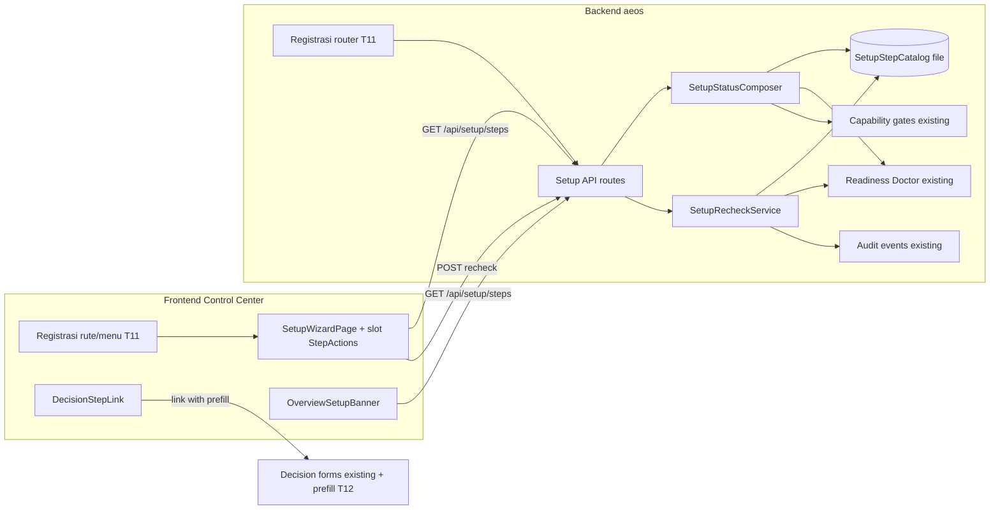
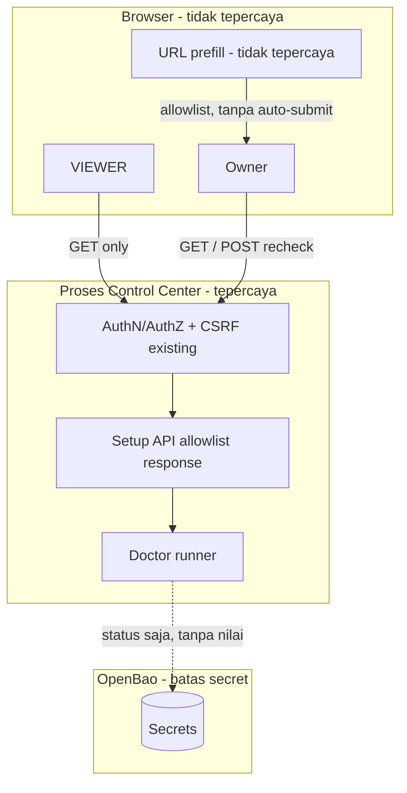
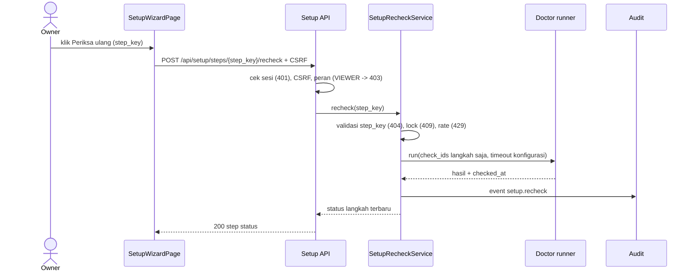

# Architecture Overview

<!-- aeos:logical_id=03-architecture-overview renderer=4 -->

| Metadata | Nilai |
|---|---|
| Logical doc ID | `03-architecture-overview` |
| Project / domain | DLY AEOS (`dly-aeos`) / PERSONAL |
| Owner | UNASSIGNED (Tech Lead belum ditetapkan) |
| Status (saat render) | DRAFT |
| Source plan / version | plan `c09825d6-657b-4845-a959-154315737e0f` v2 (`sha256:547a873dfd6c24ca`) — PREVIEW, BELUM DISETUJUI |
| External revision / last synced | dicatat oleh AEOS (DocumentRecord/ExternalReference), tidak ditulis ke isi dokumen |
| Last reviewed | dicatat oleh AEOS per content hash (DocumentRecord), tidak ditulis ke isi dokumen |
| Links | requirement: 02-requirements/prd-f1, 02-requirements/prd-f2, 02-requirements/prd-f3, 02-requirements/prd-f4; visuals: d1, d2, d3 |
| Issue / evidence | dirujuk live di AEOS (Work items, Evidence) — tidak disalin ke dokumen |

## Context

<!-- aeos:section=context anchor=03-architecture-overview--context content_type=AI_MAINTAINED -->
_Content type: AI_MAINTAINED_

DLY AEOS adalah platform lokal milik satu pemilik. Control Center (frontend TypeScript) memanggil backend Python yang sudah memiliki Readiness Doctor, capability gates dan endpoint keputusan. Slice ini menambah lapisan komposisi baca di atas komponen tersebut.

## High-level Architecture

<!-- aeos:section=high_level_architecture anchor=03-architecture-overview--high-level-architecture content_type=AI_MAINTAINED -->
_Content type: AI_MAINTAINED_

Modul backend baru 'setup_wizard' membaca katalog langkah berversi + hasil Doctor terakhir + status gate, lalu menyusun respons terurut. Endpoint recheck mendelegasikan ke runner Doctor yang ada dengan daftar check_id dari katalog. Frontend menambah halaman 'Penyiapan awal' dan banner Ringkasan. Langkah keputusan hanya berupa tautan ke formulir keputusan yang ada. Registrasi rute backend dan rute/menu frontend dilakukan task integrasi khusus (T11) pada path yang dilaporkan T1.

## Component Architecture

<!-- aeos:section=component_architecture anchor=03-architecture-overview--component-architecture content_type=AI_MAINTAINED -->
_Content type: AI_MAINTAINED_

- SetupStepCatalog: data berversi (urutan §07, check_ids, unlocks, remedy per OS, decision_link) divalidasi terhadap skema IC2
- SetupStatusComposer: menggabungkan katalog dengan hasil Doctor terakhir dan status gate; menghitung status langkah, freshness (aturan Doctor atau ambang ADR), progress, entry_point dan office (konstanta BLOCKED)
- SetupRecheckService: memvalidasi step_key, menerapkan lock per langkah dan batas laju yang dapat dikonfigurasi, memanggil runner Doctor untuk subset check, menulis event audit
- Setup API routes: GET /api/setup/steps, POST /api/setup/steps/{step_key}/recheck (terdaftar di contracts/api/routes.json)
- Registrasi rute/menu (T11): pendaftaran router backend dan rute/menu frontend pada file yang dilaporkan T1
- Frontend SetupWizardPage: daftar langkah, StatusBadge, panel perintah per OS, slot aksi per langkah (StepActions) untuk tombol Periksa ulang (role-gated) dan DecisionStepLink
- Frontend OverviewSetupBanner: banner di Ringkasan berdasarkan entry_point
- Pembacaan prefill allowlist di formulir keputusan (T12)

**Diagram: Komponen Penyiapan awal** — Context/component diagram; status desain (DESIGN), bukan bukti runtime. Sumber yang disyaratkan: Contract/manifest dan review arsitektur.

Verifikasi diagram: **UNVERIFIED** — Dari rencana (model-authored); belum dibandingkan dengan contract/manifest — review arsitektur manusia lewat approval rencana saja. (rencana: periksa terhadap contracts/api/setup-wizard.json (IC1), contracts/setup/setup-steps.schema.json (IC2), contracts/ui/decision-prefill.json (IC3), contracts/architecture/module-boundaries.json, laporan discovery T1)

> **Visual pending** — mermaid-cli (mmdc) tidak ditemukan; visual tetap sebagai source Mermaid dan berstatus visual pending. Opsional: npm install -g @mermaid-js/mermaid-cli. Source Mermaid disimpan agar dapat di-diff.

## Data Architecture

<!-- aeos:section=data_architecture anchor=03-architecture-overview--data-architecture content_type=AI_MAINTAINED -->
_Content type: AI_MAINTAINED_

Tidak ada tabel atau migrasi baru. Sumber kebenaran status adalah penyimpanan hasil Doctor yang ada; katalog langkah adalah file data di repo. Audit recheck memakai mekanisme audit/event yang ada. Wizard tidak menyimpan state progres sendiri. Lock recheck in-memory; validitasnya bergantung pada model proses yang dikonfirmasi T1.

## Data Flow

<!-- aeos:section=data_flow anchor=03-architecture-overview--data-flow content_type=AI_MAINTAINED -->
_Content type: AI_MAINTAINED_

Alur baca: Browser -> GET /api/setup/steps -> composer membaca katalog + hasil Doctor + gate -> respons allowlist. Alur recheck: Browser (peran berwenang) -> POST recheck -> validasi peran/CSRF/step_key -> runner Doctor (subset) -> Doctor menyimpan hasil -> composer -> respons. Alur keputusan: tautan -> formulir keputusan yang ada (prefill allowlist) -> submit manual oleh manusia -> antrean keputusan.

**Diagram: Batas kepercayaan wizard** — Trust boundary/data flow; status desain (DESIGN), bukan bukti runtime. Sumber yang disyaratkan: Threat model dan inventory data.

Verifikasi diagram: **MISMATCH** — Trust boundary di threat model tidak muncul di diagram: Browser <-> Control Center API, URL/query parameter <-> formulir keputusan, Control Center <-> Doctor runner/check eksternal, Control Center <-> OpenBao (rencana: periksa terhadap Threat model bagian 04, contracts/security/asvs-selection.yaml, ADR-0042/0043, IC3)

> **Visual pending** — mermaid-cli (mmdc) tidak ditemukan; visual tetap sebagai source Mermaid dan berstatus visual pending. Opsional: npm install -g @mermaid-js/mermaid-cli. Source Mermaid disimpan agar dapat di-diff.

## External Integrations

<!-- aeos:section=external_integrations anchor=03-architecture-overview--external-integrations content_type=AI_MAINTAINED -->
_Content type: AI_MAINTAINED_

- Tidak ada integrasi eksternal baru. Check yang dijalankan ulang (mis. adapter.github_token, adapter.google_oauth) dapat melakukan konektivitas yang sudah mereka lakukan saat ini.
- OpenBao (melalui check Doctor yang ada; wizard tidak membaca secret)

## API Landscape

<!-- aeos:section=api_landscape anchor=03-architecture-overview--api-landscape content_type=AI_MAINTAINED -->
_Content type: AI_MAINTAINED_

- GET /api/setup/steps (baru, VIEWER+)
- POST /api/setup/steps/{step_key}/recheck (baru; hanya peran berwenang sesuai enumerasi yang diverifikasi T1; VIEWER 403)
- Endpoint Doctor/readiness yang ada (dipakai internal)
- Endpoint capability gate yang ada (dipakai internal)
- Formulir/endpoint keputusan yang ada (hanya ditautkan, tidak dipanggil wizard)

**Diagram: Urutan Periksa ulang per langkah** — Sequence diagram; status desain (DESIGN), bukan bukti runtime. Sumber yang disyaratkan: Alur API dan pengujian integration.

Verifikasi diagram: **UNVERIFIED** — Dari rencana (model-authored); VERIFIED hanya bila ditautkan ke evidence integration test — belum ada. (rencana: periksa terhadap contracts/api/setup-wizard.json (IC1) dan TDD-2)

> **Visual pending** — mermaid-cli (mmdc) tidak ditemukan; visual tetap sebagai source Mermaid dan berstatus visual pending. Opsional: npm install -g @mermaid-js/mermaid-cli. Source Mermaid disimpan agar dapat di-diff.

## Infrastructure

<!-- aeos:section=infrastructure anchor=03-architecture-overview--infrastructure content_type=AI_MAINTAINED -->
_Content type: AI_MAINTAINED_

Tidak ada perubahan infrastruktur; berjalan di proses Control Center lokal yang ada pada Windows/macOS. CI tetap GitHub Actions yang ada.

## Security Architecture

<!-- aeos:section=security_architecture anchor=03-architecture-overview--security-architecture content_type=AI_MAINTAINED -->
_Content type: AI_MAINTAINED_

Otorisasi berbasis peran yang ada: baca untuk VIEWER, recheck hanya peran berwenang dengan CSRF/same-origin. Respons dibangun dari allowlist field; remedy disaring, penanda [REDACTED] dipertahankan, dan pola jalur home diuji. Wizard tidak memiliki jalur tulis ke keputusan dan tidak menjalankan perintah shell. step_key divalidasi terhadap katalog; check_id tidak pernah diterima dari klien. Prefill formulir keputusan diisolasi di T12 dengan allowlist dan tanpa auto-submit.

## Principles

<!-- aeos:section=principles anchor=03-architecture-overview--principles content_type=AI_MAINTAINED -->
_Content type: AI_MAINTAINED_

- Doctor adalah satu-satunya sumber status check. Ambang kesegaran memakai aturan Doctor; bila tidak ada, wizard memakai nilai eksplisit dari ADR yang disetujui manusia dan menampilkannya di respons.
- Kejujuran status: STALE/UNKNOWN tidak pernah dibulatkan menjadi VERIFIED
- Wizard tidak mengeksekusi perintah dan tidak mencatat keputusan
- Discovery dan kontrak dulu (T1, IC1-IC3) sebelum implementasi paralel
- Default-deny untuk aksi; read-only untuk VIEWER

## Decisions

<!-- aeos:section=decisions anchor=03-architecture-overview--decisions content_type=HUMAN_GOVERNED -->
_Content type: HUMAN_GOVERNED_

_HUMAN_GOVERNED — diisi oleh manusia yang berwenang (keputusan / risk acceptance / approval). AEOS dan model tidak mengisi bagian ini._

Usulan keputusan dari rencana (DATA, bukan approval):

- Usulan ADR: katalog langkah §07 sebagai file data berversi di repo, bukan tabel DB (perlu persetujuan manusia)
- Usulan: OS untuk perintah default = OS host backend, dengan tab untuk OS lain
- Usulan: recheck memakai runner Doctor yang ada dengan filter check_id; tidak ada jalur eksekusi check baru. Bila subset tidak didukung, fallback dipilih manusia.
- Usulan: prefill keputusan via query parameter allowlist tanpa auto-submit (RFC-2), diimplementasikan terpisah di T12
- Usulan: office.status konstanta BLOCKED pada slice ini
- Usulan: ambang kesegaran fallback, default timeout recheck dan batas laju sebagai nilai konfigurasi yang ditetapkan di ADR slice ini (Proposed)
