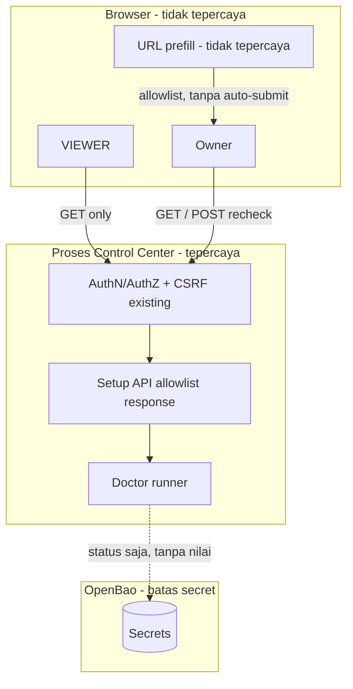

# Threat Model — Initial

<!-- aeos:logical_id=04-threat-models/threat-model-initial renderer=4 -->

| Metadata | Nilai |
|---|---|
| Logical doc ID | `04-threat-models/threat-model-initial` |
| Project / domain | DLY AEOS (`dly-aeos`) / PERSONAL |
| Owner | UNKNOWN (pemilik keamanan tidak disebutkan; keputusan risiko tetap pada pemilik manusia). (Security Lead) |
| Status (saat render) | DRAFT |
| Source plan / version | plan `c09825d6-657b-4845-a959-154315737e0f` v2 (`sha256:547a873dfd6c24ca`) — PREVIEW, BELUM DISETUJUI |
| External revision / last synced | dicatat oleh AEOS (DocumentRecord/ExternalReference), tidak ditulis ke isi dokumen |
| Last reviewed | dicatat oleh AEOS per content hash (DocumentRecord), tidak ditulis ke isi dokumen |
| Links | — |
| Issue / evidence | dirujuk live di AEOS (Work items, Evidence) — tidak disalin ke dokumen |

## Assets

<!-- aeos:section=assets anchor=04-threat-models--threat-model-initial--assets content_type=AI_MAINTAINED -->
_Content type: AI_MAINTAINED_

- Status readiness dan capability gate
- Integritas antrean keputusan
- Secret di OpenBao (tidak boleh terekspos tidak langsung)
- Jejak audit
- Jalur lokal/nama pengguna OS dalam remedy

## Actors

<!-- aeos:section=actors anchor=04-threat-models--threat-model-initial--actors content_type=AI_MAINTAINED -->
_Content type: AI_MAINTAINED_

- Pemilik (peran berwenang)
- VIEWER
- Halaman/situs pihak ketiga di browser yang sama (CSRF)
- Pembuat tautan prefill tidak tepercaya
- Konten tidak tepercaya dalam hasil check

## Trust Boundaries

<!-- aeos:section=trust_boundaries anchor=04-threat-models--threat-model-initial--trust-boundaries content_type=AI_MAINTAINED -->
_Content type: AI_MAINTAINED_

- Browser <-> Control Center API
- URL/query parameter <-> formulir keputusan
- Control Center <-> Doctor runner/check eksternal
- Control Center <-> OpenBao

**Diagram: Batas kepercayaan wizard** — Trust boundary/data flow; status desain (DESIGN), bukan bukti runtime. Sumber yang disyaratkan: Threat model dan inventory data.

Verifikasi diagram: **MISMATCH** — Trust boundary di threat model tidak muncul di diagram: Browser <-> Control Center API, URL/query parameter <-> formulir keputusan, Control Center <-> Doctor runner/check eksternal, Control Center <-> OpenBao (rencana: periksa terhadap Threat model bagian 04, contracts/security/asvs-selection.yaml, ADR-0042/0043, IC3)

> **Visual pending** — mermaid-cli (mmdc) tidak ditemukan; visual tetap sebagai source Mermaid dan berstatus visual pending. Opsional: npm install -g @mermaid-js/mermaid-cli. Source Mermaid disimpan agar dapat di-diff.

## Entry Points

<!-- aeos:section=entry_points anchor=04-threat-models--threat-model-initial--entry-points content_type=AI_MAINTAINED -->
_Content type: AI_MAINTAINED_

- GET /api/setup/steps
- POST /api/setup/steps/{step_key}/recheck
- Query parameter prefill pada formulir keputusan
- Halaman Ringkasan (banner)

## Threats

<!-- aeos:section=threats anchor=04-threat-models--threat-model-initial--threats content_type=AI_MAINTAINED -->
_Content type: AI_MAINTAINED_

- **TH-1** — Information disclosure
- **TH-2** — Elevation of privilege
- **TH-3** — CSRF
- **TH-4** — Tampering / social engineering
- **TH-5** — Injection
- **TH-6** — Denial of service lokal
- **TH-7** — Information disclosure (data pribadi)

## Attack Scenarios

<!-- aeos:section=attack_scenarios anchor=04-threat-models--threat-model-initial--attack-scenarios content_type=AI_MAINTAINED -->
_Content type: AI_MAINTAINED_

- **TH-1** — Respons API meneruskan detail Doctor mentah berisi fragmen token.
- **TH-2** — VIEWER mengirim POST recheck langsung.
- **TH-3** — Situs lain memicu recheck atas nama pemilik.
- **TH-4** — Tautan prefill berisi target berbahaya untuk aktivasi rute atau write enablement.
- **TH-5** — step_key atau parameter berisi nilai yang dipakai memilih check arbitrer.
- **TH-6** — Recheck berulang membebani host atau kuota eksternal.
- **TH-7** — Remedy/detail memuat jalur home berisi nama pengguna OS dan dirender kepada VIEWER.

## Mitigations

<!-- aeos:section=mitigations anchor=04-threat-models--threat-model-initial--mitigations content_type=AI_MAINTAINED -->
_Content type: AI_MAINTAINED_

- **TH-1** — Allowlist field, redaksi, tes pola secret.
- **TH-2** — Gate peran server-side, tes 403.
- **TH-3** — Proteksi CSRF/same-origin yang ada (tes F2-AC6), lock dan batas laju.
- **TH-4** — Tanpa auto-submit, allowlist, tinjauan manual, binding keputusan, RFC-2 disetujui sebelum T12.
- **TH-5** — step_key dicocokkan ke katalog; check_ids hanya dari katalog.
- **TH-6** — Lock, 429, timeout yang dapat dikonfigurasi.
- **TH-7** — Pemeriksaan contoh remedy di T1, template remedy tanpa jalur pengguna, tes pola jalur home di T2/T8.
